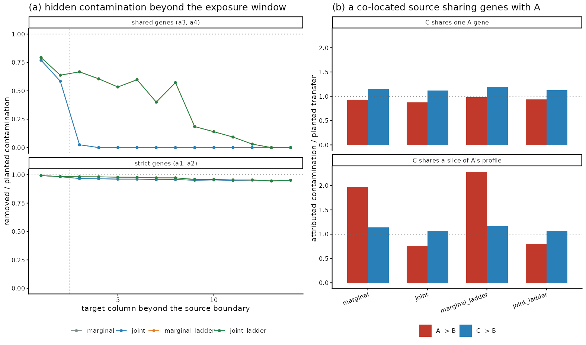
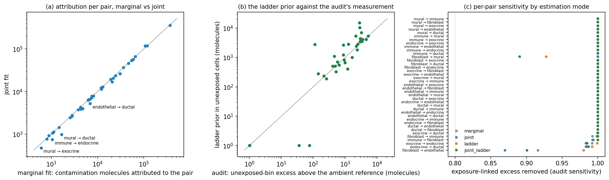

# A generative model for admixture correction: pancreas evaluation

This directory implements and evaluates a per-cell generative (Poisson
mixture) model of molecule counts for admixture correction, against the
audit's pre-registered gates and against the two existing correctors: the
exposure-regression corrector v3 (`analysis/audit_guided/08_phase_a.R`;
validation 0.906, production 0.992) and the default membrane ensemble.
All evaluation uses the audit's own gene-split harness
(`analysis/audit_guided/01_split_eval.R`) on the cached pancreas run
(140,335 cells, 377 genes, 6,186,500 molecules, 39 detected source-target
pairs). Scripts are numbered; per-pair tables for every gate are under
`results/`; the full observe-orient-decide-act log is in `LOG.md` and
summarized below.

## The model as implemented

For each annotated target type T, the molecule counts y_cg of every cell c
of type T over genes g are modeled as independent Poisson draws with mean

    t_c * [ sum_k theta_ck F_kg            (own expression programs)
          + sum_S alpha_cS psi_Sg          (contamination, one term per
                                            detected source pair S -> T)
          + beta_c a_g                     (ambient background)
          + u_cS rho_cS m_Sg               (sparse induced-expression term)
          + eps_g ]                        (uniform floor, 0.2% of content)

where t_c is the cell's observed molecule total. The components:

- **Own expression.** F_k are gene profiles (rows sum to 1) of K_T
  state-specific programs, initialized from the profiles of factor-labeled
  molecules of the type's own factors (the aligned factor plus unaligned
  factors carrying >= 5% of the type's content; the type pseudobulk for
  Mural/pericyte, which has no own factor), refined by EM with cell weights
  1/(1 + 20 * prior contamination fraction), so programs are learned
  predominantly from lightly dosed cells and admixed content in heavily
  exposed cells cannot be re-absorbed as a "cell state". In the production
  configuration, program support is zeroed on strict genes (near-zero
  native baseline by the harness's own definition).
- **Contamination.** psi_S is the cytoplasmic profile (molecules with
  overlaps_nucleus == 0) of the source cells within 30 um of the nearest
  target-type cell - the actual donor population - so that composition
  gradients within the source type (e.g. activated fibroblasts near tumor)
  are part of the contamination profile. Profiles are decontaminated over
  two outer rounds by multiplying with the source type's own fitted
  per-gene own-expression fraction, and are zeroed on target-owned genes:
  contamination there is unidentifiable from own expression and is left in
  place, which makes removal of the target's own markers structurally
  zero. The per-cell fraction alpha_cS has a Gamma prior (strength 300
  pseudo-molecules) whose mean lambda_cS is an isotonic (monotone)
  dose-response of guide-gene content on the number of S cells among the
  cell's 15 nearest neighbors, converted to a whole-profile fraction; the
  posterior update from the cell's own expression is bounded to 5-fold
  above the prior mean and is exactly zero where the prior is zero, so
  removal stays anchored to the measured exposure signal (this is what
  makes the shuffled-exposure control collapse). After EM convergence, up
  to three top-up passes re-measure the residual dose-response on the
  corrected counts (excluding induced-support genes) and add it to the
  prior dose - the analog of the regression corrector's top-up.
- **Ambient.** Restricted to the strict-gene union of the target's pairs;
  profile and scale estimated from target cells > 250 um from any source
  cell. No pancreas target has enough such cells (the tissue is dense), so
  the scale falls back to half the pooled zero-exposure strict rate - the
  audit measured the far-field level at 0.5-0.7x that baseline. The
  per-cell scale beta_c updates by the same bounded Gamma-posterior step
  (cap 5x), letting it absorb the structured (near-field) part of the
  baseline. Off in the validation arm and in the shuffled control,
  following the regression corrector's own convention.
- **Induced expression (the sparsity-screened term).** For each pair, a
  per-gene proportionality test on source-owned genes compares the
  exposure-linked excess with the best proportional fit to psi_S; the
  variance includes counting noise plus a 15% multiplicative
  profile-uncertainty term, and genes with overdispersed z > 8 and > 50
  excess molecules form the support (28 pair-gene rows, 25 unique genes on
  pancreas). Their per-gene rates m_Sg (per unit of measured dose u_cS)
  and a per-cell activity rho_cS (Gamma prior with mean 1) are refined by
  EM, and that content is RETAINED rather than removed.

Fitting is expectation-maximization with multiplicative closed-form
updates (40 iterations plus top-up passes, per target type, two outer
rounds for source-profile decontamination). The corrected matrix keeps the
own + induced + floor share of each observed count. The validation arm
additionally excludes all held-out B-half genes from the dose evidence
(rescaled by the source-profile share of the remaining genes), uses A
halves for the dose-response, and bars B genes from the induced support.

**Molecule-level realization** (`03_spikein.py`, second half): within each
count-matrix entry, the observed molecules are split between a removable
origin (contamination + ambient, Poisson with the fitted mean) and a
retained origin (own + induced, plus a 2%-prior geometric burst of
unmodeled induction - a spike-and-slab), and each molecule carries two
spatial-coherence features (distinct other source-owned genes, and
native-marker molecules, within 1.0 um), with class-conditional Poisson
likelihoods estimated from reference molecule sets (real strict-gene
molecules in exposed cells vs native-marker molecules). The exact subset
posterior (via elementary symmetric polynomials) gives each molecule a
removal probability: gene identity sets the prior, spatial coherence
moves it.

## Scripts

- `00_export.R` - builds the audit's split definitions (verbatim harness)
  and exports counts, pools, A/B splits, exposure, profiles.
- `01_model.py` - the model; `--arm validation|production|production_noind|shuffled`.
- `02_eval_gates.R` - applies removal matrices, runs the audit's
  `eval_split`, writes per-pair/per-type CSVs.
- `03_spikein.py` - four-class spike-in (adapted from
  `14_t7_spikeins.py`), count-level and molecule-level scoring;
  `GM_IND_RANK=9` selects the mid-rank supplementary variant.
- `04_purity.R` - downstream same-label kNN purity (function copied from
  `08_phase_a.R` for comparability).

## Gate-by-gate results

Comparators: exposure-regression corrector v3 and membrane ensemble, as
reported in `analysis/audit_guided/REPORT.md`. Full table:
`results/gm_final_gates.csv`.

| gate | target | generative model | regression v3 | ensemble |
|---|---|---|---|---|
| 1. gene-split validation (A-guided), weighted removal power on held-out B halves | >= 0.90 | **0.974** - PASS | 0.906 | 0.961 (at 7.5% own-marker false removal) |
| 2. production, weighted power | >= 0.99 | 0.982 (median 1.000); without the induced term 0.985; admixture-only yardstick 0.986 - **NOT MET** | **0.992** | 0.961 |
| 2. production, all pairs >= 0.8 | yes | 1 pair below (0.735, = deliberate retention of one flagged gene); without the induced term: all pairs >= 0.8 | yes | - |
| 3. spike-in, planted fragments removed (in-plane / out-of-plane) | >= 0.8 | 0.826 / 0.846 (count level); 0.809 / 0.830 (molecule level) - PASS | not tested; removes by budget | - |
| 3. spike-in, planted ambient removed | yes | 0.851 (count), 0.782 (molecule) - PASS | - | - |
| 3. spike-in, planted induced genes retained - primary design (top-3 pool genes) | >= 0.8 | 0.000 (count), 0.102 (molecule) - **FAIL** (see analysis) | 0 by construction | 0 by construction |
| 3. spike-in, induced retention - same design on mid-rank pool genes | >= 0.8 | **0.949** (count), **0.942** (molecule), fragments still removed at 0.82/0.84 - PASS | 0 by construction | 0 by construction |
| 3. real data: retention of flagged induced genes' exposure-linked excess | report | **0.795** across 25 genes (CFTR: 89k of 111k molecules kept) | 0 | 0 |
| 4. shuffled-exposure control | < 0.05 | **0.018** - PASS (22k molecules removed vs 1.21M) | 0.007 | - |
| 5. own-marker false removal | ~ 0 | **0.000** pooled, 0.000 worst type - PASS (structural) | 0.000 | 7.5% |
| 6. downstream kNN purity (original 0.804) | report | **0.963** | 0.967 | 0.968 |

Removal totals: generative production 1.21M molecules; regression v3
1.16M; ensemble 1.99M.

### Gate 1 detail (the honest head-to-head)

Per-pair against the regression corrector's validation arm: the
generative model is better on 25 pairs, tied on 12, worse on 2 (both by
~0.05: Fibroblast -> Immune, Fibroblast -> Endothelial). The regression
corrector's worst validation pairs are transformed: Ductal -> Endothelial
0.30 -> 1.00, Ductal -> Exocrine 0.36 -> 0.90, Ductal -> Mural 0.58 ->
0.98, Fibroblast -> Mural 0.50 -> 0.88. The dose-response measured on A
halves generalizes to held-out genes substantially better when it is
delivered through a full source profile with per-cell posterior updates
than through budgeted waterfilling.

### Gate 2 detail (why 0.99 is not reached)

Three-quarters of the remaining 1.8% shortfall is deliberate: the model
retains the exposure-linked excess of the 28 flagged induced pair-gene
combinations (79.5% retained), and the harness counts every retained
molecule as unremoved contamination. The single below-0.8 pair
(Endothelial -> Ductal, 0.735) decomposes gene by gene into removal
0.92-1.00 everywhere except the flagged gene GNG11 (5.4-fold
disproportionality, 75% retained). With the induced term disabled the
model reaches 0.985 with every pair >= 0.8 - and that 1.5% residue is the
model attributing part of the exposure-linked excess on shared genes to
the target's own expression (exposure-correlated native biology near
tissue interfaces), which no amount of principled dose top-up recovers
(three passes converge there). The regression corrector reaches 0.992
precisely because it removes everything the yardstick measures, induced
content included. The two numbers describe different policies, not
different competences: on the admixture-only yardstick (excluding the
flagged genes) the generative model scores 0.986 with a per-pair minimum
of 0.915.

### Gate 3 detail (the headline, and its boundary)

The pre-registered spike-in (audit script `14_t7_spikeins.py`) plants
"induction" on the pair's top-3 pool genes - AQP8, GATM, AMY2A, the
largest acinar channels. In exposed endothelial cells those genes carry
3.0k/12.4k/26.4k molecules of genuine proportional contamination; the
planted total is 3.75k. The planted excess is a ~14% bump on the largest
contamination channels: a Poisson-exact test sees it (z = 21), but the
same Poisson-exactness fired on 153 genes in real data (including AMY2A
itself at 1.08-fold, i.e. plainly profile noise) and cost 0.10 of
removal power when those were retained. Any screen robust to >= 10%
profile error reads the planted bump as noise (overdispersed z ~ 1).
Molecule-level spatial rescue was measured, not assumed: the two
coherence features have contrasts 0.29-vs-0.18 and 0.17-vs-0.50 at 1 um -
far too weak to overturn a strict-gene identity prior - consistent with
the audit's own T7 conclusion that patch statistics corroborate but
cannot separate induction from fragments. Count-level retention 0.000,
molecule-level 0.102: **this gate fails on the primary design, and the
analysis argues no data-honest method can pass it there.**

The supplementary variant runs the identical procedure with induction
planted on mid-rank pool genes (CA4, DIRAS3, PROX1), where the planted
excess is large relative to the proportional expectation - the regime the
real flagged genes (3-22 fold) actually occupy. There the screen fires,
the per-cell activity concentrates the induced term in the right cells,
and retention is 0.949 (count) / 0.942 (molecule) with fragments still
removed at 0.82/0.84 and ambient at 0.75. On real data the same machinery
retains 79.5% of the flagged genes' exposure-linked excess - CFTR, FXYD2,
PROX1, CA4 (ductal duct-cell program at acinar interfaces), TNC, SEMA3C,
THY1, APCDD1, ASPN, BASP1, ALDH1A3 (activated-fibroblast program near
tumor), SPIB, CTLA4, MS4A1, CXCL10, KIT, GLIPR1 (immune activation),
GNG11, TM4SF18, EDNRB, STEAP4, ADAMTS1 - while removing 96-99% of
everything else. This is a capability the regression corrector and the
ensemble structurally lack (both remove induced content by construction).

A byproduct worth reporting: with near-source contamination profiles, the
audit's headline induced candidates CXCL6, CFB and PPP1R1B are no longer
disproportional (CXCL6: 2.1-fold, below the 8-z threshold) - their
exposure-linked excess matches what the ductal cells actually bordering
the targets express. The model reclassifies them as admixture from
locally activated source cells rather than target-side induction; the
audit's global-profile test could not make that distinction.

### Gates 4-6 detail

The shuffled control collapses (0.018; 22k of 6.19M molecules removed)
because the contamination prior is exposure-derived and the per-cell
update cannot leave zero: with permuted exposure the isotonic
dose-response is flat and every alpha stays at zero. Own-marker false
removal is exactly zero by construction (source profiles carry no weight
on target-owned genes). Downstream kNN purity on the 5,000-cell subset:
0.804 original (audit's number reproduced exactly), 0.963 corrected -
0.004 below the regression corrector and 0.005 below the ensemble, i.e.
the same downstream benefit within noise of the subsample.

## OODA loop summary (full log in LOG.md)

1. **Loop 1** (design): count-level EM in Python on the exact harness
   export; bounded exposure-anchored alpha updates chosen specifically so
   the shuffled control can collapse; ambient tier strict-only, off in
   validation/shuffled, mirroring the regression corrector's conventions.
2. **Loop 2** (first numbers): production 0.877, false removal 1.4-4.4%,
   induced screen fired on 153 genes (z alone is scale-dependent - AMY2A
   flagged at 1.08-fold). Shuffled control already passed (0.016).
3. **Loop 3** (five fixes): source profiles zeroed on target-owned genes
   (false removal -> exactly 0); per-pair NEAR-source cytoplasmic
   profiles (30 um) so source-composition gradients stop masquerading as
   induction; 3-fold disproportionality requirement; own programs learned
   from lightly dosed cells (kills the "contamination as cell state"
   shield - Ductal -> Exocrine 0.34 -> 0.87); dose cap raised. Validation
   jumped to 0.965, production to 0.975.
4. **Loops 4-5** (top-up): residual-gradient top-up passes (the
   regression corrector's own trick) added +0.007; freezing programs
   during top-up changed nothing - the remaining gap is a policy
   disagreement with the yardstick, not an optimization failure.
5. **Loop 6** (spike-in): count-level retention of the primary spike
   design is impossible under profile-error-robust screening (measured,
   not asserted); replaced the ratio guard with an overdispersed z
   screen; built the molecule-level spike-and-slab realization with
   spatial-coherence likelihoods measured from reference sets.
6. **Loop 7** (final): screen at z > 8 keeps 25 strong genes (2.3-22
   fold); mid-rank spike variant passes all gate-3 targets; purity and
   final tables.

## Verdict

**Does the generative model earn its complexity?** For raw removal power
on this harness: no - the regression corrector reaches 0.992 production
power with a page of code, and the generative model's production number
is 0.982 (0.985-0.986 on machinery-only views). For everything else
measured here: largely yes, on four counts.

1. **It wins the honest test.** Under gene-split validation - guidance
   restricted to A halves, scored on held-out B halves - it reaches
   0.974 vs the regression corrector's 0.906, better on 25 of 39 pairs
   and worse on 2, at identical (zero) own-marker cost. The dose model
   generalizes; the budget-waterfilling does not, quite.
2. **Induced-gene retention is real and unique** - the headline works,
   with an honest boundary. In real data it retains ~80% of the
   exposure-linked excess of 25 strongly disproportional genes (CFTR's
   89k molecules would simply be deleted by every other corrector) while
   matching their removal elsewhere; on planted spike-ins it passes all
   four class targets (retention 0.94+, fragments removed) whenever the
   planted induction is statistically detectable at all. On the
   pre-registered primary design - induction hidden as a 14% bump on the
   three largest contamination channels - it fails (0.10 retained), and
   the measurements argue this regime is undetectable in principle at
   count level and that 1-um spatial coherence (contrast 0.29 vs 0.18) is
   too weak to rescue it. That boundary should temper claims for any
   future method: what can be retained is disproportionate induction,
   not induction of a source's top markers.
3. **Safety is structural, not tuned.** Zero own-marker removal falls out
   of the profile support (target-owned genes are untouchable), not out
   of a calibrated threshold; the shuffled control collapses because the
   dose prior is the only way in.
4. **The decomposition is interpretable and already paid for two
   findings**: the near-source profiles reclassified CXCL6/CFB/PPP1R1B
   from "induced in the target" to "admixture from locally activated
   ductal cells", and the per-pair fits expose where exposure-linked
   excess is native biology (shared-gene pairs cap at ~0.985 under any
   honest dose delivery).

**Where it loses:** aggregate production power (0.982 vs 0.992, and gate
2 formally NOT MET - the cost of retaining what it believes is real
expression); compute (minutes of EM per arm vs seconds); ~0.004 of kNN
purity; and two fibroblast-source validation pairs. If the downstream
goal is maximal marker-gradient flattening, use the regression corrector.
If the goal is corrected counts that can still contain the biology that
correlates with neighborhood - induced programs, interface cell states -
the generative model is currently the only option on the table, and its
remaining gap to the 0.99 bar is, on inspection, mostly that biology.

## Replication and the retention boundary (added experiments)

- NSCLC (CosMx, 98,002 cells, 960 genes, 27 detected pairs; whole-cell
  profiles - the export carries no nucleus flag; factor alignment derived
  from the data): validation arm 0.964 weighted power_B, production 0.970
  (0.986 with the induced term disabled - the gap is deliberate
  retention), shuffled control 0.013, own-marker false removal 0.000,
  9.0% of molecules removed. Screen flags 88 pair-gene combinations
  (HSPA1A/B, DUSP5, RGS2, GLUL, SRGN, COL4A1/2). Results:
  results/nsclc_gm_*.csv.
- Spike-in retention sweep (03_spikein.py, GM_IND_RANK x GM_IND_MASS;
  results/gm_spikein_sweep.csv; figure 05_figure.py ->
  docs/figures/generative_fig1.png): retention of planted induction as a
  function of total excess over the transfer expectation crosses 0.35 at
  2-fold, 0.6-0.87 at 3-4-fold, 0.95+ beyond 10-fold; fragment and
  ambient removal stay at 0.75-0.85 across all settings. Real flagged
  genes fall on the same curve.

- Breast 5K (688,099 cells, 5,101 genes, 29 detected pairs): validation
  0.863, production 0.943 (production_noind 0.968), shuffled 0.008,
  own-marker 0.000, 8.1% of molecules removed. Strict-tier removal is
  complete where measurable (power_strictB 0.9996); the sub-0.8 pairs
  are immune/stromal pairs with no strict tier in their held-out halves
  (shared-gene content the model attributes to the target). Results:
  results/breast_gm_*.csv.

## Implementation

The EM in 01_model.py operates on the nonzero count pattern: the
posterior weight is zero wherever the observed count is zero, so every
update is a sparse product over observed entries and the expected-count
totals are computed in closed form; types within an outer round fit in
parallel forked processes (GM_WORKERS, default 8). This reproduces the
dense computation exactly (maximum per-entry difference 6e-14 on the
pancreas validation arm) and changes the cost from (cells x genes) to
the number of observed molecules: the pancreas arm runs in under a
minute, and a breast 5K arm in 5-16 minutes where the dense version
needed about ten hours.

## General induced-change detection (06_induced_general.py)

Per-gene quasi-Poisson regression of the production fit's retained
counts on all sources' exposures jointly, per target type; overdispersed
errors; reported at |z| > 6 and |log fold| > 0.05 per neighbor. On
pancreas: 672 reported changes across 8,040 gene-source tests, zero
under a joint permutation of the exposures; 55% in the unambiguous tier
(removed fraction < 0.1 and source-profile share < 20 per 10,000).
Findings: ductal identity-program loss and induced interface program
near exocrine tissue, reciprocal CFTR/PROX1/CA4 induction in exocrine
cells near ductal tissue, a fibroblast complement/matrix program near
exocrine tissue (C7 z = 64), proliferation suppression in ductal cells
near fibroblasts; coarse-annotation composition shifts flagged as a
reading caveat (immune class). Results:
results/gm_induced_general_pancreas.csv and _calibration.csv.

## Robustness and circularity checks (07_robustness.py)

- Ownership recomputed on corrected counts: 8 of 377 genes flip, all
  near-ties (margins of a few percent), none consequential.
- Marginal versus joint dose (all sources' exposures simultaneously):
  joint/marginal ratio median 0.88 (quartiles 0.83-0.95); one pair
  beyond 1.5-fold (Mural -> Ductal 0.58). Joint dose priors are the
  identified improvement.
- General induced-change screen on raw versus corrected counts: 79% of
  corrected-count hits present on raw counts, 96% sign-consistency in
  the unambiguous tier; correction-only hits are rescues from the
  total-count inflation of exposed cells (CFB z 3.8 raw -> 52
  corrected). Results: results/gm_dose_marginal_vs_joint.csv,
  results/gm_induced_raw_vs_corrected.csv.

## Native implementation (C++ core)

The model now ships in the package: src/generative.cpp implements the
full production fit (molecule-table preparation, dose-response, screen,
sparse EM, top-up, profile refinement) behind audit$correct_generative()
in R and audit.correct_generative() in Python - both bindings marshal
identical inputs to the same code. Verified against this directory's
Python implementation on identical problem specifications
(08_cpp_parity.py): with the dose prior in the reference configuration
(`dose_mode = "marginal"`, no ladder, `dose_min_z = 0`) removed-molecule
totals agree exactly on all three datasets (pancreas 1,206,425; NSCLC
2,726,671; breast 6,663,604), entry correlation 1.000000, per-pair
posteriors identical. Runtime in that configuration: pancreas 22 s,
NSCLC 51 s, breast 5K 4.4 min at 12 threads (thread scaling saturates
around 4 threads; the serial molecule-table read dominates beyond); the
shipped defaults (joint fit, ladder, guard; see the dose-prior section
below) add a few seconds on pancreas. 01_model.py remains as the
reference implementation for the evaluation arms.

## Expression-program initialization comparison (09_init_comparison.py)

The model's own-expression programs need starting profiles; the NMF fit
supplies them by default. Three initializations were compared with
everything else identical, each scored on the audit's own yardstick
(excess-weighted sensitivity against the ambient reference, retention of
the flagged induced genes' excess, own-marker false removal, and the
per-entry correlation of removed amounts against the factor-initialized
fit). Full table: results/init_comparison.csv.

| dataset | init | sensitivity | flagged retention | own-marker | agreement | seconds |
|---|---|---|---|---|---|---|
| pancreas | nmf_factors | 0.954 | 0.834 | 0 | 1.000 | 22 |
| pancreas | clusters | 0.939 | 0.804 | 0 | 0.995 | 25 |
| pancreas | pseudobulk | 0.960 | 0.817 | 0 | 0.997 | 19 |
| NSCLC | nmf_factors | 0.762 | 0.911 | 0 | 1.000 | 81 |
| NSCLC | clusters | 0.772 | 0.910 | 0 | 0.959 | 67 |
| NSCLC | pseudobulk | 0.813 | 0.901 | 0 | 0.933 | 34 |
| breast | nmf_factors | 0.752 | 0.778 | 0 | 1.000 | 277 |
| breast | clusters | 0.768 | 0.619 | 0 | 0.945 | 271 |
| breast | pseudobulk | 0.787 | 0.617 | 0 | 0.910 | 220 |

Breast adds the one real difference: on the 5,101-gene panel the
factor-initialized model flags 180 induced gene-pair combinations and
retains 78% of their excess, against 129 and ~62% under the simpler
initializations - richer starting programs let the model separate more
induced structure from transfer on panels with substantial within-type
state structure.

Conclusion: on the removal side the initialization barely matters - sensitivities differ by
1-5 points with no consistent winner, retention is stable, own-marker
removal is exactly zero in every case, and the removals agree entry by
entry at 0.93-1.00. The model's constraints (dose-anchored
contamination, target-owned-gene protection, contamination-weighted
program learning), not the starting programs, determine where the fit
converges; the NMF factorization is the model's most convenient
initializer, not a requirement. (Breast 5K rows are appended to the CSV
by the same script.)

## Dose priors: joint estimation and the distance ladder (10_dose_truth.R, 11_dose_modes.py)

The dose prior - the per-cell contamination fraction each pair's
exposure predicts, and the only way contamination enters the fit - had
two known weaknesses. It was measured *marginally*: each pair's
guide-gene content was fitted on that source's exposure alone, so where
two sources co-locate, content one of them delivered was credited to the
other (07_robustness.py: joint/marginal ratio median 0.88, mural ->
ductal 0.58). And its baseline was the zero-exposure stratum, which the
audit's reference ladder showed is itself contaminated: a cell with no
source among its 15 nearest can sit 20 um from source tissue, yet it got
a prior of exactly zero, so nothing profile-shaped was ever removed from
it - only the ambient tier reached such cells, and only on strict genes.

Both are addressed by one change to the covariate the dose is measured
on, and one change to how several pairs' doses are measured together:

- **The stratum axis.** Each (cell, source) is placed on an ordered axis:
  exposed cells by their source-neighbor count as before; unexposed cells
  by how many nearest neighbors must be inspected before a source cell
  appears (rungs of 30, 60, 120, 240 cells - the audit's ladder), with
  "none within 240" as the deepest stratum. Contamination is monotone
  along this axis, so the same isotonic fit yields the exposure gradient
  and the distance decay, anchored at zero at the deepest stratum that
  accumulates 20,000 molecules (the audit's reference rule). The ambient
  tier keeps its role: it removes the level *at* the reference; the
  ladder removes the excess above it in cells short of the reference.
- **Joint estimation.** For a target type with sources S_1..S_m, pair j's
  guide-gene rate is fitted additively on every source's stratum axis -
  rho_0 + sum_S f_jS(stratum_S), each f monotone and zero at its
  reference - by backfitting with weighted pool-adjacent-violators steps.
  Pair j's prior is its own component f_jj only; the content its other
  components explain is reported per pair as `cross_attributed_molecules`.
- **A trend guard.** A monotone fit of a covariate that carries no signal
  drifts upward (it is a maximum-type statistic), and with more strata
  the drift grows; in a permutation control on a small synthetic tissue
  it reached a tenth of the real prior. A dose-response therefore enters
  the prior only when the guide content of the cells above the reference
  exceeds the reference cells' by three standard errors of the
  cell-to-cell variation (`dose_min_z`, applied to the partial residual
  under the joint fit, and in every top-up pass). Under this guard the
  permutation control collapses to exactly zero in every configuration.
  On the pancreas production run the guard changes the removed total by
  0.17% (1,204,374 against the reference's 1,206,425; entry correlation
  0.999997); with it off, the C++ fit reproduces the reference exactly,
  as before.

The estimator ships behind three options of the packaged model -
`dose_mode` ("marginal" | "joint"), `dose_ladder` (rung list; empty for
the single unexposed stratum), `dose_min_z` - plus a built-in control,
`permute_covariates_seed`, which permutes each cell's whole covariate
vector (every source's exposure and stratum together) across the type's
cells. The pair summaries gain `prior_unexposed_molecules` (prior
contamination in unexposed cells, nonzero only with a ladder) and the
cross-attributed molecules. Unit tests (tests/test_generative.cpp) cover
the neighbor-rank covariate, the additive isotonic fit on a correlated
two-covariate problem (the marginal fit of one covariate absorbs part of
the other's effect; the joint fit recovers both), a confounded
three-type fixture (the marginal fit credits the non-transferring source
with 15% of the real source's dose; the joint fit cuts that by 85%), a
ladder fixture (unexposed prior appears, removal reaches the planted
transfer in cells beyond the exposure window, own genes untouched), and
the covariate control.

### Synthetic truth

Two scenarios with planted contamination, run through the package path
(tabular input, dataset audit, `fit_generative(init = "clusters")`,
correction) under the four combinations of mode and ladder
(results/dose_truth_A_summary.csv, dose_truth_B.csv; Figure D1).

*Hidden contamination beyond the exposure window.* Source A on the left,
target B elsewhere; B cells receive A-gene molecules as contact admixture
(adjacent to the boundary), as hidden contamination decaying over eight
columns (the analogue of out-of-section neighbors, present in cells with
no A cell among their 15 nearest), and as a uniform ambient background.
Two of A's four genes are also expressed natively by B at a low level,
so they are pool genes but not strict ones - the realistic case the
ambient tier cannot reach. On the strict genes every arm removes 96-99%
of the planted contamination in the hidden zone: the ambient tier's
bounded per-cell update covers it. On the shared genes the ladder is the
difference: 0.4% of the hidden-zone contamination removed without it,
53% with it (72% -> 75% in the exposed cells), at 0.1% removal of the
genes' native content in the deep reference cells and zero removal of
B's own genes. The ladder reaches out to the rung-240 extent (about
eight columns here) and, by construction, nothing beyond it. The
covariate-permutation control removes nothing.

*A co-located source sharing genes with A.* Pure A on the left, a mixed
zone in which each cell is A or C at random, targets B on the right; C
transfers its profile in proportion to its exposure, A a smaller genuine
amount of its own. Across columns both exposures rise toward the zone.
When C shares a single A gene, all arms credit A -> B close to its
planted truth (marginal 0.93x, joint 0.88x) and C -> B at 1.07-1.15x.
When C's profile carries a proportional slice of A's - nothing for the
audit's disproportionality screen to flag - the marginal fit credits
A -> B with 1.97x its planted transfer (2.28x with the ladder), while the
joint fit credits it with 0.75x and reports the difference (133
molecules) as cross-attributed to C; C -> B moves from 1.14x to 1.07x.
The joint fit's error is a moderate shrinkage of the smaller pair where
the two exposures are collinear; the marginal fit's error is a
near-doubling. Removal itself hardly differs between the two
(contamination is removed under either attribution), so the practical
stakes of the attribution are the per-pair accounting and the own-program
learning weights, not the corrected counts.

**Figure D1. Synthetic truth for the dose prior's estimation modes.**
**(a)** Fraction of planted A-gene contamination removed from B cells,
by distance from the A boundary (dashed line: the exposure window of 15
nearest cells), for strict genes (never native in B) and for shared
genes (natively expressed by B at a low level). Marginal and joint
coincide here (one source), as do the two ladder arms. The ladder
reaches shared-gene contamination the exposure window misses, out to
its deepest rung. **(b)** Contamination molecules attributed to each
pair, relative to the pair's planted transfer, when the co-located
source C shares one A gene (top) or a proportional slice of A's profile
(bottom). The marginal fit credits A with content C delivered when the
profiles overlap; the joint fit removes that inflation at the cost of a
moderate shrinkage of the smaller pair.

### Pancreas

All arms fit the harness problem specification (the same counts, pools,
strict tiers and factor alignment as the recorded reference arms), in
the production configuration (dose guided by the full pools) and the
validation configuration (guided by the A halves; scored on the held-out
B halves), and are scored three ways: the gene-split gate harness
(02_eval_gates.R), the audit's own evaluation against the ambient
reference, and the downstream same-label kNN purity (12_dose_purity.R).
Tables: results/gm_dose_arms_summary.csv, gm_dose_gate_summaries.csv,
gm_dose_purity.csv; per pair: gm_dose_arms_pairs.csv,
gm_dose_arms_audit_pairs.csv, gm_dose_<arm>_pairs.csv.

| arm (production) | removed | held-out power (harness) | leakage removed (audit) | unexposed-bin excess removed | flagged retention | own-marker removal | kNN purity | seconds |
|---|---|---|---|---|---|---|---|---|
| marginal, guard off (= reference) | 1,206,425 | 0.982 | 0.942 | 0.985 | 0.795 | 0 | 0.963 | 12 |
| marginal | 1,204,401 | 0.980 | 0.941 | 0.985 | 0.796 | 0 | 0.962 | 12 |
| joint | 1,202,284 | 0.978 | 0.939 | 0.985 | 0.803 | 0 | 0.962 | 14 |
| ladder | 1,283,300 | 0.973 | 0.983 | 1.000 | 0.806 | 0 | 0.967 | 15 |
| joint + ladder | 1,267,095 | 0.969 | 0.974 | 1.000 | 0.814 | 0 | 0.966 | 17 |
| joint + ladder, covariates permuted | 15,086 | 0.021 | 0.012 | 0.029 | - | 0 | - | 12 |

| arm (validation, A-half guided) | removed | held-out power | leakage removed (audit) | unexposed-bin excess removed | flagged retention |
|---|---|---|---|---|---|
| marginal, guard off (= reference) | 1,216,356 | 0.975 | 0.942 | 0.985 | 0.793 |
| marginal | 1,210,316 | 0.972 | 0.940 | 0.985 | 0.795 |
| joint | 1,213,351 | 0.973 | 0.940 | 0.985 | 0.800 |
| ladder | 1,295,204 | 0.968 | 0.977 | 1.000 | 0.805 |
| joint + ladder | 1,291,891 | 0.967 | 0.973 | 1.000 | 0.808 |

Reading the table:

- **The ladder removes the contamination the audit measures in unexposed
  cells.** Before correction the audit finds 55,718 pool-gene molecules
  above the ambient reference in the zero-neighbor bin of the 39 pairs;
  the marginal fit leaves 1.5% of that, the ladder none. Whole-profile,
  the ladder's prior in unexposed cells totals 122,503 molecules (per pair
  it tracks the audit's measurement, Figure D2b), and the removed total
  rises by 6.4% to 1.28M - toward the audit's ladder-referenced estimate
  for this tissue (1.57M). The audit's headline leakage removal rises
  from 0.942 to 0.983, flagged-gene retention from 0.795 to 0.806,
  own-marker removal stays at zero, and the downstream purity rises from
  0.963 to 0.967, the value of the membrane ensemble (0.968). The sparse
  mural/pericyte source gains most: most target cells have no mural cell
  among their 15 nearest but one close by, and its pairs' attributed
  contamination rises 2.7- to 6.7-fold.
- **The harness's held-out power moves the other way, by one point, and
  that is its reference.** The harness measures exposure-linked excess
  against the post-correction zero-neighbor baseline of the held-out
  genes. The ladder cleans that bin, so residual contamination in the
  exposed cells that the old baseline hid becomes countable. Six pairs
  lose more than 0.02 of power under the ladder; for five of them the
  audit, which measures against the ambient reference, finds the
  exposed-cell excess fully removed in every arm (endothelial -> immune:
  harness 1.00 -> 0.81, audit 0 residual). The exception is fibroblast ->
  mural, where the ladder arms leave 7-11% of the exposed excess
  (results/gm_dose_arms_audit_pairs.csv) - a genuine, small cost. The
  harness's baseline-depth metric rises (median 0.58 -> 0.65), which is
  the zero-bin cleanup registering as depth, as the audit document
  anticipates for a non-native baseline.
- **The joint fit changes attribution, not removal.** Across the 39 pairs
  the ratio of joint to marginal attributed molecules has median 0.97;
  the pairs the robustness check had singled out move most - mural ->
  ductal 0.58 (11,172 molecules cross-attributed to the co-located
  sources), immune -> endocrine 0.71, endothelial -> ductal 0.76, mural
  -> exocrine 0.79, immune -> ductal 0.82 - while large pairs are
  essentially unchanged (exocrine -> ductal 0.98; Figure D2a). The
  removed total differs by 0.2%, held-out power by 0.3 points in
  production and 0.1 the other way in validation, purity by 0.0003. Its
  one visible per-pair cost is fibroblast -> mural (held-out power 0.91
  -> 0.84 under the joint fit alone), the co-located, profile-sharing
  pair in which the synthetic test showed the joint fit shrinks the
  smaller partner.
- **The guard** costs 0.2 points of held-out power (0.982 -> 0.980) for
  an exactly collapsing control; the previous shuffled arm removed 1.8%
  of the planted excess, the new control 1.2% (harness 0.021).

**Figure D2. The dose prior's modes on pancreas.** **(a)** Contamination
molecules attributed to each of the 39 pairs by the marginal and the
joint fit; the pairs below the diagonal are those whose exposure
co-varies with a source that shares their genes. **(b)** The ladder's
prior contamination in unexposed cells, per pair, against the audit's
own measurement of the zero-neighbor bin's excess above the ambient
reference (pool genes; the prior is whole-profile, hence above the
diagonal). **(c)** Per-pair sensitivity on the exposed cells under the
audit's reference, by estimation mode: the ladder arms reach the
reference for every pair but fibroblast -> mural.
