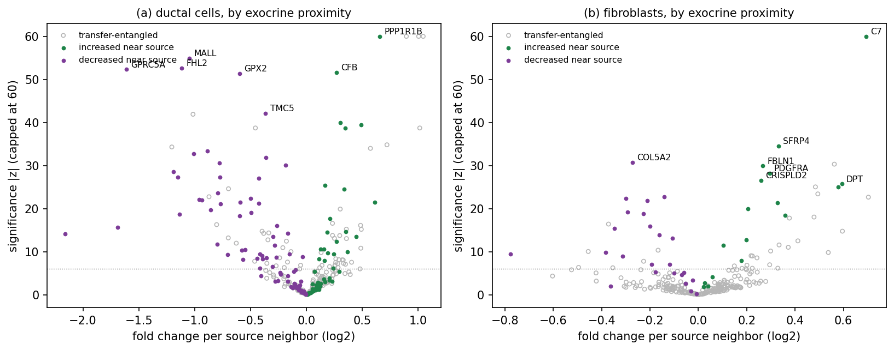

# Admixture and induced expression: a generative model

Admixture correction removes source-marker molecules whose content in
target cells rises with the number of source-type neighbors. But two
different realities produce such exposure-linked excess: molecules admixed from neighboring cells (spilled fragments,
out-of-plane material, ambient background), and transcription by the
target cell itself that responds to its neighborhood — a cell switching
on an activation program at a tissue interface. A correction that
removes both flattens every gradient, at the cost of erasing exactly the
biology that spatial data is often collected to see: interface cell
states, induced programs, ligand–receptor signaling. This document
describes a generative model that decomposes each cell's counts into
origin components so that induced expression can be told apart from
admixed molecules and retained, the evidence for where that
separation is possible and where it is not, and the practical correction
that resulted. The complete experimental record lives in
`analysis/generative_model/` (model, evaluation scripts, findings) and
`analysis/audit_guided/` (the shared evaluation harness); the audit
vocabulary used throughout — exposure, marker pools, the ambient
reference — is defined in [audit.md](audit.md).

## The model

For each annotated target cell type, the observed count $y_{cg}$ of
cell $c$ at gene $g$ is modeled as a Poisson draw whose expected value
adds up the four origins of the molecules inside the cell's segmentation
boundary:


**Figure 1. The model.** A target cell (blue) overlaps a neighboring source cell
(red), so its segmentation boundary (dashed) collects the cell's own
expression programs (blue), molecules admixed from the neighbor (red),
background (grey), and the cell's own response induced by the neighbor
(green). The formula beside it gives each origin a term, in the same colors.

Indices are $c$ for cells, $g$ for genes, $k$ for expression programs and
$s$ for source cell types; per-cell weights are lower-case Greek letters
and gene profiles capital Latin letters. $t_c$ is the cell's total
molecule count, so every bracketed quantity is a fraction of the cell's
content. The components, and where each one's parameters
come from:

- **Own programs** ($\theta_{ck}$, $F_{kg}$): the target type's
  expression programs (the molecular factors) — gene profiles $F_k$
  with per-cell weights $\theta_{ck}$, initialized in the recommended
  configuration from the profiles of factor-labeled molecules of the
  type's own NMF factors (other initializations are described below). The programs are re-estimated
  during fitting, but predominantly from lightly contaminated cells
  (each cell's contribution is down-weighted by its prior contamination
  fraction): without this, a program shared between source and target
  absorbs the admixed molecules as if they were a cell state, and the
  affected pair's removal collapses.
- **Admixed molecules** ($\alpha_{cs}$, $P_{sg}$): one term per detected
  source type, the contamination the correction removes. The profile
  $P_s$ is the cytoplasmic expression profile of the source cells that
  border the target type, measured before the fit (how, and how it is
  corrected for those cells' own admixture, is described in the next
  section): cell states are not uniform across a tissue, and molecules
  admixed from activated interface cells carry their elevated
  activation-gene share; against a global profile those genes would be
  misread as induced. The profile is zeroed on target-owned genes (a gene
  is *owned* by the cell type in which it makes up the largest share of
  the transcriptome, counting over all the type's cells together), where
  contamination is indistinguishable from own expression: it is
  deliberately left in place, which makes removal of the target's own
  markers structurally impossible. The per-cell fraction $\alpha_{cs}$ is
  estimated for every cell around a prior mean $\lambda_{cs}$, the cell's
  exposure to the source: the pair's dose–response, the content of the
  source's marker genes in target cells as a function of their number of
  source neighbors. The prior, the strength with which it holds the
  estimate, and the bounds on the estimate are given in the next section.
- **Background** ($\beta_c$, $A_g$): ambient molecules, restricted to the strict
  genes (essentially absent from the target natively), with profile and
  level measured on target cells far from any source cell, and a bounded
  per-cell scale. This is the component that removes the
  exposure-independent baseline of strict genes.
- **Induced by neighbors** ($\lambda_{cs}$, $\rho_{cs}$, $M_{sg}$): a
  sparse term whose induction profile $M_s$ is nonzero only on genes
  selected by the induced-expression screen (its own section below). The
  response scales with the cell's exposure $\lambda_{cs}$, the same dose
  that is the prior of the admixed share, and the per-cell strength
  $\rho_{cs}$ concentrates the induced content in the cells that respond.
  This content is retained; the genes' proportional (admixed) share is
  still removed.
- **Uniform floor** ($\varepsilon_g$): 0.2% of cell content spread over
  all genes, keeping the division of each count well-defined where every
  structured component is near zero.

## How the model is fitted

The model is fitted one target cell type at a time. All cells of the type
are fitted together, in one model that contains every source type the
audit detected for it, the type's own expression programs, the background
term and the induced term. Types are fitted independently of one another,
and the whole procedure is run twice (two outer rounds), the second time
with source profiles corrected by the first round's result. Within a type,
the fit has three stages: quantities measured from the data before any
fitting, the exposure prior and the screen, and the iterations that
estimate the per-cell quantities.

### Quantities measured before fitting

- **Exposure.** For every cell and every type $x$, the number of $x$ cells
  among the cell's 15 nearest neighbors, $N_{cx}$. For a cell with none, the
  number of nearest neighbors that must be inspected before an $x$ cell
  appears, recorded against the rungs 30, 60, 120 and 240.
- **Pairs and their genes.** The source–target pairs come from the audit,
  each with its marker pool (the source's genes most specific against the
  target) and its strict genes (genes essentially absent from the target).
  Gene ownership is computed from the per-type expression profiles.
- **Source profile $P_s$ for a pair.** The share of each gene among the
  cytoplasmic molecules of the source cells that lie within 30 µm of the
  nearest target cell; the radius widens to 100 µm, then to all source
  cells, when those cells hold fewer than 30,000 molecules. The shares of
  genes the target type owns are set to zero and the profile renormalized.
  In the second round each share is first multiplied by the source type's
  own fraction for that gene (below) and the profile renormalized.
- **Own programs $F_k$.** From the NMF fit, the gene shares of the
  molecules labeled with the factors aligned to the type (the alternatives
  are described at the end of this page). Strict genes are set to zero in
  the programs when the background term is in use.
- **Background profile $A_g$ and level.** The gene shares, over the strict
  genes, of the molecules of target cells farther than 250 µm from any
  source cell, and their share of those cells' content; when such cells hold
  fewer than 20,000 molecules, the level falls back to half the strict-gene
  rate of all unexposed cells.
- **Floor $\varepsilon_g$.** 0.2% of the cell's content, spread evenly over
  all genes.

### The exposure prior $\lambda_{cs}$

For each pair the target cells are placed on an axis: exposed cells by
their number of source neighbors (1, 2, 3, …), unexposed cells by the rung
at which the first source cell appears, deepest first, so that admixed
content should not decrease along the axis. The content of the pair's
marker genes in each cell, as a fraction of the cell's molecules, is then
fitted as a non-decreasing function of the position on this axis (an
isotonic regression, each cell weighted by its molecule count). All sources
of the target type are fitted at once, additively, so that content a
co-located source explains is not credited to the pair. The reference level
is the fitted value at the deepest unexposed stratum that holds at least
20,000 molecules, and never above the pooled rate of all unexposed cells.
The prior is

$\lambda_{cs} = \min\{(\text{fitted}_{cs} - \text{reference}_s) / \text{share}_s,\ 0.6\}$,

where share$_s$ is the share of the marker genes in $P_s$, so that the
marker content is converted into a fraction of the whole profile. The prior
is zero at the reference stratum and below it. If the exposed cells'
marker content does not exceed the unexposed cells' by three standard
errors, the pair's prior is zero everywhere: a monotone fit of a covariate
that carries no signal drifts upward, and the guard keeps such a pair from
removing anything.

### The screen

Before the iterations, the induced-expression screen (next section) runs
on each pair and selects the genes on which the induced profile $M_s$ may
be nonzero, from the excess of those genes in exposed cells relative to the
proportion the source profile predicts. The screen uses only the counts,
the profile and the prior; it does not use a fitted model.

### The iterations

The per-cell quantities are estimated by expectation–maximization for the
Poisson model, in the form of multiplicative updates. Starting values:
$\alpha_{cs} = \lambda_{cs}$, $\beta_c$ at the background level,
$\rho_{cs} = 1$, and $\theta_{ck}$ set to the cell's remaining share
$\max(1 - \sum_s \lambda_{cs} - \text{background level}, 0.2)$ spread
over the programs by their share of the type's pooled expression.

In each iteration, for each cell $c$ and each of its nonzero counts, the
expected rate per molecule is
$r_{cg} = \sum_k \theta_{ck} F_{kg} + \sum_s \alpha_{cs} P_{sg} + \beta_c A_g + \sum_s \lambda_{cs} \rho_{cs} M_{sg} + \varepsilon_g$
and the ratio $w_{cg} = y_{cg} / (t_c r_{cg})$ of observed to expected
count divides the count among the components in proportion to their
contributions. The updates are:

- **Program weights**, no prior:
  $\theta_{ck} \leftarrow \theta_{ck} \sum_g F_{kg} w_{cg}$.
- **Admixed fractions**, pulled toward the prior with a strength $s_s$
  measured in molecules: with $e_{cs} = t_c \alpha_{cs} \sum_g P_{sg} w_{cg} / \sum_g P_{sg}$
  the number of the cell's molecules the current fit attributes to the
  source,
  $\alpha_{cs} \leftarrow \min\{(e_{cs} + s_s \lambda_{cs}) / (t_c + s_s),\ 5\lambda_{cs}\}$.
  A cell with many molecules is governed by its counts, a cell with few by
  the prior; the estimate cannot exceed five times the prior and is zero
  where the prior is zero, which ties the removal to the measured
  dose–response and makes the permutation control below meaningful.
- **Background scale**, likewise toward its level with strength 300,
  capped at five times the level.
- **Induced strength**, with a gamma prior of shape 2 and a cap of 30:
  $\rho_{cs} \leftarrow \min\{(2 + z_{cs}) / (2 + t_c \lambda_{cs} \sum_g M_{sg}),\ 30\}$,
  where $z_{cs}$ is the number of molecules attributed to the pair's
  induced term.
- **Programs** $F_{kg}$, updated from all cells of the type with each cell
  weighted by $1 / (1 + 20 \sum_s \lambda_{cs})$, so that lightly exposed
  cells determine them, then renormalized; without this weighting a program
  shared between source and target absorbs the admixed molecules as a cell
  state and the pair's removal collapses.
- **Induced profile** $M_{sg}$, updated on the screened genes only.

The source profiles, the background profile, the prior $\lambda_{cs}$ and
the set of screened genes stay fixed throughout.

Forty iterations are run (fewer if the log-likelihood has converged). The
prior strength $s_s$ is then estimated per pair from the spread of the
cells' attributed fractions $e_{cs}/t_c$ around the prior, net of the
binomial counting variance, as the pseudo-count of a beta distribution with
that spread, bounded to 5–1000, and the forty iterations are run again
with it. (The first pass uses $s_s = 10$; on simulated pancreas sections
the estimates come out at 5 to 15, and against a fixed value of 300 the
recall of admixed molecules rises by 2 to 3 points at equal own-molecule
loss.) Finally, up to three refinement passes: the removal implied by the
current fit is applied, the dose–response of the marker genes not selected
by the screen is measured again on the remaining counts, and any exposure
gradient still present is added to the prior (capped at 0.6), followed by
fifteen iterations with the programs held fixed; the passes stop when the
addition falls below 0.01% of the type's molecules.

### The output of a round, and the second round

For every count, the share kept is the own, induced and floor part of the
rate, $(\sum_k \theta_{ck} F_{kg} + \sum_s \lambda_{cs} \rho_{cs} M_{sg} + \varepsilon_g) / r_{cg}$,
and the rest is removed; without retention of induced expression the
induced part is removed too. For every gene, the type's own fraction is
the share of its molecules of that gene, over all its cells, that the fit
attributes to the own programs. The second round repeats everything for
every type with each source profile corrected by that source type's own
fractions: the profile of what a source sheds is measured on its interface
cells, which are themselves contaminated, and the correction removes from
it the genes that are present in those cells only through admixture. Two
rounds are run, not more; the correction averages over all cells of the
source type, while the profile is measured on its interface cells, so it is
likely too weak where it is applied, and on the source's own genes nothing
can be attributed to admixture, so those shares are not corrected at all.

In outline:

```
for round in 1, 2:
    for each target type T with detected sources:
        P_s  <- interface profile of each source s (round 2: each gene times s's own fraction),
                zero on genes T owns
        F    <- T's expression programs from the NMF factors
        A    <- background profile of T from cells far from any source
        for each source s of T:
            lambda_cs <- dose-response of s's marker genes along the exposure axis,
                         fitted jointly over all sources of T; zero without a significant rise
            M_s       <- screen: genes whose excess in exposed cells exceeds
                         the proportion P_s predicts
        alpha <- lambda; beta <- background level; rho <- 1; theta <- the cell's remaining share
        repeat 40 times:
            divide each count among the components in proportion to their expected contributions
            update theta_c, alpha_cs (toward lambda_cs), beta_c, rho_cs for every cell
            update F (cells weighted toward lightly exposed ones) and M (screened genes only)
        estimate the prior strength s_s per source from the spread of alpha around lambda
        repeat the 40 iterations with it
        up to 3 times:
            re-measure the dose-response on the counts left after removal
            add any remaining exposure gradient to lambda; 15 iterations with F fixed
        removed_cg <- y_cg x (admixed + background share of r_cg)
        own fraction of T per gene <- for the next round's profiles
```

| Estimated in the iterations | Fixed during the iterations |
|---|---|
| Per cell: $\theta_{ck}$, $\alpha_{cs}$, $\beta_c$, $\rho_{cs}$ | Source profiles $P_s$, background profile $A_g$ |
| Per gene, shared by the type's cells: programs $F_{kg}$; induced profile $M_{sg}$ on the screened genes | Exposure prior $\lambda_{cs}$ (refined only between passes); the screened gene set |

## The fitted model on one pair

Figure 2 shows the fitted model on one pair: admixture from malignant
cells into fibroblasts on the CosMx NSCLC section (fine labels). The
content of malignant-specific genes in fibroblasts, read as a fraction
of the whole malignant profile, is 2.0% of a fibroblast's molecules
with no malignant cell among its 240 nearest neighbors and rises
steadily as malignant cells come closer, to 9.7% with four or more
among the 15 nearest. The prior is this dose–response measured above
the deepest stratum, and the fitted admixture fraction follows it: 7.9%
of the molecules of fibroblasts with four or more malignant neighbors,
and 1.4% over all 13,151 fibroblasts. The three genes beneath show the
three outcomes the model distinguishes. KRT19, a malignant marker that
fibroblasts do not express, is removed at every stratum: the
exposure-linked part by the admixture term, the baseline of 2.8 per
10,000 by the background term. MMP7 is also a malignant gene, but
fibroblasts near malignant cells carry 3.1 times the excess that
admixture from the bordering malignant cells can deliver; the screen
flags it, and the fibroblasts keep 34 of their 42 molecules per 10,000
at four or more neighbors. DCN, a fibroblast gene, falls from 78 to 37
per 10,000 as malignant cells come closer; as a gene of the target's
own, it has no admixture component, and the correction leaves its
repression exactly as observed.


**Figure 2. The model fitted on admixture from malignant cells into
fibroblasts (CosMx NSCLC).** Fibroblasts are grouped by the number of
malignant cells among their 15 nearest neighbors (1, 2, 3, 4+), and
those with none by how far the neighborhood must be widened before a
malignant cell appears (none among 15, 30, 60, 120, 240 nearest).
**(a)** The share of fibroblast molecules admixed from malignant cells
by stratum: the observed content of the twelve most malignant-specific
genes, scaled to the whole profile of the malignant cells that border
fibroblasts (dark), the model's prior (dashed) and the fitted admixture
fraction (bars); grey numbers are the fibroblasts in each stratum.
**(b–d)** Three genes in fibroblasts, observed (red) and retained after
correction (blue), with the observed level in the deepest stratum
dotted: KRT19, admixture only, removed entirely; MMP7, induced above its
admixture expectation, its excess retained; DCN, repressed near
malignant cells, retained unchanged. Script:
`analysis/generative_model/15_figure_nsclc.py`.

## The induced-expression screen

The screen decides, for each pair, on which genes the induced term may be
nonzero. It compares, gene by gene, the excess of the gene in exposed
target cells with the excess that admixture of the source's material would
produce, and selects the genes whose excess is too large to be admixture.
The procedure, for a pair with source $s$ and target type $T$:

1. The target cells are split into exposed cells (at least one $s$ cell
   among the 15 nearest neighbors) and unexposed cells (none). Both groups
   must hold at least 50 cells.
2. For each gene $g$, the excess is the number of molecules of $g$ in the
   exposed cells beyond what the unexposed cells' rate predicts for the
   exposed cells' total molecule count:
   $\text{excess}_g = c^{\text{exp}}_g - c^{\text{un}}_g \, t^{\text{exp}} / t^{\text{un}}$.
3. Admixed material should add molecules of each gene in proportion to the
   gene's share $\psi_g$ of the source profile $P_s$. Over the genes the
   source owns, the excess is regressed on $\psi_g$ through the origin by
   weighted least squares; each gene is weighted by the inverse of the
   variance its excess would have if the proportional relation held (the
   counting variance of the unexposed reference plus the proportional
   expectation itself), and the slope and the weights are iterated ten
   times. The slope is the amount of admixed material per unit of profile
   share. Weights taken from the observed counts instead would favor the
   genes that happen to fall below the proportion and pull the slope toward
   them, so that admixed genes above it would read as induced.
4. The residual of each gene is standardized,
   $z_g = (\text{excess}_g - \text{slope} \cdot \psi_g) / \sqrt{V_g + (0.15 \cdot \text{slope} \cdot \psi_g)^2}$,
   where $V_g$ is the counting variance of the excess and the second term
   allows a 15% error in the profile's share of the gene. Without that
   term, a gene carried in very large amounts would be selected for a
   deviation of a few percent: on the pancreas section AMY2A, at 1.08 times
   its expectation, reached formal significance on counting noise alone,
   while the genes that are induced deviate 2.7- to 22-fold.
5. A gene is selected when $z_g > 8$ and its excess exceeds 50 molecules.
   Its induced profile value $M_{sg}$ starts as the part of its excess above
   the proportional expectation, per unit of dose, and is refined in the
   iterations on the selected genes only.

The selected genes keep their disproportionate excess in the corrected
counts (the per-cell strength $\rho_{cs}$ concentrates it in the cells
that respond), while their proportional share is still removed as
admixture. Because the second term of the denominator grows with the
expectation, a shortfall below the proportion can never be selected; the
screen acts on excess only.

To be explicit about the reference of the comparison: each gene is
tested individually against the proportional fit to the *source-cell
profile* — there is no induced-profile template, and no correlation
among induced genes is assumed or used. Figure 3a shows the test on the
pancreas exocrine → ductal pair. Each point is one exocrine-owned gene; its
vertical position is the measured excess — how many extra molecules of
that gene appear in ductal cells as exocrine neighbors accumulate — and
its horizontal position is how many extra molecules proportional
admixture would deliver, given the gene's share of the exocrine profile.
A gene on the diagonal is fully accounted for by admixture. The genes
line up on the diagonal across three orders of magnitude — AMY2A, the
largest channel, sits exactly on it — while CFTR, PROX1 and CA4 carry
several times more excess than admixture can deliver, and are flagged.

Figure 3b asks the same question for the reverse admixture direction:
ductal cells are now the source, exocrine cells the targets, and the
plot shows the excess of ductal-owned genes found in exocrine cells —
are the CXCL6, CFB and PPP1R1B molecules appearing in exocrine cells
near ductal tissue induced in the exocrine cells, or admixed from
the ductal cells? The answer depends on which ductal cells define the
admixture expectation. The grey points are all ductal-owned genes with
the expectation computed from the bordering ductal cells — these are
the data the proportional fit is made from, and they line up on the
diagonal. The activation genes CXCL6, CFB and PPP1R1B are drawn twice:
an open circle at the expectation computed from the average ductal
cell, and a filled point at the expectation computed from the ductal
cells that border exocrine tissue, with an arrow connecting the two
positions of the same gene. The measured excess — the vertical position
— is the same in both cases; only the expectation moves. Against the
average profile the three genes appear to carry ten to twenty times
more excess than admixture could deliver, and would be called induced;
against the profile of the bordering cells, the same excess is exactly
what admixture delivers, and the genes land on the diagonal: admixture,
not induction. The length of the shift is itself a measurement: it
shows how much richer in each of these transcripts the material shed by
the bordering ductal cells is, compared with material from an average
ductal cell — about ten-fold.

The two panels also explain why each shows different genes, although
both concern transcriptional changes in ductal cells at the exocrine
border. The elevated expression of CXCL6, CFB and PPP1R1B is a genuine
induced change *of the ductal cells* — but in the ductal cells these
are the cells' own genes, which the audit never counts as admixture and
the model structurally cannot remove (contamination profiles are zeroed
on target-owned genes), so it needs no flag and appears in no screen.
Its only risk of misinterpretation arises in the neighbors that receive
the admixed products, which is panel (b). The screens therefore
examine only source-owned genes — the genes whose excess could be
mistaken for admixed source material — and panel (a)'s flagged
genes are the genuinely confusable case: CFTR, PROX1 and CA4 are
assigned to exocrine by top expression yet switched on by ductal cells
at the border, so their induced excess looks exactly like exocrine
admixture and must be flagged to be retained. For CFTR the ownership
call is a near-tie (71,145 per million in exocrine versus 70,475 in
ductal), but either assignment preserves the gene: owned by exocrine,
its ductal excess is flagged and retained; owned by ductal, it would be
a target-owned gene and untouchable in ductal cells by construction.


**Figure 3. What the screen compares.** **(a)** *Induced changes
deviate from the admixture expectation.* Each point is one
exocrine-owned gene in the exocrine → ductal pair: measured excess in
ductal cells (vertical) against the excess that proportional admixture
would deliver given the gene's share of the interface-local exocrine
profile (horizontal). The diagonal means "fully accounted for by
admixture"; the dashed curve marks the largest excess still consistent
with proportional admixture, allowing counting noise and a 15% error in
the profile itself, with a wide safety margin — the genes above it
(CFTR, PROX1, CA4) are flagged as induced. As in (b), both expectations
are drawn for these genes — from the average exocrine cell (open red)
and from the bordering exocrine cells (filled green) — and here the two
coincide within 1%, so the markers superimpose: the exocrine
composition is the same at the border, and the border-state effect of
(b) is a property of the ductal cells rather than a general feature of
interfaces. No lower bound is drawn: at this safety margin the
allowance exceeds the expectation itself, so a shortfall can never be
flagged and the screen acts only on excess. **(b)** The
same plot for the reverse admixture direction, ductal → exocrine. Grey:
all ductal-owned genes under the expectation from the bordering ductal
cells — the data the proportional fit is made from; the dashed curve is
the same significance bound as in (a). CXCL6, CFB and PPP1R1B appear
twice, connected by an arrow: at the expectation from the average
ductal profile (open red, above the bound — they would be flagged as
induced) and from the bordering ductal cells (filled green, within
it).
Their measured excess does not change between the two — only the
expectation does — and with the profile of the cells the material
actually comes from, all three sit on the diagonal; the horizontal
shift shows how much richer in each transcript the material shed by the
bordering ductal cells is than material from an average ductal cell.

A separate question is how a flagged gene is known to be induced rather
than admixed from a *different* source type. Three mechanisms address
it. First, each gene is screened in the pair of its own top-expressing
type: a gene owned by another type is tested against that type's
profile, in that type's pair, where its admixture reads as proportional.
Second, the fitted model is simultaneous over every detected source: a
target cell carries one contamination term per source, each anchored to
that source's own neighbor count, so molecules arriving from a second
source load onto that source's term — the induced term only receives
what no modeled source can explain. Third, what remains is the honest
residual risk: material from a source with no detected pair — an
unannotated or rare cell type — has no term to load onto, and its genes
could be misread as induced if their arrival correlates with a modeled
source's exposure. The screen's reports (`markers()` in the audit, the
per-pair induced tables here) name the flagged genes precisely so such
cases can be inspected.

This same screen, applied to the audit's marker panels, is how the
package excludes induced genes from admixture estimation (see
[audit.md](audit.md) and the binding documentation); flagged
genes and their measured disproportionality are reported by
`markers()`.

## Testing associations with neighboring cell types

The test described here is a separate step that follows the fit
(`model.detect_responses()`, `model$detect_responses()` in R). It has a
different form from the fit because it estimates different unknowns.

The fit estimates per-cell quantities: for every cell, the fraction of its
molecules admixed from each source ($\alpha_{cs}$), the weights of its own
expression programs, and its background level. These can be estimated only
because the gene profiles ($P_s$, $F_k$, $A_g$) are held in common across all
cells: a cell's admixed fraction is read from all of its genes at once, as the
amount of the source's whole profile that its counts contain. The profiles
have to be rigid for this to work. A profile free to change gene by gene
would make the admixed fraction of a cell indistinguishable from its own
expression, and the division of each count into origins, which is what the
correction removes, would no longer be determined.

The test estimates per-gene quantities: for every gene of a target type,
whether its counts across the type's cells depend on the numbers of
neighboring cells of each type beyond the dependence that admixture
produces. Here the fit's per-cell quantities enter as known covariates: each
cell's fitted own expression, its fitted admixed amount from each source, its
background. No per-cell quantity is re-estimated, which is what keeps the
test from re-dividing the molecules the fit has already divided. For one gene
a profile is a single number, so the fit's profiles enter the test only
through the fitted per-cell fractions, which were estimated from all genes
together, and through which genes they leave at zero.

The hypothesis tested, for a target type $T$, a gene $g$ and a neighboring type
$x$, is the following. Under the null hypothesis the expected count of $g$ in a
cell $c$ of type $T$ is described by the fit's components, each rescaled by a
non-negative factor for this gene:
$E[y_{cg}] = a_g\,\widehat{\mathrm{own}}_{cg} + \sum_s b_{sg}\,\widehat{\mathrm{admixed}}_{csg} + \widehat{\mathrm{background}}_{cg}$.
Under the alternative, terms proportional to the numbers of neighboring $x$
cells are added, $\gamma_{xg} N_{cx} + \delta_{xg} D_{cx}$ with
$\gamma_{xg}, \delta_{xg} \ge 0$. The null model is contained in the
alternative, and the test asks whether the neighbor counts explain variation
in the gene's counts that the best admixture-only description of that gene
does not: a test of the neighbor count, not of the profile. The statistics and
the threshold are given after Figure 4.

The test's evidence is a pattern across cells, not an amount. For one gene,
the own term and each admixed term are fixed patterns across the cells of the
type: the cell's fitted own expression of the gene, and the amount of each
source's material the cell received. The per-gene scales $a_g$ and $b_{sg}$
can raise or lower the gene's counts by any factor along those patterns, so
the test does not use how many molecules of the gene the fit predicts: a gene
with twice the admixed molecules the profile predicts, in the same cells, is
explained by the null model. What the scales cannot do is produce a pattern
they do not have: counts that rise with the number of neighboring $x$ cells in
cells that received little of their material. That pattern is the evidence for
an association, and the fitted per-cell fractions make it readable, because
cells with the same number of neighbors differ in how much material they
received (across the ductal cells of the simulated pancreas section, fitted
exocrine material and exocrine neighbor count are correlated at 0.78, not 1).
On a gene the source does not shed there is no admixed term, and any
dependence on the neighbor count beyond the cell's own expression and
background is an association.

The scales are free because the alternative is worse. With the admixed term
held at the profile's amount, the null model is wrong for every gene whose
share of the shed material the profile misjudges, and the error has the
pattern of the material, which rises with the neighbor count. On the simulated
section, CD19 carries 36% more admixed molecules in ductal cells than the
exocrine profile predicts and has no planted response. With its scale free,
the mean difference between observed and expected counts per cell stays
within 0.02 molecules at every neighbor count and the gene is not called; with
the amount fixed, that difference grows from 0.02 molecules in cells without
exocrine neighbors to 0.99 in cells with six or more, and the gene is called
at z = 7.6 with 4,900 molecules attributed to the neighbors. A planted
response on STC2, which exocrine cells do not shed, is called either way
(z = 16 with the scale free, 37 with the amount fixed, the difference being
the part of the response that the extension of the profile to shared genes,
described below, lets $b_{sg}$ absorb). The cost of the free scales is the
other side of the same coin: on a gene the source sheds, a response whose
pattern across cells is that of the material received, or close to it, is
absorbed by $b_{sg}$ and not called. The planted CD68 response is missed
either way, because the profile over-predicts the gene and the response hides
inside the over-prediction. The measurements over all variants of the scale
are given below.

The test takes the fit's components as inputs and does not change them; the
fitted model and its correction stay as they are unless the called
associations are explicitly kept (`retain_responses`, below). An association
is a statistical statement made under the assumption of short-range
interactions: whether it reflects a response to neighbors or a regional state
that rises with them, the test does not say.


**Figure 4. The regression of the test, which follows the fit.** The colors are
those of Figure 1. Hats mark values taken from the fit and not re-estimated;
$a_g$, $b_{sg}$, $\gamma_{xg}$ and $\delta_{xg}$ are estimated here, per gene and
constrained to be non-negative, separately for each target type $T$. The tested
coefficients are $\gamma_{xg}$ and $\delta_{xg}$; the fit's induced term is left
out, so that an association has to appear in them.

The terms of the regression are the following.

- **Own programs.** The cell's own expression as fitted, with one free scale
  $a_g$ per gene.
- **Admixed from sources.** The fitted admixed fraction $\hat\alpha_{cs}$ of
  every source the fit carries for the target type, with one free scale
  $b_{sg}$ per source and gene. The profile $\tilde P_{sg}$ equals the
  fit's $P_{sg}$, extended to genes the fit zeroes, as described below.
- **Background and floor.** Held at the fitted values.
- **Association with neighboring types.** For every labeled type $x$ other than
  the target, whether or not the fit carries it as a source: $N_{cx}$, the
  number of cells of type $x$ among the cell's nearest neighbors, with
  coefficient $\gamma_{xg}$ (molecules per neighbor). With `kernels="both"` the
  regression also includes $D_{cx}$, the number of cells of type $x$ between 20
  and 60 µm of the cell per 1000 µm², with coefficient $\delta_{xg}$, so that an
  association with cells beyond the nearest neighbors can load on it.

The regression is fitted by maximum likelihood, and the covariance of the
coefficients comes from the inverse Fisher information at the estimate. Two
tests follow, at a threshold of z = 6.

- **Per neighboring type.** $z = \hat\gamma_{xg}/\mathrm{SE}(\hat\gamma_{xg})$, and
  likewise for $\delta_{xg}$; a gene is called for type $x$ when either z reaches
  the threshold.
- **Over the neighborhood.** A Wald test that all neighbor coefficients of the
  gene are zero, $W = \hat\beta^\top \hat\Sigma^{-1} \hat\beta$, compared with a
  $\chi^2$ distribution with as many degrees of freedom as there are coefficients
  and reported as the normal z of equal one-sided tail probability
  (`joint_z`, `joint_called`). It finds an association that several
  co-occurring types share and none carries alone. It leaves out the
  coefficients of the gene's owner (the type with the highest rate of the gene,
  `owner`), because an association of a gene with neighbors of the type that
  mainly expresses it cannot be told from admixture.

Three parts of this design keep the remainder of admixture from reading as an
association. The free scales $b_{sg}$ absorb an error in the shape of a source's
profile. On the simulated sections described below, the removal itself is
accurate where a source's material is concentrated: in ductal cells with
exocrine neighbors, and no planted response on those genes, the molecules removed
from exocrine-owned genes are 1.00 to 1.02 of the true admixed and background
molecules there, at every neighbor count. But the profile puts 85% of its mass on
those genes where the truly admixed material has 81%, so that on genes owned by
other types the fit's expectation of exocrine material is 68% of the truth. Those
molecules are mostly still removed, under the terms of other sources (total
removal on such genes is 0.94 to 1.01 of the truth), but the fit does not
attribute them to exocrine cells, and they would otherwise read as an association
with exocrine neighbors. Second, every type's neighbor counts sit in the same
regression, so that a remainder following one type's neighbors is not credited
to another type that happens to sit nearby. Third, the profile is extended to
genes both types express. The fit zeroes $P_{sg}$ on the target's own genes and
never removes admixture there, but a source can carry such a gene in quantity:
exocrine cells carry the ductal genes CAV1 and CAPN8 into ductal cells at up to a
quarter of a molecule per cell, more than the cells' own expression at high
exposure. $\tilde P_{sg}$ therefore takes the source's own rate of the gene,
wherever it is at least a tenth of the target's rate, both measured in cells with
no neighbor of the other type.

The free scale also limits what the test can find: on a gene the source profile
carries, a response proportional to the source's dose is absorbed by $b_{sg}$ and
is not called. Imposing the profile's amount instead was measured on the
simulated sections described below, on a sixth section whose genes shed with the
per-gene transfer propensities measured on the real pancreas section (0.3 to
3 times the proportional amount), and on the two real sections. With the
admixed term held at the fit's amount, or given one scale per source that all
its genes share, the test recovers one to three more planted responses per
section but calls 16 to 36 genes per section that have no planted response,
carrying 28,000 to 72,000 molecules; on the section with transfer propensities
it calls 18 to 20 of the genes whose propensity exceeds 1.5; and on the real
pancreas section it calls the T-cell genes in fibroblasts at 0.15 to 0.28 of
their content, where those genes rise in proportion to the neighbors' own
content, the mark of admixture. Pulling each gene's scale toward its source's,
by a spread estimated from the source's genes, recovers nothing more and adds 3
to 7 such calls per section. Estimating a per-gene factor of the source from
its other target types, so that an excess specific to one target reads as a
response and one shared by all targets as a property of the source gene, calls
none of the propensity genes and recovers the planted responses on genes the
source sheds, but calls the genes a source expresses only at its interface
with that target, its own induced genes carried into the target, and again
the T-cell genes in fibroblasts: the profile of what a source sheds is
specific to the pair. Using the fit's dose prior $\lambda_{cs}$ in place of
the fitted fraction $\hat\alpha_{cs}$ is worse on every count, because the
fitted fraction carries each cell's actual admixed content, which is what
separates the neighbor count from admixture. The free scale is therefore the
price of a test whose calls are not the profile's errors.

On five simulated pancreas sections with responses planted in known genes (on
contact, by gene level, by density at 20 to 60 and 60 to 120 µm, decaying with
distance, and following a regional share of stromal cells within 100 µm), the
test calls 33 of the 62 planted gene and neighboring-type pairs on the correct
type, and the test over the neighborhood finds 33 of the 50 planted genes. Among
genes without a planted response it calls none owned by the target, one owned by
a type that is neither the target nor the one it was called against (over all
five sections, 159 molecules) and at most one owned by the neighboring type per
section. As a comparison, regressing one source at a time, with the other
sources' admixture held fixed and no other type's neighbors in the regression,
calls 50 to 62 target-owned genes per section with $N$ alone, and 21 to 27 genes
of such other types with $N$ and $D$ (12,000 to 23,000 molecules attributed, 80%
to 93% of whose content in the target is admixture); on the section with responses
at several distances it credits a planted gene to the wrong type 60 to 74 times,
against 4 here. The misses are genes the source profile carries (the limit above),
genes the target's own programs already carry in the exposed cells' state, and
responses of a few thousand molecules from sparse types. The regional responses
are found by the test over the neighborhood (4 of 4 genes) and on one type only
for 3 of the 16 gene and type pairs: the four stromal types rise together across
a region, and an association they share has no single type.

On the same section with responses at several distances, the share of a planted
response's attributed molecules that falls on $D$ rather than $N$ is 0.00 for
responses on contact, 0.97 to 1.00 for responses at 20 to 60 µm, and 0.84 to 0.98
for responses at 60 to 120 µm or decaying over 30 or 80 µm: the two terms tell
contact from distance, not one distance from another. A response whose distance
profile neither term matches can be credited in part to a type that sits at that
distance (4 such calls on that section).

On the real pancreas section, with both terms, the test calls CFTR, PROX1, FXYD2
and PPP1R1B in ductal cells next to acini at a third to a half of their content,
and makes 63 calls over all types (90 genes by the test over the neighborhood,
against 222 calls when each source is regressed alone). It takes about 15 minutes
on three threads for a section of 150,000 cells.

What the test calls can be kept: `model.retain_responses(responses)` takes, for
each called type, target and gene, the attributed molecules in every target cell
($\hat\gamma_{xg} N_{cx} + \hat\delta_{xg} D_{cx}$) out of the cell's removal of
that gene and changes nothing else. On the simulated sections this lowers the
share of the planted induced molecules removed from 0.48 to 0.38 and from 0.86 to
0.71, at a cost of 0.006 to 0.024 in the recall of admixed molecules, where the
screen's own retention keeps almost none of them. It is partial because the rate
the regression attributes to a neighbor is the part of the response the free
admixed scale does not already absorb.

## The interface-activation finding

Figure 3b's three genes exemplify a general finding: what looks like
induction in a cell's neighbors can be activation of the cell itself,
carried over by admixture. The direct evidence sits in the source cells'
own cytoplasm, measured independently of any target: ductal cells
within 30 µm of another cell type carry 1.1–1.6 times the
ductal-average share of CXCL6, CFB and PPP1R1B — they are, plausibly,
the inflamed tumor edge — and that elevation, compounded across the
admixed material, accounts for the neighbors' excess. The genes the
screen does flag as induced behave differently: their excess tracks
exposure but not the source-side composition shift, at 2.7- to 22-fold
their admixture expectation (on pancreas, led by CFTR — the canonical
duct gene, peaking in duct cells at acinar interfaces — with interface
programs of fibroblasts, immune and endothelial/mural cells behind it).
The same screen applied across datasets flags inflammatory and
myoepithelial contractile programs on breast 5K (CCL2, IL6, LIF; MYH11,
MYLK, CNN1) and the classic stress and chemokine programs on NSCLC
(FOS, JUNB, HSPA1A/B, CCL3/4, CXCL2/3).

## Validation

All evaluation runs through the audit's gene-split harness: each pair's
20-gene marker pool is split in half, everything that guides the model
sees only the guide half, and performance is the fraction of
exposure-linked excess removed on the held-out half, weighted across the
39 detected pancreas pairs.

- **Held-out-gene generalization**: 0.971 (median 0.995), versus 0.906
  for an exposure-regression corrector guided by the same genes and
  0.961 for the default molecule-vote ensemble — the ensemble reaching
  its number at 7.5% own-marker false removal, the model at 0.000. A
  dose measured on half the markers generalizes to the other half best
  when delivered through a full source profile with per-cell posterior
  updates. The harness measures against the post-correction
  zero-neighbor baseline of the held-out genes, which the dose prior's
  ladder cleans, so no hidden residual flatters the number; against the
  audit's ambient reference, the exposed-cell excess removed rises from
  0.940 with a single-stratum dose to 0.975.
- **Production behavior**: 0.975 weighted removal on the harness, taking
  out 1.28M of the dataset's 6.19M cell-assigned molecules (the ensemble
  removes 1.99M for the same downstream benefit), including the
  contamination the audit measures in cells with no source among their
  15 nearest, which a single-stratum dose leaves in place. The flagged
  genes retain 81% of their exposure-linked excess in aggregate — for
  CFTR, 95k of its 111k excess molecules stay in the ductal cells —
  while unflagged marker content is removed at 96–99%.
- **Spike-in test**: with four classes of molecules planted in one
  pair's exposed cells, the model removes 81–85% of in-plane fragments,
  out-of-plane fragments, and ambient singletons, at every setting of the
  planted induction. The planted induction itself is retained or removed
  depending on how far it exceeds the admixture expectation of its genes —
  the full sweep over gene ranks and planted amounts is shown in
  Figure 5 and discussed under the identifiability limit below.
- **Replication**: on the CosMx NSCLC dataset (98,002 cells, 960-gene
  panel, 27 detected pairs) the same configuration reaches 0.942 on
  held-out genes, removes 11.6% of the molecules, keeps own-marker
  removal at zero and the permutation control at exactly zero; against
  the audit's ambient reference it removes 0.976 of the leakage, where a
  single-stratum dose removes 0.785 (on this denser tissue nearly half of
  the contamination sits in cells with no source among their 15 nearest),
  and downstream purity rises from 0.811 to 0.902. Its screen flags the
  same kind of interface biology: heat-shock and immediate-early programs
  (HSPA1A/B, DUSP5, RGS2), macrophage activation (GLUL, SRGN), and
  collagen programs at endothelial–fibroblast borders. On the breast 5K
  dataset (688,099 cells, 5,101-gene panel, 29 detected pairs) held-out
  accuracy is 0.850 with 9.1% of molecules removed, the permutation
  control at exactly zero, own-marker removal at zero, and purity rising
  from 0.702 to 0.822. The lower figure has a specific anatomy: wherever
  a pair has strict-tier genes (essentially absent from the target),
  their leakage is removed at 0.96, and the shortfall concentrates in
  immune and stromal pairs whose held-out markers are shared between
  source and target on a panel this large — content the model
  deliberately attributes to the target's own expression rather than
  remove.
- **Controls**: permuting every cell's spatial covariates together
  collapses removal to 0.025 on the harness and 0.011 against the
  audit's reference (the dose prior, not a downstream threshold, carries
  the control); own-marker false removal is 0.000 pooled and for the
  worst type; downstream cell-type k-nearest-neighbor purity rises from
  0.804 to 0.966, within a quarter point of the ensemble's 0.968.

## The identifiability limit

Any method of this family — target counts modeled as own expression
plus admixture proportional to a source profile, with the amount of
admixture tied to a spatial measurement such as the neighbor count — can
separate induction from admixture through only three signals, and each
has a floor. Disproportionality is bounded by how well
the source profile is known: with interface-composition effects alone
shifting profiles 10–60%, induction on a source's dominant expression
channels is invisible until it rivals the admixture itself (the planted
14% increment on the pancreas's top acinar genes is undetectable in
principle, while the same mass on mid-rank genes is recovered at 94%).
Spatial coherence — fragments arrive as gene-diverse patches, induced
molecules sit among the cell's own — is real but weak at
single-molecule resolution in dense tissue: per-molecule likelihood
ratios stay under an order of magnitude, against prior odds — of
order a thousand to one — that a strict-tier molecule in an exposed
cell is contamination. And cell-level concentration of induction can
sharpen a gene already flagged but cannot flag one hidden below the
disproportionality floor. The honest claim for this model and any
successor is therefore: induced expression is preserved when it is
disproportionate to the local source profile; induction proportionate
to a source's own top markers is indistinguishable from admixture at
count level and will be removed.

Figure 5 shows this boundary measured directly. Synthetic induced
expression was planted across a range of gene ranks and amounts, and
its retained fraction charted against the gene's total exposure-linked
excess relative to the admixture expectation: retention turns on where
the excess exceeds the expectation about three-fold and is essentially
complete beyond ten-fold, while excess below two-fold is removed as
admixture. The real flagged genes, plotted at their measured
disproportionality and their realized retained fractions, fall on the
same curve — the model treats real and planted induction alike, and
its largest real retention decision (CFTR, flagged in Figure 3a) sits well inside
the recoverable regime at 3.8-fold.


**Figure 5. The separation boundary.** Fraction of planted induced
expression retained, as a function of the gene's exposure-linked excess
relative to the admixture expectation (blue: spike-in sweep over planted
gene ranks and amounts, pancreas); red squares: the real flagged genes
at their measured disproportionality. The dotted line marks 80%
retention.

## Induced changes across all genes

The screens above serve admixture estimation, and so examine only
source-owned genes. The corrected counts enable the general question:
for each source and target type, which genes — of any ownership, in
either direction — change their expression in the target cells with
that source's proximity? On the retained counts (admixture and ambient
removed), each gene of a target type is fitted with a Poisson
regression on all sources' exposures jointly, so that spatially
correlated neighborhoods do not attribute one source's effect to
another; the error estimates are widened by the variability actually
measured in the residuals, and a change is reported at a deviation of
six such errors with at least a 4% change per neighboring cell
(`06_induced_general.py`).

Two safeguards accompany every reported gene. Rerunning the identical
fit with the exposure values permuted across cells — one joint
permutation, preserving the correlation between sources — yields zero
reported changes across all seven pancreas target types, against 672
observed. And each gene carries the fraction of its content the model
removed as admixture, together with its share of the source's admixture
profile: genes with essentially nothing removed (55% of the reported
changes, including half on the target's own genes) are pure expression
changes, while the remainder are entangled with the admixture split and
inherit its uncertainty — CFTR is in this second tier by construction,
since a sixth of its content in ductal cells is removed as admixture,
and its retention rests on the separation measured in Figure 5.

The pancreas results (Figure 6) extend the interface picture in both
directions. Ductal cells near exocrine tissue not only gain the induced
program (PPP1R1B, CFB, CXCL2 among the unambiguous tier) but lose part
of their identity program — GPRC5A, MALL, FHL2, GPX2 and TMC5 fall
one-and-a-half to three-fold per exocrine neighbor. Exocrine cells near
ductal tissue induce CFTR, PROX1 and CA4 reciprocally: the duct-gene
program is a property of the epithelial boundary, expressed on both of
its sides. Fibroblasts near exocrine tissue mount a complement and
matrix program (C7 at 1.6-fold per neighbor, SFRP4, FBLN1, PDGFRA,
DPT), and ductal/tumor cells adjacent to fibroblasts suppress their
proliferation program (MKI67, CDK1, CCNB2, CENPF). One reading caveat:
under a coarse annotation, a shift of subtype composition within the
target class reads as expression change — the immune rows near tumor
(macrophage markers rising, T-cell markers falling) are most naturally
composition, not per-cell state.



**Figure 6. Neighborhood-associated expression changes on the corrected
counts.** Each point is one gene of the target type: fold change per
source neighbor (horizontal, log scale) against the significance of the
association (vertical). Filled points are the unambiguous tier —
essentially none of the gene's content was removed as admixture — green
increasing near the source, purple decreasing; open grey points are
entangled with the admixture split. **(a)** Ductal cells by exocrine
proximity: the induced interface program on the right, the loss of the
ductal identity program on the left. **(b)** Fibroblasts by exocrine
proximity: the complement and matrix program.

## Circular reasoning, and the measurements that check it

Several of the model's inputs are estimated from the same contaminated
data the model is meant to explain, so each loop deserves a named check.

*Gene ownership.* Ownership is computed from the observed per-type
expression profiles, and contamination between two types is part of why
their rates for a shared gene are close. Recomputing ownership on the
corrected counts changes the owner of 8 of the panel's 377 genes — all
near-ties with margins of a few percent, none among the genes any
result here rests on. The loop is real but confined to genes whose
ownership was a coin flip either way.

*Source profiles.* The admixture profile of each source is measured from
its bordering cells, which are themselves the most contaminated members
of their type. The fit breaks this loop by iterating: after all types
are fitted once, each profile is cleaned by its own type's fitted
own-expression fraction per gene, and the fit repeats — so a profile
progressively sheds the contamination it carried.

*The dose.* Each pair's contamination dose is measured against its own
source's neighbor count, but neighborhoods are correlated — where there
are mural cells there are endothelial cells — so a marginal measurement
books some of one source's material to another. Re-estimating every
pair's dose jointly across all sources' exposures shifts the median
pair by 12% (the marginal estimate being the larger), with one pair
beyond 1.5-fold: mural → ductal, whose mural dose halves once the
accompanying vessel cells are accounted for. The simultaneous fit
limits the damage — molecules are attributed by competition among all
sources at the count level — and the dose prior itself is estimated
jointly across all of a target type's sources (`dose_mode = "joint"`,
the default), so each pair keeps only its own component of the
dose–response.

*Detection on the model's own output.* The induced-change test of the
previous section runs on retained counts, so an error in the admixture
split could manufacture or erase a change. Two measurements bound this.
The per-gene guard already reported: 55% of the changes are on genes
with essentially nothing removed, where no split error is possible. And
rerunning the identical test on the raw, uncorrected counts: 79% of the
reported changes are visible there too, with 96% agreement in direction
in the unambiguous tier. The changes visible only after correction are
rescues, not artifacts, and for a stated reason: contamination inflates
the total molecule count of exposed cells, which deflates every gene's
rate there and masks genuine changes — CFB's induction in ductal cells
measures z = 3.8 on raw counts and z = 52 on corrected ones. An
uncorrected neighborhood analysis is confounded twice over: admixed
molecules add false positives, and inflated totals hide true changes.

## A practical composite

The model's two portable mechanisms — the screen, with its
bordering-cell profiles and its allowance for profile error, and the
per-gene retention of the disproportionate excess share — graft
directly onto the much simpler exposure-regression corrector: measure the removal dose on unflagged genes only, and cap
each flagged gene's removable content at its proportional (admixed)
share, leaving the induced share with the cell. Under the same harness
this composite removes admixed content at the regression corrector's
full power (0.992 on held-out genes excluding flagged ones, every pair
covered) while retaining 79.6% of the flagged-gene excess — against
8.4% when the retention cap is ablated, and matching the full model's
79.5% — at zero own-marker removal and a clean permutation control. The
same script reproduces every gate on the CosMx NSCLC dataset (0.998 on
non-flagged content, 80.1% retention). Scripts and per-pair tables:
`analysis/audit_guided/17_composite.R` and
`analysis/audit_guided/results/`.

The model ships in the package with the fit separated from the
correction, and with no dependence on a factorization anywhere in the
chain — the NMF enters at exactly one optional point, as the
recommended initializer of the model's expression programs:

```r
ds <- cellAdmix(source, output_dir, annotation = annotation)
audit <- ds$audit_admixture()          # measurement: counts, positions, annotation
nmf_fit <- ds$fit()                    # used only to initialize the model
model <- audit$fit_generative(init = nmf_fit)
correction <- model$correct()          # or correct(retain_induced = FALSE)
audit$evaluate(correction)
```

The Python workflow is identical (`ds.audit_admixture()`,
`audit.fit_generative(init=nmf_fit)`, …); both bindings marshal the
same inputs to one shared C++ implementation, so their results are
identical. `fit$audit_admixture()` remains as the same audit computed
from a fitted run's counts. The fitted model exposes the per-cell
decomposition (`composition()`), the retained induced genes
(`induced`), and per-pair summaries (`pairs`), and derives corrections
without refitting: `model$correct()` keeps the induced expression,
`model$correct(retain_induced = FALSE)` removes the fitted induced
share along with the contamination — the direct demonstration of what
retention protects. `correct_generative()` remains as the one-call
convenience. The fitted model also writes a molecule-level
correction, `model.realize(nmf_fit)`: a corrected molecule store in the
layout of the factor-based cleanup, with the removal in every cell and
gene drawn at random over the cell's molecules of that gene. Within one
gene in one cell nothing tells a transferred molecule from an own one
where source cells lie above or below the target, and position adds
under a point of precision where they lie beside it, so the draw is
random; on a simulated pancreas section with a known origin per
molecule it recalls 0.83 of the admixed molecules at a precision of
0.86 and removes no own-marker molecule, where the ten-member molecule
vote of the factor-based cleanup recalls 0.79 at 0.82 and removes 3.3%. The dose prior's estimation is set by three options —
`dose_mode` (`"joint"`, or `"marginal"` for one source at a time),
`dose_ladder` (the rungs stratifying unexposed cells; empty for a single
unexposed stratum) and `dose_min_z` (the significance a dose–response
must reach to enter the prior; 0 to disable) — and a built-in control,
`permute_covariates_seed`, which permutes every cell's spatial
covariates together. With the marginal mode, no ladder and no guard the
fit reproduces the reference implementation to the last molecule on all
three datasets; the defaults are the joint fit, the ladder of 30, 60,
120 and 240 neighbors, and a three-standard-error guard, the
configuration whose evaluation is recorded in
`analysis/generative_model/REPORT.md`. The fit runs in about 20 seconds
on the pancreas dataset, under a minute on NSCLC, and a few minutes on
breast 5K; on larger panels and whole-transcriptome datasets it can take
hours. With progress reporting on (`verbose=True`, the default in
Python; `verbose = TRUE` in R, where it is off by default, as for the
package's other R functions) the fit prints timestamped `[INFO ...]`
lines as it goes: the spatial covariates, the molecule-table
preparation and program initialization,
the interface-local source profiles, and then, for each outer round and
target type (counted as "round 1/2, target B (3/24)"), its cells,
sources and nonzero counts, the dose prior, the induced-expression
screen, each expectation-maximization pass with its iteration count,
log-likelihood and relative change, each refinement of the dose prior,
and the molecules attributed to contamination. Long loops (sources,
pairs, iterations) report their position at most every
`progress_interval_sec` seconds (default 5), and each line is flushed as
it is written, so a log redirected to a file follows the fit.

The expression programs that represent each type's own states are an
initialization, selected by the `init` argument: an NMF fit supplies
them from its factor-labeled molecules — the recommended configuration,
and the default for an audit derived from a fit — while `"clusters"`
derives them by clustering each type's cells with weights favoring
lightly dosed ones (the default for an audit derived directly from a
dataset), `"pseudobulk"` uses one pooled profile per type, and a named
set of profile matrices supplies them explicitly — for example from an
external reference. On the removal side the choice
matters little: across pancreas, NSCLC, and breast 5K the
initializations agree at the removal-entry level to 0.91–1.00, with
sensitivities within a few points of each other and zero own-marker
removal in every case — the model's constraints (the dose-anchored
contamination, the target-owned-gene protection, and the
contamination-weighted program learning) determine where the fit
converges far more than its starting point. Where the initialization
does matter is retention on large panels: on breast 5K the
factor-initialized model flags 180 induced genes and keeps 78% of their
excess, against 129 genes and 62% under the simpler initializations —
richer starting programs let the model separate more induced structure
from admixture. The practical guidance: use the NMF
initialization when a fit exists (it is the validated configuration and
preserves the most induced biology); the alternatives serve when no
factorization is available. Each target type can carry at most 32
detected contamination sources and 32 own-expression programs
(`n_programs`, default 4); a fit that would exceed either limit stops
with an error.

Worked examples with figures accompany the package: a
[minimal pancreas example](../examples/xenium_pancreas_membrane_377_full/pancreas_generative_minimal.md)
(the workflow above, executed), a
[full pancreas walkthrough](../examples/xenium_pancreas_membrane_377_full/pancreas_generative.md)
characterizing the admixture and induction patterns in depth — down to
the decomposition of individual cells and molecule-level views of a
contaminated cell — and the same characterization on
[CosMx NSCLC](../examples/cosmx_nsclc_giotto/nsclc_generative.md) and
[Xenium breast 5K](../examples/xenium_breast_membrane_5k_full/breast_5k_generative.ipynb).
The NSCLC analysis is also given with the Python bindings
([nsclc_generative.ipynb](../examples/cosmx_nsclc_giotto/nsclc_generative.ipynb)),
step for step alongside the R page; both compare the volcano of
neighborhood-associated changes before and after correction.

The three correctors order naturally by need. The exposure-regression
corrector is the simplest and fastest way to flatten exposure-linked
marker gradients, at the known cost of removing induced and interface
expression along with admixture. The composite adds retention of
identified induced genes at essentially no cost in removal power or
complexity. The full generative model additionally offers the best
held-out-gene generalization and per-cell, per-component decompositions
(contamination fraction per source, ambient share, induced activity) as
outputs in their own right, at the cost of more machinery and minutes of
runtime.
