Xenium Breast 5K: cellAdmix Membrane Scoring
================

-   <a href="#overview" id="toc-overview">Overview</a>
-   <a href="#inputs" id="toc-inputs">Inputs</a>
-   <a href="#fit-factors" id="toc-fit-factors">Fit Factors</a>
-   <a href="#admixture-audit" id="toc-admixture-audit">Admixture Audit</a>
-   <a href="#tissue-context" id="toc-tissue-context">Tissue Context</a>
-   <a href="#diagnostic-setup" id="toc-diagnostic-setup">Diagnostic
    Setup</a>
-   <a href="#membrane-scoring" id="toc-membrane-scoring">Membrane
    Scoring</a>
-   <a href="#example-cells" id="toc-example-cells">Example Cells</a>
-   <a href="#cleanup" id="toc-cleanup">Cleanup</a>
-   <a href="#cleanup-diagnostics" id="toc-cleanup-diagnostics">Cleanup
    Diagnostics</a>
-   <a href="#bridge-scoring-and-its-limits-on-stain-weak-targets"
    id="toc-bridge-scoring-and-its-limits-on-stain-weak-targets">Bridge
    Scoring and Its Limits on Stain-Weak Targets</a>
-   <a href="#cell-state-umap-before-and-after-cleanup"
    id="toc-cell-state-umap-before-and-after-cleanup">Cell-State UMAP Before
    and After Cleanup</a>

## Overview

This notebook starts from the curated breast 5K annotations shipped with
the example, then runs the main cellAdmix workflow on the full Xenium
bundle: fit molecule-level factors, infer membrane-supported admixture
patterns, remove molecules matching those correction rules, and inspect
the effect of cleanup.

The workflow is:

``` r
ds <- cellAdmix(bundle_dir, output_dir = output_dir, annotation = cell_annotation)
fit <- ds$fit(nmf_variant = "invsqrt_kl")  # membrane scoring pairs with invsqrt_kl

membrane_score <- fit$score_membrane()
membrane_rules <- membrane_score$rules()
membrane_correction <- membrane_score$correct(rules = membrane_rules)
```

## Inputs

Place the Xenium output bundle in a local folder named `data` (this
example uses a Xenium Prime 5K breast cancer run). The cell-type
annotation ships with this example under `annotations`:
`annotation.csv.gz` holds one label per cell and
`domain_annotation.csv.gz` the coarse tissue domains inferred from the
local cell-type composition. The labels come from a cellAdmixCore
clustering of the bundle’s cells at resolution 3 (cells with at least 30
molecules and 15 detected genes, 15-nearest-neighbor graph), with the
lymphoid clusters sub-clustered separately to resolve T cells, B cells,
and plasma cells. Each cluster was labelled from its top detection-AUC
marker genes and the per-cluster rates of canonical lineage markers
(`cluster_annotation.csv` lists the label and marker rationale of every
cluster); clusters with no dominant lineage signal are labelled
`Ambiguous / low-quality`.

This 5K panel uses higher cell-complexity QC thresholds in the
annotation and cell-state diagnostic steps than the smaller pancreas
377-gene example: `min_molecules = 30` and `min_genes = 15`. With the
default lower thresholds, many very small low-complexity segmented
objects formed detached UMAP islands. These thresholds are practical
choices for this dataset, not universal defaults.

``` r
bundle_dir <- "data"
output_dir <- "out"
annotation_file <- file.path("annotations", "annotation.csv.gz")
domain_file <- file.path("annotations", "domain_annotation.csv.gz")

annotation <- read.csv(annotation_file, stringsAsFactors = FALSE)
domain_annotation <- read.csv(domain_file, stringsAsFactors = FALSE)

table(annotation$merged_annotation)
```

    ## 
    ##         Ambiguous / low-quality                          B cell 
    ##                           76811                           24723 
    ##                     Endothelial                      Epithelial 
    ##                           15539                          144214 
    ##         Inflammatory fibroblast                      Macrophage 
    ##                           54230                           24603 
    ##               Matrix fibroblast           Mature dendritic cell 
    ##                           31849                            4224 
    ## Monocyte / inflammatory myeloid                     Plasma cell 
    ##                           23979                           12886 
    ##                          T cell 
    ##                           57491

``` r
table(domain_annotation$domain_label)
```

    ## 
    ##      immune_rich    immune_stroma     mixed_region tumor_epithelial 
    ##           110069           123249            90356           146875

The cell-type annotation is passed as a named vector. Cells labeled
`Ambiguous / low-quality` are retained in the side plots, but are
excluded from the active fit/scoring annotation so they are not treated
as a biological source or target class. The domain annotation is kept in
R memory for spatial plots and diagnostic DE comparisons; it is not used
to fit factors or score admixture.

``` r
cell_annotation <- setNames(annotation$merged_annotation, annotation$cell_id)
cell_annotation <- cell_annotation[cell_annotation != "Ambiguous / low-quality"]

ds <- cellAdmix(bundle_dir, output_dir = output_dir, annotation = cell_annotation,
  num_threads = 10)

ds
```

    ## cellAdmix dataset
    ##   format: xenium 
    ##   output cache: configured
    ##   threads: 10 
    ##   molecules: transcripts.parquet 
    ##   cells: cells.parquet 
    ##   annotation:manual (393738 cells, 10 labels)

## Fit Factors

The fit uses the `invsqrt_kl` NMF variant — the recommended pairing for
membrane scoring on stained data (see
[docs/audit.md](../../docs/audit.md)) — with automatic rank based on the
number of annotated cell types, multiple NMF restarts, and gene-loading
molecule scoring.

``` r
fit <- ds$fit(nmf_variant = "invsqrt_kl", verbose = TRUE)
```

    ## Reusing cached run fit_manual_rank12_invsqrt_kl (parameters match)

``` r
fit
```

    ## cellAdmix fit
    ##   run: fit_manual_rank12_invsqrt_kl 
    ##   annotation: manual 
    ##   rank: 12 
    ##   NMF: invsqrt_kl 
    ##   molecule scoring: gene_loadings 
    ##   cells: 688099 
    ##   transcripts: 82144903

Top factor loadings are the first-pass interpretation of each factor.

``` r
fit$plot_loadings()
```

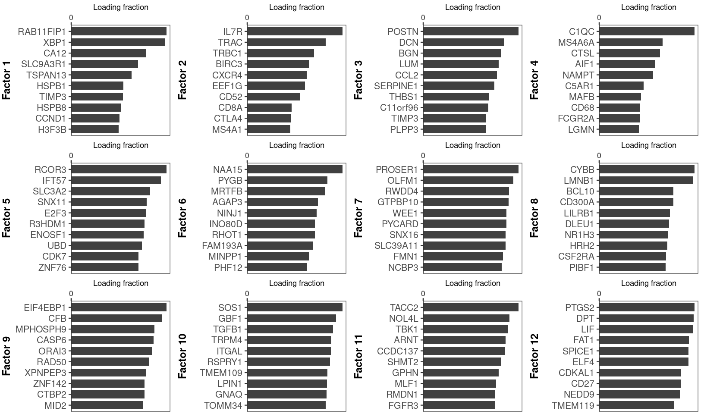

The stability plot summarizes how reproducible the factors were across
NMF starts. High-importance, high-stability factors are usually easiest
to interpret.

The stability plot shows the matched gene-ownership correlation of each
factor across independent NMF restarts (near zero for unrelated factors,
above 0.3 for reproducibly re-found ones). Factor importance (the
x-axis, echoed by dot size) is the share of all assigned molecules that
carry the factor’s label, so large dots mark factors that dominate the
tissue-wide signal.

``` r
fit$plot_stability()
```

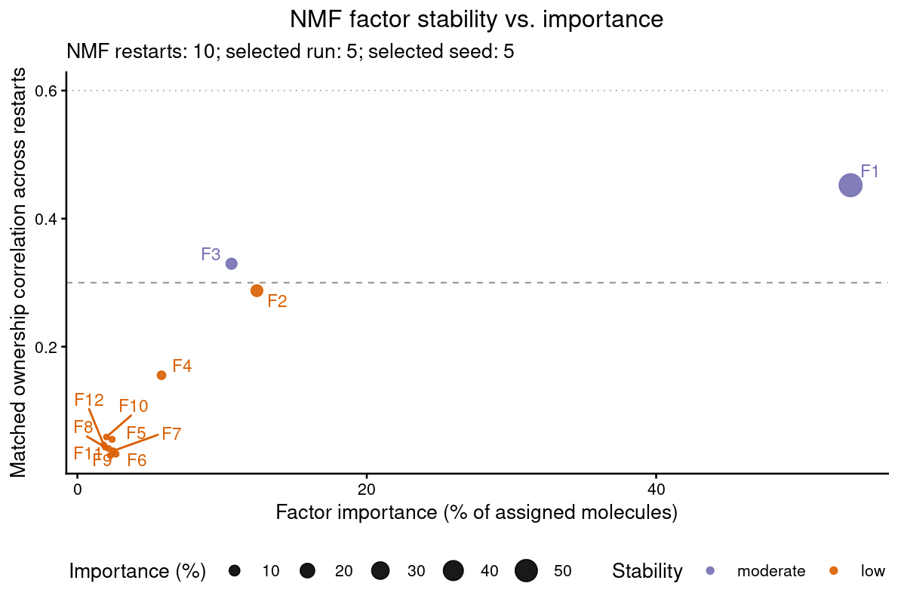

## Admixture Audit

Before correcting anything, the audit estimates each ordered cell-type
pair’s admixture rate — the percent of the target type’s molecules that
leaked in from the source — using only the spatial exposure structure of
the data. It frames what the cleanup below should fix, and the same
audit object verifies the correction afterwards.

``` r
audit <- fit$audit_admixture()
```

    ## Excluded 52 likely induced genes from marker panels (exposure-linked excess far above the source-profile expectation): ADIPOQ, ALPL, ATF3, CAV2, CCDC102B, CCL19, CD52, CDC14A

``` r
audit$plot_map()
```

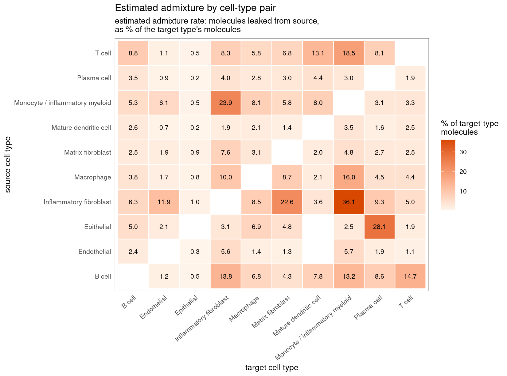

## Tissue Context

For the side visualizations below, merge cell-level factor summaries
with the provisional cell-type and domain annotations.

``` r
cell_factors <- fit$cell_factors()
cell_spatial <- merge(cell_factors,
  annotation[, c("cell_id", "merged_annotation", "cluster_label")],
  by = "cell_id", all.x = FALSE, sort = FALSE)
cell_spatial <- merge(cell_spatial,
  domain_annotation[, c("cell_id", "domain_label")],
  by = "cell_id", all.x = FALSE, sort = FALSE)
cell_spatial$domain_label <- factor(cell_spatial$domain_label,
  levels = c("tumor_epithelial", "immune_rich", "immune_stroma", "mixed_region"))
```

``` r
celladmix_plot_spatial(cell_spatial, color_by = "merged_annotation",
  point_size = 0.06) +
  ggtitle("Cell type annotation")
```

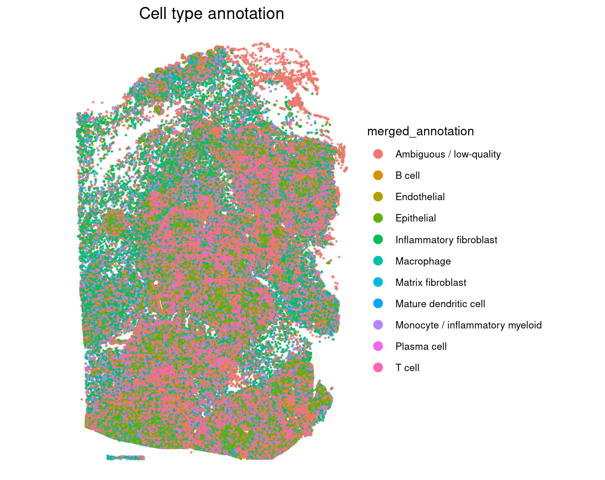

``` r
cowplot::plot_grid(plotlist = list(
  celladmix_plot_spatial(cell_spatial, color_by = "domain_label",
    point_size = 0.06) +
    ggtitle("Coarse tissue domains"),
  celladmix_plot_spatial(cell_spatial, color_by = "dominant_factor",
    point_size = 0.06) +
    ggtitle("Dominant cellAdmix factor")
), ncol = 2, align = "hv", axis = "tblr")
```

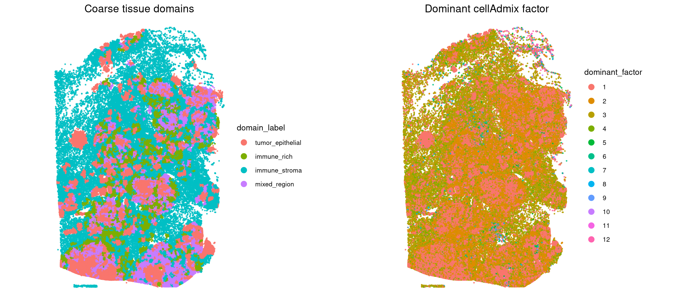

## Diagnostic Setup

Correction is run for all annotated cell types. To keep the follow-up
plots readable, the diagnostic DE panels focus on the two largest
populations, for which membrane scoring issues correction rules against
their dominant admixture sources — epithelial cells (which receive
immune leakage) and T cells (which receive epithelial, macrophage, and
endothelial leakage). The stain-weak stromal/vascular types, whose
admixture the current corrections cannot handle safely, are examined
separately in the bridge section below. The marker sets highlight likely
source signatures that may appear as admixture in the target cells.

``` r
diagnostic_cell_types <- c("Epithelial", "T cell")

epithelial_tumor_markers <- c("EPCAM", "KRT8", "KRT18", "KRT19", "MUC1",
  "GATA3", "CA12", "XBP1", "ERBB2")
lymphoid_myeloid_markers <- c("TRAC", "TRBC1", "CD3D", "CD3E", "CD8A",
  "IL7R", "MS4A1", "CD79A", "AIF1", "C1QC", "MS4A6A", "ITGAX")
source_marker_sets <- list(
  "epithelial/tumor source" = epithelial_tumor_markers,
  "immune source" = lymphoid_myeloid_markers
)
```

The baseline DE comparison contrasts the tumor-epithelial domain against
the immune-rich domain within each diagnostic cell type. This is an
illustrative diagnostic, not a curated biological benchmark.

``` r
original_counts <- fit$counts()
diagnostic_de_original <- celladmix_de_by_group(original_counts, cell_spatial,
  subset_by = "merged_annotation", subsets = diagnostic_cell_types,
  group_by = "domain_label", contrast = c("tumor_epithelial", "immune_rich"))
```

``` r
baseline_volcano_plots <- lapply(diagnostic_cell_types, function(target_type) {
  de <- diagnostic_de_original[[target_type]]
  celladmix_plot_volcano(de, markers = source_marker_sets,
    title = paste(target_type, "before cleanup"),
    subtitle = sprintf("logFC = tumor_epithelial / immune_rich; n = %d / %d",
      unique(de$n_group_a), unique(de$n_group_b)))
})
cowplot::plot_grid(plotlist = baseline_volcano_plots,
  ncol = length(baseline_volcano_plots), align = "hv", axis = "tblr")
```

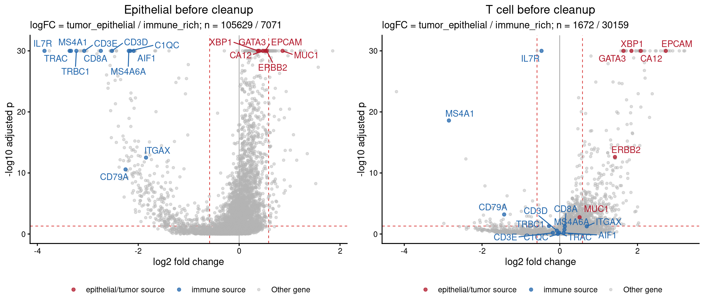

## Membrane Scoring

Membrane scoring asks whether target-cell molecules assigned to a factor
are enriched along membrane-stain paths facing a candidate source cell
type.

``` r
p_thresh <- 0.1
score_pairs_width <- 9.6
score_pairs_height <- max(6, ceiling(fit$rank / 2) * 4.9)
```

``` r
membrane_score <- fit$score_membrane()
```

The factor annotation identifies likely factor source cell types and
significant target cell types. Correction rules say which factor/target
combinations will be removed.

``` r
membrane_annotation <- membrane_score$annotation(p_thresh = p_thresh)
membrane_rules <- membrane_score$rules(p_thresh = p_thresh)

head(membrane_rules[, c("factor", "source_cell_type", "target_cell_type", "p_value")])
```

    ##   factor source_cell_type        target_cell_type      p_value
    ## 1      1       Epithelial                  B cell 3.310551e-02
    ## 2      1       Epithelial             Endothelial 2.392963e-04
    ## 3      1       Epithelial Inflammatory fibroblast 3.543994e-03
    ## 4      1       Epithelial              Macrophage 4.312782e-02
    ## 5      1       Epithelial       Matrix fibroblast 6.685384e-05
    ## 6      1       Epithelial   Mature dendritic cell 4.191718e-02

The heatmap shows factor-by-cell-type evidence, with symbols marking
inferred source and cleanup target calls.

``` r
membrane_score$plot_heatmap(p_thresh = p_thresh)
```

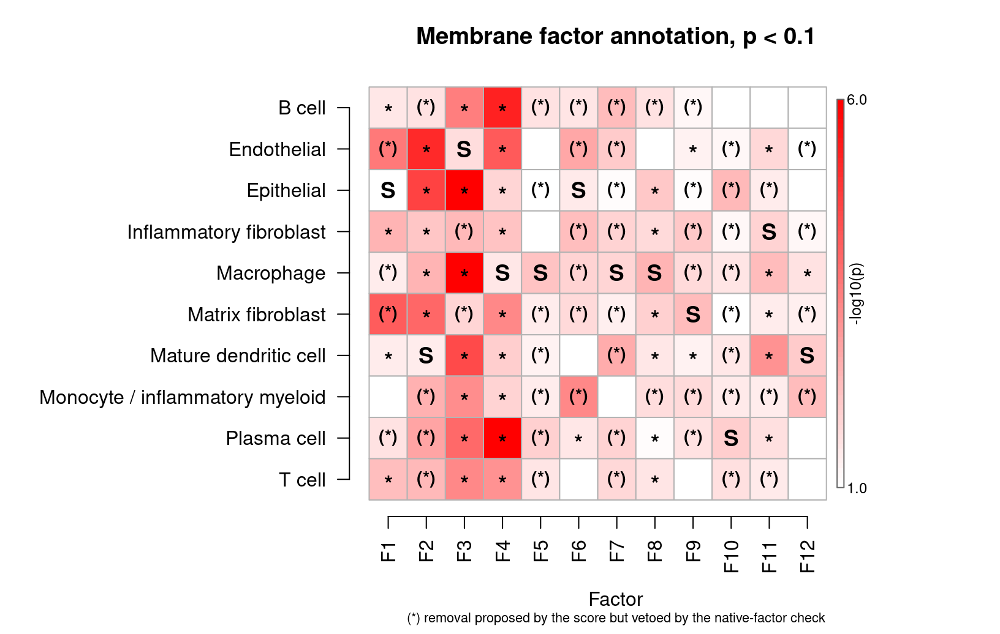

The pair plots show one factor at a time. The top margin shows source
evidence; the main heatmap shows target significance for source-target
cell-type pairs.

``` r
membrane_score$plot_pairs()
```

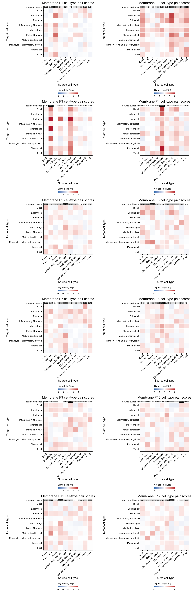

## Example Cells

These examples show the molecule-level interpretation for selected
diagnostic cells before cleanup. The examples are chosen from cells with
strong rule-supported membrane-score evidence. Molecule colors show the
native factor set in blue, the top putative admixture factor in red, and
other non-native factors in orange. Source-marker molecules are drawn
slightly larger.

``` r
example_cells <- membrane_score$examples(rules = membrane_rules,
  score_annotation = membrane_annotation, cell_data = cell_spatial,
  targets = diagnostic_cell_types, n_per_target = 4)

for (cell_type in diagnostic_cell_types) {
  type_examples <- example_cells[example_cells$target_cell_type == cell_type, , drop = FALSE]
  print(membrane_score$plot_examples(type_examples,
    score_annotation = membrane_annotation, cell_data = cell_spatial,
    markers = unique(unlist(source_marker_sets)), ncol = 2))
}
```

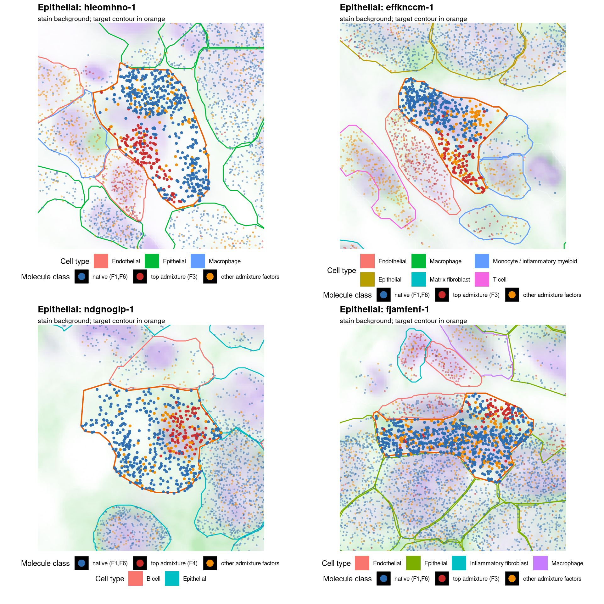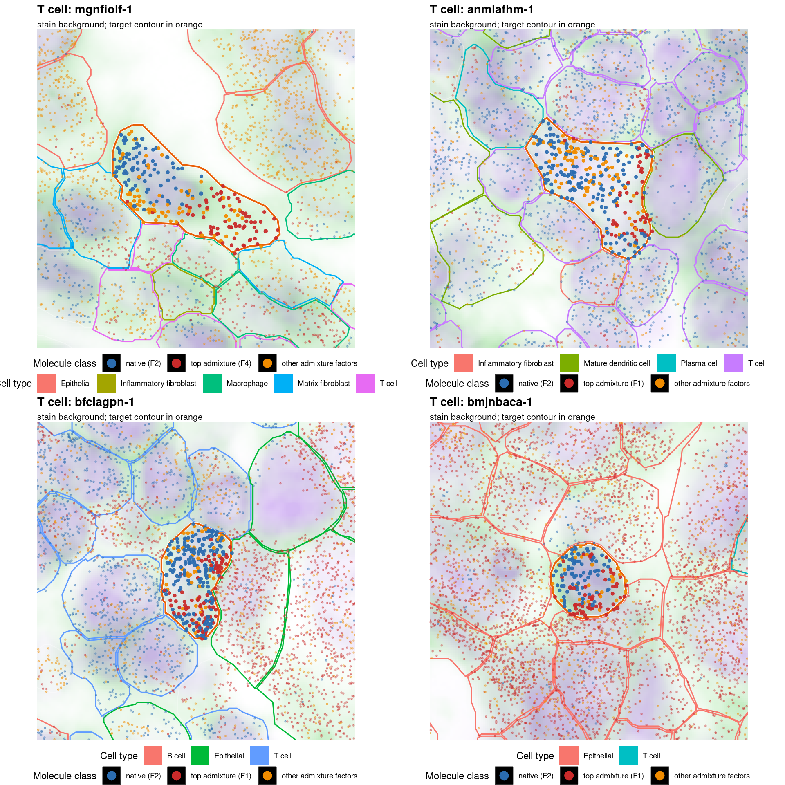

## Cleanup

Apply all membrane-derived correction rules across all annotated cell
types. With the default multi-restart fit this is the molecule-vote
ensemble: each restart member is scored and vetted independently, and a
molecule is removed only when at least 30% of the members agree (3 of 10
here). The corrected counts are then used for diagnostic plots.

``` r
membrane_correction <- membrane_score$correct(rules = membrane_rules,
  name = "membrane_clean")
```

    ## Ensemble correction over 10 members: molecules removed by >= 3 members (vote >= 0.30) are dropped (11,590,385 molecules).

``` r
membrane_counts <- membrane_correction$counts()

membrane_correction$summary()
```

    ##                          cell_type n_cells n_modified_cells
    ## 1                              all  688099           389397
    ## 2                           B cell   24723            24620
    ## 3                      Endothelial   15539            15504
    ## 4                       Epithelial  144214           143838
    ## 5          Inflammatory fibroblast   54230            54077
    ## 6                       Macrophage   24603            23813
    ## 7                Matrix fibroblast   31849            31370
    ## 8            Mature dendritic cell    4224             4224
    ## 9  Monocyte / inflammatory myeloid   23979            21979
    ## 10                     Plasma cell   12886            12783
    ## 11                          T cell   57491            57189
    ## 12                         unknown  294361                0
    ##    fraction_cells_modified molecules_before molecules_after molecules_removed
    ## 1                0.5659026         82144903        70554518          11590385
    ## 2                0.9958338          1786962         1070130            716832
    ## 3                0.9977476          3063402         2647402            416000
    ## 4                0.9973928         49027051        43902164           5124887
    ## 5                0.9971787          4248030         2232226           2015804
    ## 6                0.9678901          3559087         3314914            244173
    ## 7                0.9849603          5026410         4092724            933686
    ## 8                1.0000000           408087          217913            190174
    ## 9                0.9165937          1793419         1320149            473270
    ## 10               0.9920068           996170          807000            189170
    ## 11               0.9947470          4596360         3309971           1286389
    ## 12               0.0000000          7639925         7639925                 0
    ##    fraction_molecules_removed median_removed_per_modified_cell
    ## 1                  0.14109682                               22
    ## 2                  0.40114563                               21
    ## 3                  0.13579674                               20
    ## 4                  0.10453182                               30
    ## 5                  0.47452678                               31
    ## 6                  0.06860552                                8
    ## 7                  0.18575604                               18
    ## 8                  0.46601337                               37
    ## 9                  0.26389260                               12
    ## 10                 0.18989731                               10
    ## 11                 0.27987125                               16
    ## 12                 0.00000000                                0
    ##    median_fraction_removed_per_modified_cell
    ## 1                                 0.12351544
    ## 2                                 0.32926829
    ## 3                                 0.10784314
    ## 4                                 0.09581882
    ## 5                                 0.45544554
    ## 6                                 0.05913978
    ## 7                                 0.11976048
    ## 8                                 0.42443952
    ## 9                                 0.18181818
    ## 10                                0.14388489
    ## 11                                0.21739130
    ## 12                                0.00000000

``` r
membrane_de <- celladmix_de_by_group(membrane_counts, cell_spatial,
  subset_by = "merged_annotation", subsets = diagnostic_cell_types,
  group_by = "domain_label", contrast = c("tumor_epithelial", "immune_rich"))
```

## Cleanup Diagnostics

This boxplot summarizes how many molecules were removed from modified
cells.

``` r
membrane_correction$plot_removed_molecules()
```

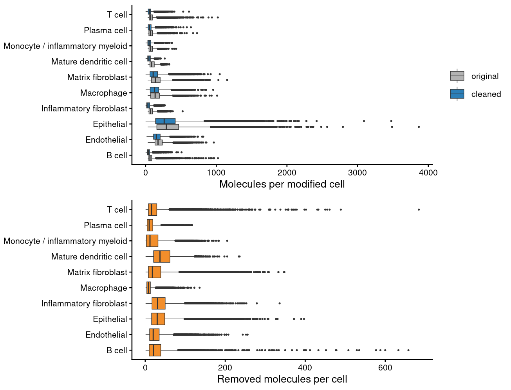

The audit verifies the cleanup against the same exposure measurements:
the report gives per-pair sensitivity and the own-marker false-removal
rate, and the panels show the estimated admixture remaining and the
pooled exposure profile before and after cleanup. The evaluation warns
that the correction removed about half of the own-marker molecules of
the monocyte / inflammatory myeloid class — a class whose expression
overlaps the macrophage factors that the rules remove from it — and that
many pairs remain largely uncovered, above all those in which the two
fibroblast states are the source. The uncovered stromal pairs are the
stain-weak-type problem examined in the bridge section below.

``` r
report <- audit$evaluate(membrane_correction)
```

    ## Warning: Correction removed 53% of Monocyte / inflammatory myeloid's own-marker
    ## molecules - severe over-removal of near-surely-genuine expression

    ## Warning: Correction removed only 18% of the estimated ~243,384 admixed
    ## molecules from B cell into Macrophage

    ## Warning: Correction removed only 2% of the estimated ~237,007 admixed molecules
    ## from B cell into Monocyte / inflammatory myeloid

    ## Warning: Correction removed only 0% of the estimated ~676,221 admixed molecules
    ## from B cell into T cell

    ## Warning: Correction removed only 1% of the estimated ~237,270 admixed molecules
    ## from Endothelial into Inflammatory fibroblast

    ## Warning: Correction removed only 9% of the estimated ~64,704 admixed molecules
    ## from Endothelial into Matrix fibroblast

    ## Warning: Correction removed only 0% of the estimated ~63,137 admixed molecules
    ## from Epithelial into Endothelial

    ## Warning: Correction removed only 0% of the estimated ~245,615 admixed molecules
    ## from Epithelial into Macrophage

    ## Warning: Correction removed only 0% of the estimated ~242,352 admixed molecules
    ## from Epithelial into Matrix fibroblast

    ## Warning: Correction removed only 0% of the estimated ~45,295 admixed molecules
    ## from Epithelial into Monocyte / inflammatory myeloid

    ## Warning: Correction removed only 0% of the estimated ~279,752 admixed molecules
    ## from Epithelial into Plasma cell

    ## Warning: Correction removed only 9% of the estimated ~112,860 admixed molecules
    ## from Inflammatory fibroblast into B cell

    ## Warning: Correction removed only 3% of the estimated ~363,054 admixed molecules
    ## from Inflammatory fibroblast into Endothelial

    ## Warning: Correction removed only 12% of the estimated ~301,060 admixed
    ## molecules from Inflammatory fibroblast into Macrophage

    ## Warning: Correction removed only 11% of the estimated ~1,137,803 admixed
    ## molecules from Inflammatory fibroblast into Matrix fibroblast

    ## Warning: Correction removed only 12% of the estimated ~647,610 admixed
    ## molecules from Inflammatory fibroblast into Monocyte / inflammatory myeloid

    ## Warning: Correction removed only 18% of the estimated ~92,267 admixed molecules
    ## from Inflammatory fibroblast into Plasma cell

    ## Warning: Correction removed only 16% of the estimated ~229,741 admixed
    ## molecules from Inflammatory fibroblast into T cell

    ## Warning: Correction removed only 8% of the estimated ~43,901 admixed molecules
    ## from Matrix fibroblast into B cell

    ## Warning: Correction removed only 5% of the estimated ~59,136 admixed molecules
    ## from Matrix fibroblast into Endothelial

    ## Warning: Correction removed only 4% of the estimated ~453,761 admixed molecules
    ## from Matrix fibroblast into Epithelial

    ## Warning: Correction removed only 6% of the estimated ~321,205 admixed molecules
    ## from Matrix fibroblast into Inflammatory fibroblast

    ## Warning: Correction removed only 2% of the estimated ~111,912 admixed molecules
    ## from Matrix fibroblast into Macrophage

    ## Warning: Correction removed only 0% of the estimated ~85,326 admixed molecules
    ## from Matrix fibroblast into Monocyte / inflammatory myeloid

    ## Warning: Correction removed only 0% of the estimated ~27,296 admixed molecules
    ## from Matrix fibroblast into Plasma cell

    ## Warning: Correction removed only 4% of the estimated ~113,863 admixed molecules
    ## from Matrix fibroblast into T cell

    ## Warning: Correction removed only 17% of the estimated ~46,853 admixed molecules
    ## from Mature dendritic cell into B cell

    ## Warning: Correction removed only 10% of the estimated ~73,277 admixed molecules
    ## from Mature dendritic cell into Macrophage

    ## Warning: Correction removed only 8% of the estimated ~63,395 admixed molecules
    ## from Mature dendritic cell into Monocyte / inflammatory myeloid

    ## Warning: Correction removed only 15% of the estimated ~115,394 admixed
    ## molecules from Mature dendritic cell into T cell

    ## Warning: Correction removed only 13% of the estimated ~287,909 admixed
    ## molecules from Monocyte / inflammatory myeloid into Macrophage

    ## Warning: Correction removed only 20% of the estimated ~151,078 admixed
    ## molecules from Monocyte / inflammatory myeloid into T cell

    ## Warning: Correction removed only 11% of the estimated ~100,218 admixed
    ## molecules from Plasma cell into Macrophage

    ## Warning: Correction removed only 0% of the estimated ~54,336 admixed molecules
    ## from Plasma cell into Monocyte / inflammatory myeloid

    ## Warning: Correction removed only 1% of the estimated ~157,748 admixed molecules
    ## from T cell into B cell

    ## Warning: Correction removed only 13% of the estimated ~351,318 admixed
    ## molecules from T cell into Inflammatory fibroblast

    ## Warning: Correction removed only 2% of the estimated ~205,808 admixed molecules
    ## from T cell into Macrophage

    ## Warning: Correction removed only 9% of the estimated ~53,554 admixed molecules
    ## from T cell into Mature dendritic cell

    ## Warning: Correction removed only 2% of the estimated ~332,663 admixed molecules
    ## from T cell into Monocyte / inflammatory myeloid

    ## Warning: Correction removed only 2% of the estimated ~80,627 admixed molecules
    ## from T cell into Plasma cell

``` r
report$summary()
```

    ## $detected_pairs
    ## [1] 88
    ## 
    ## $estimated_admixed_molecules
    ## [1] 16219949
    ## 
    ## $leakage_removed_overall
    ## [1] 0.3805345
    ## 
    ## $median_pair_sensitivity
    ## [1] 0.3603507
    ## 
    ## $own_marker_false_removal
    ## [1] 0.02981779
    ## 
    ## $worst_false_removal
    ## [1] "Monocyte / inflammatory myeloid"

``` r
cowplot::plot_grid(
  audit$plot_remaining(list(corrected = membrane_correction)),
  audit$plot_exposure(correction = membrane_correction),
  ncol = 2, align = "hv", axis = "tblr")
```

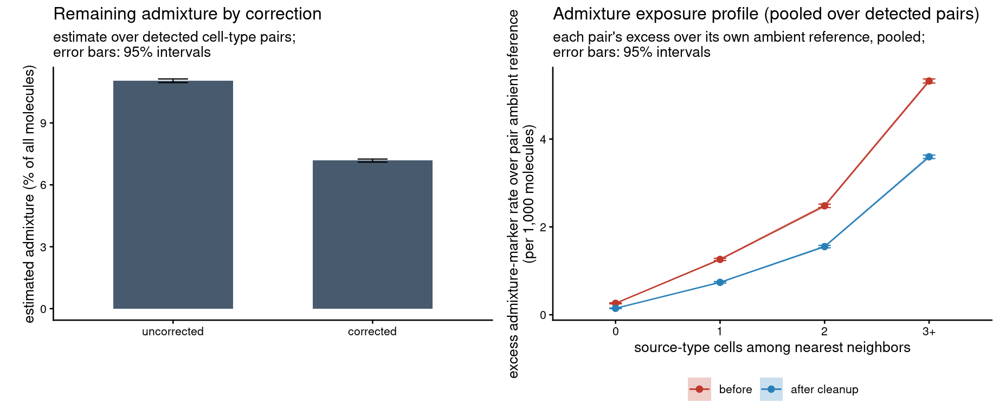

Marker-expression plots show how source-marker expression changed after
cleanup in the two diagnostic cell types.

``` r
plots <- lapply(diagnostic_cell_types, function(cell_type) {
  cells <- cell_spatial$cell_id[cell_spatial$merged_annotation == cell_type]
  celladmix_plot_marker_expression(original_counts, membrane_counts,
    cells = cells, markers = source_marker_sets) +
    ggtitle(cell_type)
})
cowplot::plot_grid(plotlist = plots, ncol = length(plots), align = "hv", axis = "tblr")
```

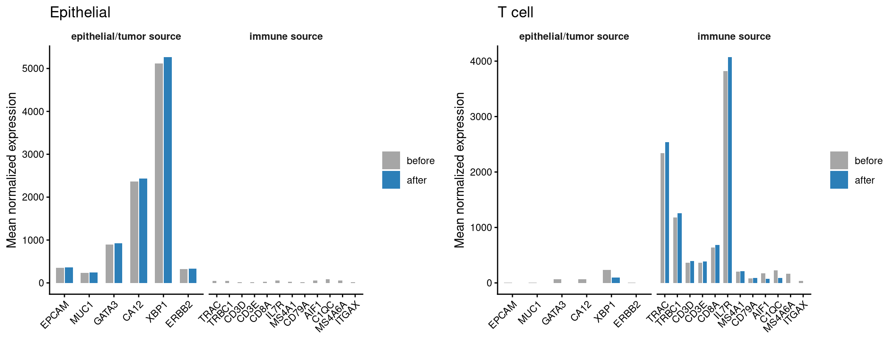

Volcano plots show the diagnostic domain comparison before and after
cleanup.

``` r
for (target_type in diagnostic_cell_types) {
  p_before <- celladmix_plot_volcano(diagnostic_de_original[[target_type]],
    markers = source_marker_sets, title = paste(target_type, "before cleanup")) +
    theme(legend.position = "none")
  p_after <- celladmix_plot_volcano(membrane_de[[target_type]],
    markers = source_marker_sets, title = paste(target_type, "after membrane cleanup"))
  print(cowplot::plot_grid(plotlist = list(p_before, p_after),
    ncol = 2, align = "hv", axis = "tblr"))
}
```

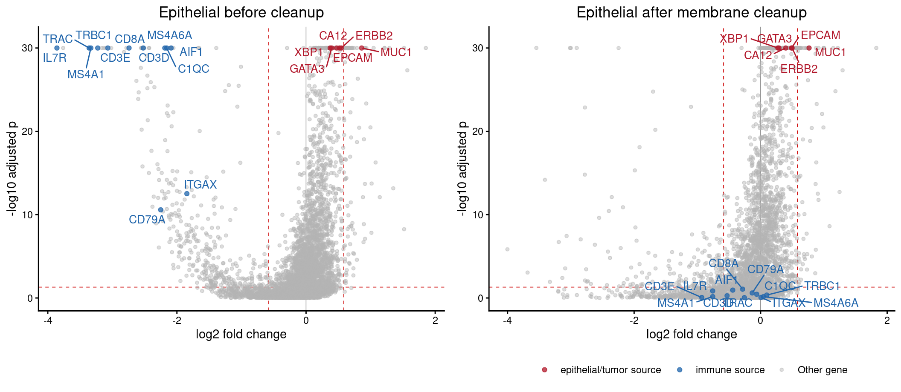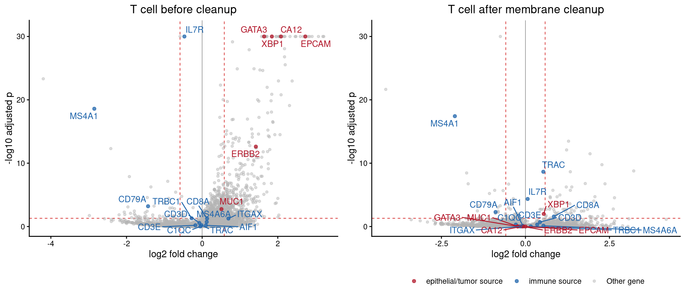

The p-value shift plots compare signed DE significance before and after
cleanup. Genes below the diagonal are less significant after correction.

``` r
plots <- lapply(diagnostic_cell_types, function(target_type) {
  celladmix_plot_de_shift(diagnostic_de_original[[target_type]], membrane_de[[target_type]],
    markers = source_marker_sets, title = paste("Membrane", target_type, "p-value shift"))
})
cowplot::plot_grid(plotlist = plots, ncol = length(plots), align = "hv", axis = "tblr")
```

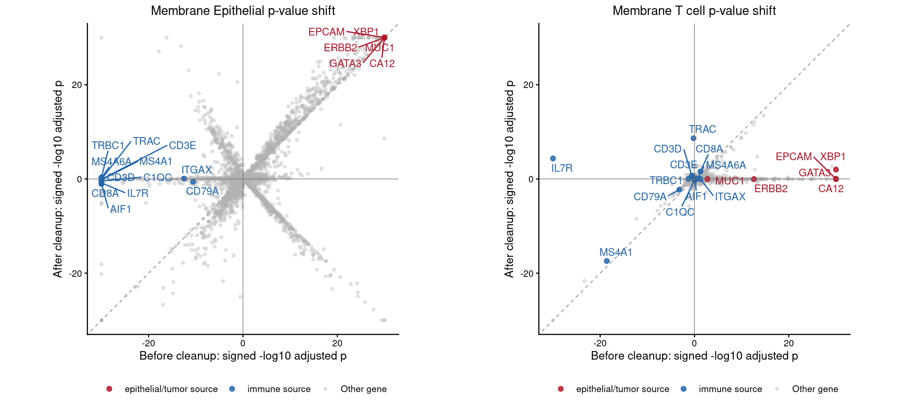

## Bridge Scoring and Its Limits on Stain-Weak Targets

The audit warnings above flag large pairs that membrane scoring left
largely uncorrected — most prominently the leakage from inflammatory
fibroblasts into matrix fibroblasts (\~1.1M estimated molecules) and
into the monocyte / inflammatory myeloid class (\~650k), and the leakage
from matrix fibroblasts into epithelial cells (\~450k). Membrane scoring
depends on stain-path contrast along molecule-to-centroid lines, which
is weak for thin, elongated cell types such as fibroblasts and
endothelium. Bridge scoring uses molecule adjacency instead of the stain
image and pairs best with the `ls_nmf` factorization (see
[docs/audit.md](../../docs/audit.md)). It detects these pairs decisively
— but, as shown below, it cannot correct them safely on this dataset,
and the reason is instructive.

``` r
fit_ls <- ds$fit()
```

    ## Reusing cached run fit_manual_rank12_ls_nmf (parameters match)

``` r
bridge_score <- fit_ls$score_bridge()
bridge_rules <- bridge_score$rules(p_thresh = p_thresh)
```

Applying the bridge rules, however, exposes a factorization-level
failure mode: the over-removal guardrails fire, reporting that
inflammatory fibroblasts and the monocyte / inflammatory myeloid class
lose most of their molecules:

``` r
bridge_correction <- bridge_score$correct(rules = bridge_rules,
  name = "bridge_clean")
```

    ## Ensemble correction over 10 members: molecules removed by >= 3 members (vote >= 0.30) are dropped (10,660,595 molecules).

    ## Warning: Correction removed 81% of all molecules from Inflammatory fibroblast -
    ## this is likely erasing native expression (does the factorization have a native
    ## factor for this type?)

    ## Warning: Correction removed 72% of all molecules from Monocyte / inflammatory
    ## myeloid - this is likely erasing native expression (does the factorization have
    ## a native factor for this type?)

The mechanism: the rank-12 `ls_nmf` fit collapses to seven active
factors, sourced by epithelial, T, B, macrophage, endothelial, and
matrix fibroblast cells plus a negligible inflammatory-fibroblast
factor; the monocyte / inflammatory myeloid and plasma-cell populations
have no native factor at all. Each bridge rule is individually
legitimate — inflammatory fibroblasts genuinely carry heavy leakage from
the lymphoid, myeloid, endothelial, and matrix-fibroblast cells around
them, and each rule passes the native-factor check against cells distant
from *its own* source — but with no substantial native factor to hold
the genuinely own molecules, the union of the rules covers the type’s
entire factor spectrum, and the correction erases the cell type instead
of cleaning it.

The per-pair diagnostics make the trade-off visible. On the leakage side
the bridge correction looks competitive — sensitivity is blind to
over-removal by construction:

``` r
bridge_report <- audit$evaluate(bridge_correction)

cowplot::plot_grid(
  report$plot_cleanup() + ggtitle("Membrane (invsqrt_kl)"),
  bridge_report$plot_cleanup() + ggtitle("Bridge (ls_nmf)"),
  ncol = 2, align = "hv", axis = "tblr")
```

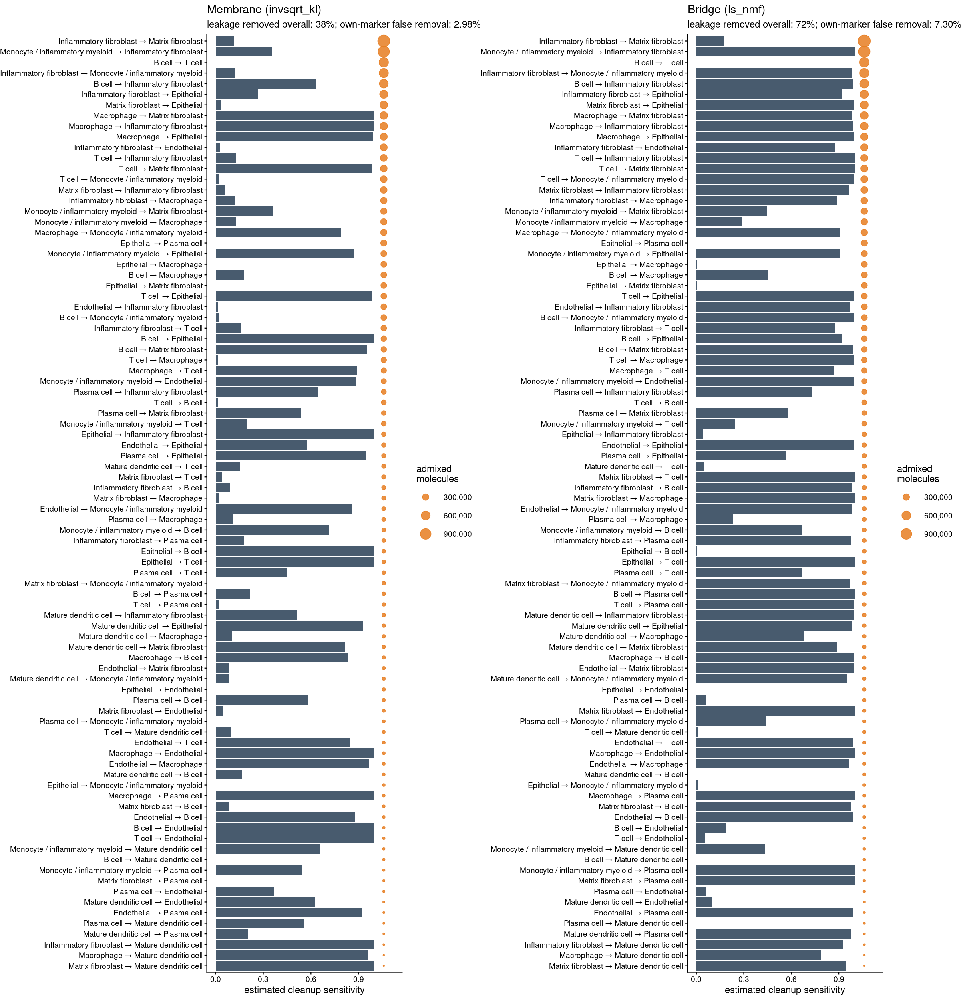

The difference shows in how much near-surely-genuine expression each
correction retains per cell type (left): the bridge correction erases
the inflammatory fibroblasts and most of the monocyte / inflammatory
myeloid and plasma cells. That erasure is also why it appears to remove
far more of the admixture burden (right) — a target type’s deleted
native expression leaves no exposure gradient to measure:

``` r
retention <- rbind(
  transform(report$false_removal(), correction = "membrane (invsqrt_kl)"),
  transform(bridge_report$false_removal(), correction = "bridge (ls_nmf)"))
retention$correction <- factor(retention$correction,
  levels = c("membrane (invsqrt_kl)", "bridge (ls_nmf)"))

cowplot::plot_grid(
  ggplot(retention, aes(cell_type, 1 - false_removal, fill = correction)) +
    geom_col(position = "dodge") +
    scale_fill_manual(values = c("#34495e", "#c0392b")) +
    labs(x = NULL, y = "own-marker molecules retained",
      title = "Retention of near-surely-genuine expression") +
    theme_classic(base_size = 10) +
    theme(axis.text.x = element_text(angle = 30, hjust = 1),
      legend.position = "bottom", legend.title = element_blank()),
  audit$plot_remaining(list(
    `membrane\n(invsqrt_kl)` = membrane_correction,
    `bridge\n(ls_nmf)` = bridge_correction)),
  ncol = 2, rel_widths = c(1.45, 1), align = "hv", axis = "tblr")
```

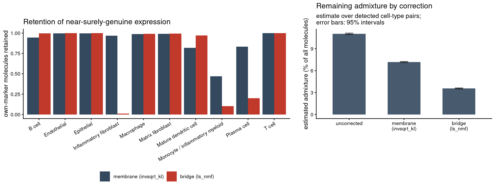

The bottom line for this dataset: membrane scoring cannot see most of
the leakage that the thin, stain-weak fibroblast states shed into their
neighbours and into each other, and bridge scoring sees it but cannot
separate it, because the factorization never formed a native factor for
the inflammatory fibroblasts, the monocyte / inflammatory myeloid class,
or the plasma cells. Correcting these pairs safely requires
factorization-level remedies (a rank that resolves these types, or
anchor-based factor recovery — see
[docs/audit.md](../../docs/audit.md)). Downstream analysis in this
notebook therefore proceeds with the membrane correction, and the
stromal admixture flagged by the audit should be kept in mind when
interpreting the fibroblast and inflammatory myeloid classes.

## Cell-State UMAP Before and After Cleanup

As a compact global diagnostic, compute cell-state UMAPs from sparse
cell-level counts before and after the membrane cleanup (the correction
retained for downstream use here — see the bridge section above for why
the bridge correction is not applied). The two UMAPs are independent
embeddings, so the exact coordinates are not meant to align; the
comparison asks whether the corrected counts produce clearer annotation
separation.

``` r
state_cells_max <- 5000
original_state <- ds$cell_state_umap(cells_max = state_cells_max,
  min_molecules = 30, min_genes = 15, verbose = TRUE)
```

    ## [INFO 09:37:21 +0.118s] Reused compatible Xenium input store (0.000s)
    ## [INFO 09:37:21 +0.118s] Built Xenium input store: 82144903 molecules, 688099 cells (0.118s)
    ## [INFO 09:37:24 +3.258s] Loaded input-store cell-gene counts: 688099 cells (3.258s)
    ## [INFO 09:37:24 +3.409s] Indexed cell counts: 470549 eligible cells (min_molecules=30, min_genes=15) (0.141s)
    ## [INFO 09:37:25 +3.628s] Selected clustering cells: 5000 cells (0.219s)
    ## [INFO 09:37:25 +3.647s] Loaded sparse cell-gene counts: 776043 non-zero entries (0.019s)
    ## [INFO 09:37:25 +3.672s] Selected variable genes: 1000 genes (0.024s)
    ## [INFO 09:37:25 +3.733s] Materialized dense clustering matrix: 1000 x 5000 (0.061s)
    ## [INFO 09:37:26 +4.800s] Computed cell PCA: 30 x 5000 (1.068s)
    ## [INFO 09:37:26 +5.138s] Built HNSW cell KNN graph: 75000 directed edges using 10 thread(s); reusing 15 cosine-distance neighbors for UMAP (0.337s)
    ## [INFO 09:37:26 +5.148s] Ran Louvain clustering (0.010s)
    ## [INFO 09:37:26 +5.190s] Initialized UMAP layout (0.042s)
    ## [INFO 09:37:29 +8.022s] Optimized UMAP layout with parallel optimization (2.831s)
    ## [INFO 09:37:29 +8.022s] Computed cell UMAP (2.874s)
    ## [INFO 09:37:29 +8.023s] Assembled cell clustering result (0.002s)
    ## [INFO 09:37:29 +8.024s] Finished store-backed cell clustering (4.766s)
    ## [INFO 09:37:29 +8.034s] Wrote cell clustering outputs (0.010s)

``` r
corrected_state <- membrane_correction$cell_state_umap(cells_max = state_cells_max,
  min_molecules = 30, min_genes = 15, verbose = TRUE)
```

    ## [INFO 09:37:50 +20.824s] Loaded run cell-gene counts: 688099 cells (20.824s)
    ## [INFO 09:37:50 +20.957s] Indexed cell counts: 416951 eligible cells (min_molecules=30, min_genes=15) (0.133s)
    ## [INFO 09:37:50 +21.141s] Selected clustering cells: 5000 cells (0.184s)
    ## [INFO 09:37:50 +21.168s] Loaded sparse cell-gene counts: 732256 non-zero entries (0.027s)
    ## [INFO 09:37:50 +21.181s] Selected variable genes: 1000 genes (0.013s)
    ## [INFO 09:37:50 +21.234s] Materialized dense clustering matrix: 1000 x 5000 (0.053s)
    ## [INFO 09:37:51 +22.231s] Computed cell PCA: 30 x 5000 (0.997s)
    ## [INFO 09:37:52 +22.602s] Built HNSW cell KNN graph: 75000 directed edges using 10 thread(s); reusing 15 cosine-distance neighbors for UMAP (0.371s)
    ## [INFO 09:37:52 +22.612s] Ran Louvain clustering (0.010s)
    ## [INFO 09:37:52 +22.654s] Initialized UMAP layout (0.042s)
    ## [INFO 09:37:55 +26.321s] Optimized UMAP layout with parallel optimization (3.666s)
    ## [INFO 09:37:55 +26.321s] Computed cell UMAP (3.709s)
    ## [INFO 09:37:55 +26.322s] Assembled cell clustering result (0.001s)
    ## [INFO 09:37:55 +26.322s] Finished run-count cell-state embedding (5.498s)

``` r
cell_type_levels <- sort(unique(cell_annotation))
cell_type_palette <- setNames(grDevices::hcl.colors(length(cell_type_levels), "Dark 3"),
  cell_type_levels)
original_state$cell_type <- factor(original_state$cell_type, levels = cell_type_levels)
corrected_state$cell_type <- factor(corrected_state$cell_type, levels = cell_type_levels)
```

``` r
state_umap_limits <- function(...) {
  frames <- list(...)
  x <- unlist(lapply(frames, `[[`, "umap_1"))
  y <- unlist(lapply(frames, `[[`, "umap_2"))
  span <- max(diff(range(x, na.rm = TRUE)), diff(range(y, na.rm = TRUE)))
  xmid <- mean(range(x, na.rm = TRUE))
  ymid <- mean(range(y, na.rm = TRUE))
  pad <- span * 0.04
  list(xlim = xmid + c(-1, 1) * (span / 2 + pad),
    ylim = ymid + c(-1, 1) * (span / 2 + pad))
}

plot_state_umap <- function(df, title, limits) {
  ggplot(df, aes(umap_1, umap_2, color = cell_type)) +
    geom_point(size = 0.55, alpha = 0.75) +
    coord_equal(xlim = limits$xlim, ylim = limits$ylim) +
    scale_color_manual(values = cell_type_palette, drop = FALSE) +
    labs(title = title, x = "UMAP 1", y = "UMAP 2", color = "Cell type") +
    theme_classic(base_size = 10) +
    guides(color = guide_legend(override.aes = list(size = 3.2, alpha = 1))) +
    theme(legend.position = "right")
}

limits <- state_umap_limits(original_state, corrected_state)
cowplot::plot_grid(plotlist = list(
  plot_state_umap(original_state, "Original counts", limits),
  plot_state_umap(corrected_state, "Membrane-corrected counts", limits)
), ncol = 2, align = "hv", axis = "tblr")
```

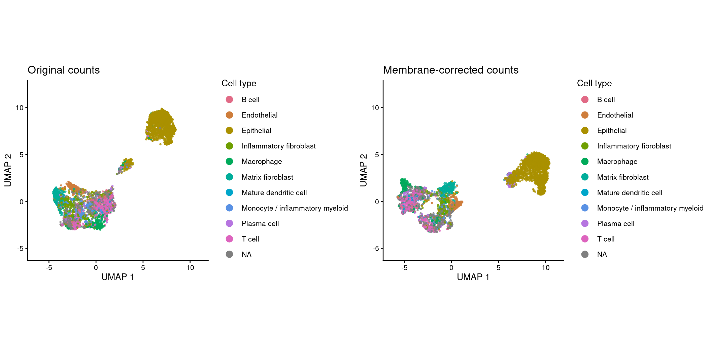
