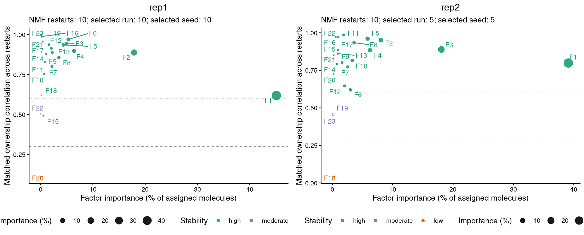
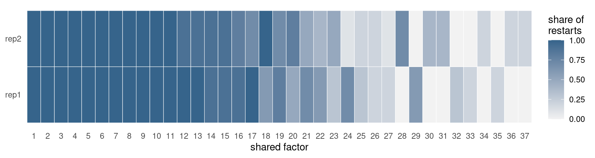
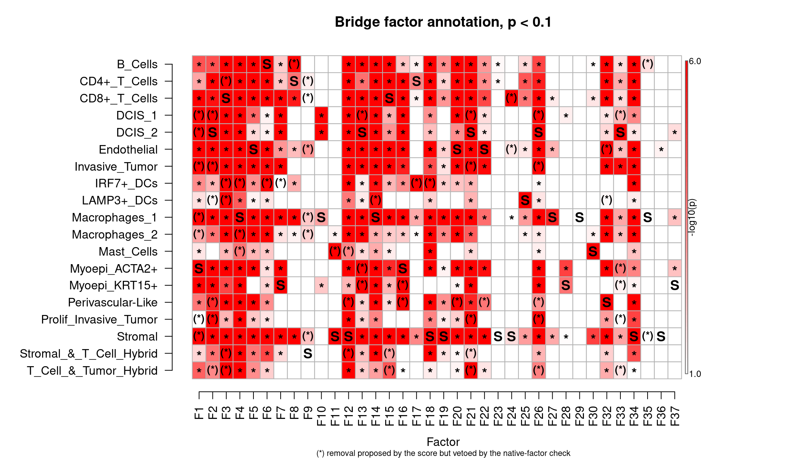
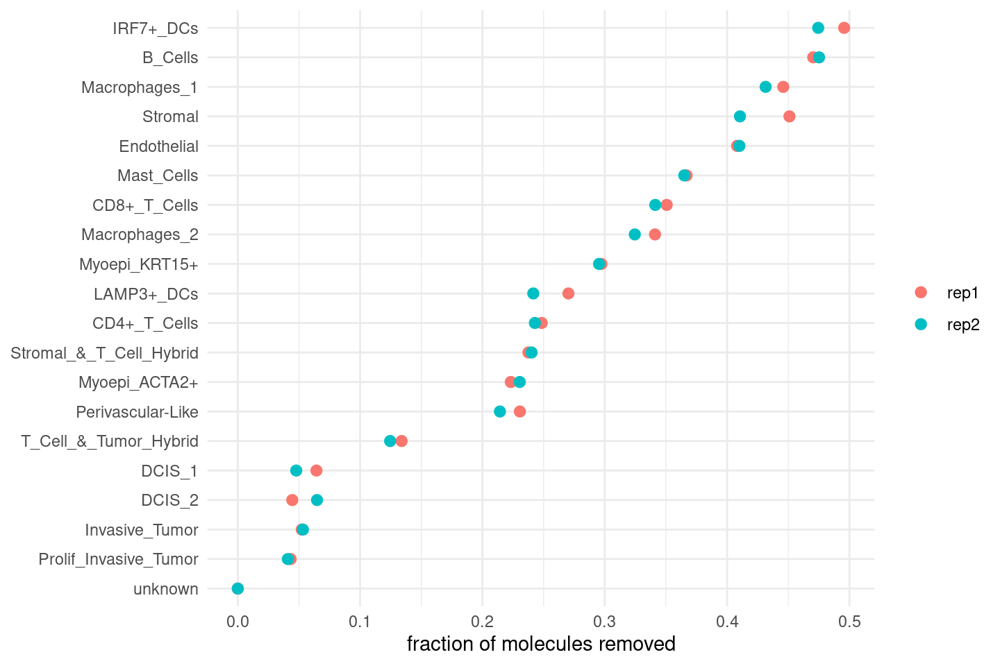
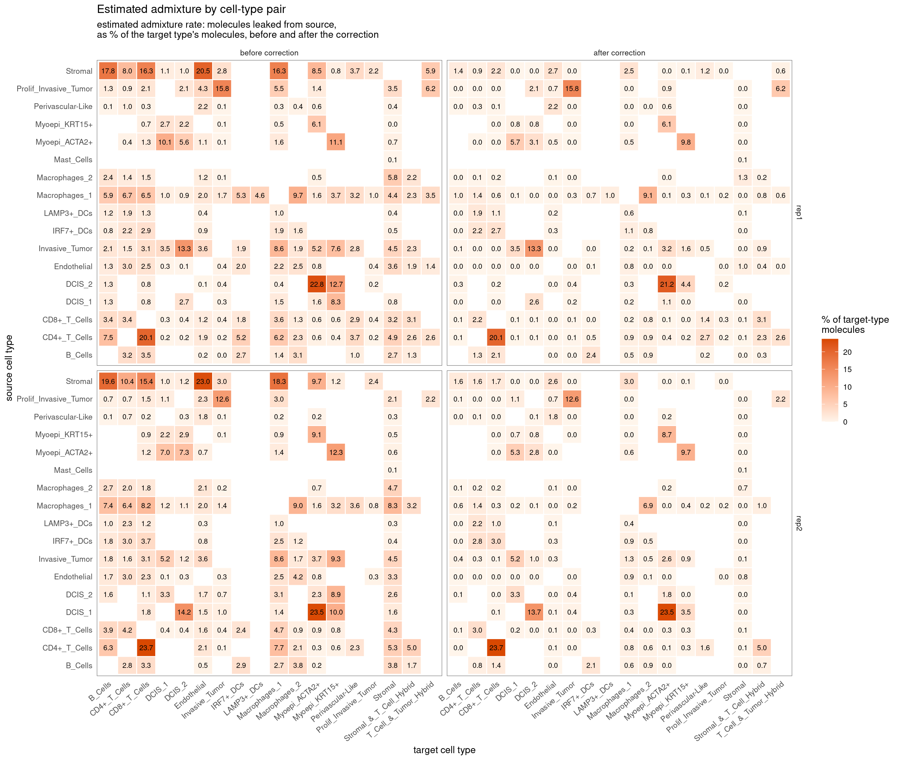
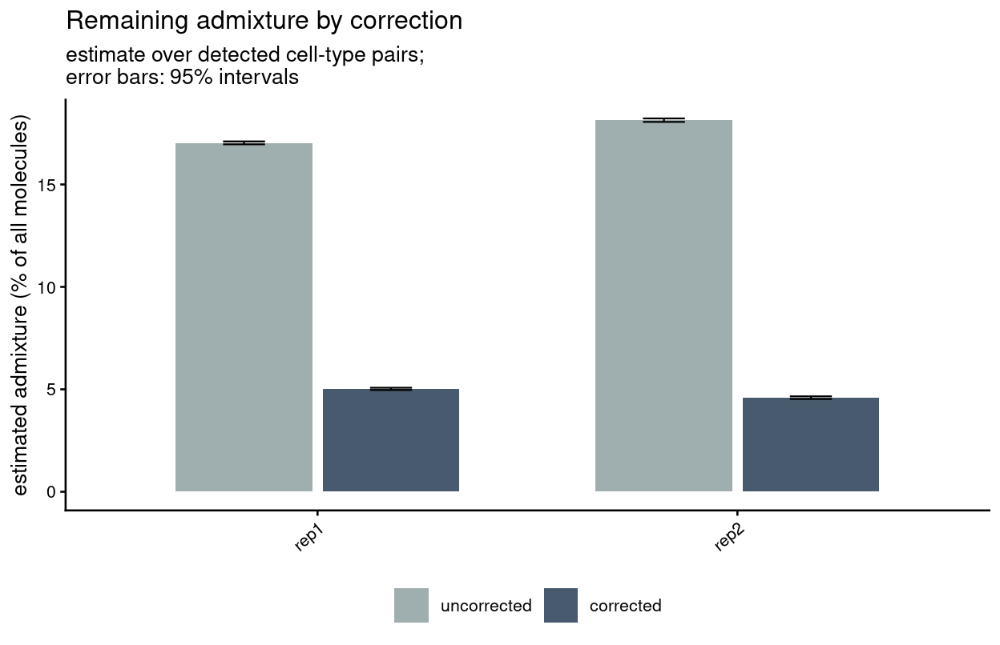
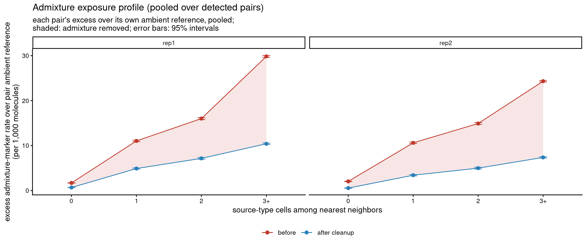
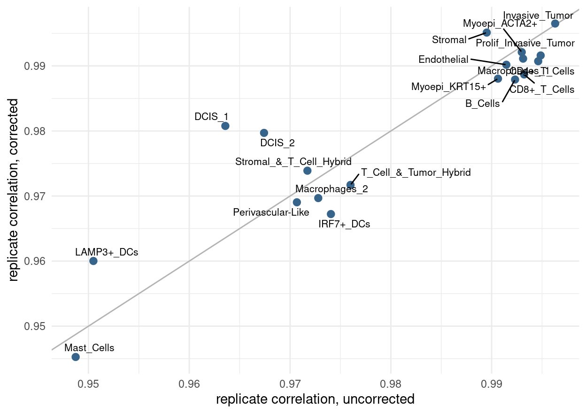

Multi-Sample Processing: Two Xenium Breast Replicates
================

Two serial sections of the same tissue, processed one at a time, come
out of the cleanup looking different: each section’s NMF finds its own
set of factors, each section’s scoring produces its own rules, and the
two cleanups then remove different molecules from the same cell types.
This notebook runs the two 10x Genomics Xenium breast cancer replicates
through the multi-sample workflow, which treats all samples by one
procedure: a shared set of gene programs built from the factorizations
of every sample (the consensus factorization), one rule set from the
pooled evidence of all samples, and a correction that votes with the
same ensemble in every sample. The audit then verifies the cleanup in
each sample on its own.

The notebook also explains every diagnostic table the workflow produces,
because the diagnostics are how one judges whether the shared treatment
suited the samples at hand. The closing section lists what to report
from a pilot run on new data. The method and the diagnostics are
described in [docs/multisample.md](../../docs/multisample.md); the
single-sample workflow is in the [pancreas
quickstart](../xenium_pancreas_membrane_377_full/pancreas_quickstart.md).

## Inputs

The two replicates are the Xenium FFPE human breast cancer sections
published by 10x Genomics (Janesick et al., 2023). Place each bundle in
`data/rep1` and `data/rep2`:

``` bash
B=https://cf.10xgenomics.com/samples/xenium/1.0.1
curl -O $B/Xenium_FFPE_Human_Breast_Cancer_Rep1/Xenium_FFPE_Human_Breast_Cancer_Rep1_outs.zip
curl -O $B/Xenium_FFPE_Human_Breast_Cancer_Rep2/Xenium_FFPE_Human_Breast_Cancer_Rep2_outs.zip
mkdir -p data/rep1 data/rep2
unzip -q Xenium_FFPE_Human_Breast_Cancer_Rep1_outs.zip -d data/rep1
unzip -q Xenium_FFPE_Human_Breast_Cancer_Rep2_outs.zip -d data/rep2
```

The cell-type labels ship with this example under `annotations/`: the
supervised labels that 10x published with the dataset for both sections
(the `Cell_Barcode_Type_Matrices` supplement), as one `cell_id`,
`cell_type` table per replicate. Cells the authors left `Unlabeled` are
dropped from the annotation, so they are neither a source nor a target
type. The samples must share one gene panel and one annotation scheme;
the same labels do not have to be present in every sample.

``` r
read_labels <- function(path) {
  labels <- read.csv(path, stringsAsFactors = FALSE)
  labels <- labels[labels$cell_type != "Unlabeled", ]
  setNames(labels$cell_type, labels$cell_id)
}
labels <- list(
  rep1 = read_labels(file.path("annotations", "rep1_annotation.csv.gz")),
  rep2 = read_labels(file.path("annotations", "rep2_annotation.csv.gz")))

table(labels$rep1)
```

    ## 
    ##                 B_Cells            CD4+_T_Cells            CD8+_T_Cells                  DCIS_1 
    ##                    4987                    8453                    6940                   12923 
    ##                  DCIS_2             Endothelial          Invasive_Tumor               IRF7+_DCs 
    ##                   11683                    8931                   34374                     494 
    ##              LAMP3+_DCs           Macrophages_1           Macrophages_2              Mast_Cells 
    ##                     298                   11174                    1624                     167 
    ##           Myoepi_ACTA2+           Myoepi_KRT15+       Perivascular-Like   Prolif_Invasive_Tumor 
    ##                    7078                    2860                     847                    3775 
    ##                 Stromal Stromal_&_T_Cell_Hybrid   T_Cell_&_Tumor_Hybrid 
    ##                   41422                     607                     589

Each sample is an ordinary cellAdmix dataset with its own output
directory, which holds that sample’s cache: the prepared molecule store,
its fits, and later the shared-profile fits and corrections. The
collection groups the datasets under sample names, which prefix the cell
ids of every combined output.

``` r
datasets <- list(
  rep1 = cellAdmix("data/rep1", output_dir = "out/rep1", annotation = labels$rep1, num_threads = 8),
  rep2 = cellAdmix("data/rep2", output_dir = "out/rep2", annotation = labels$rep2, num_threads = 8))

collection <- cellAdmixCollection(datasets)
show(collection$samples())
```

| sample | annotated\_cells | cell\_types | output\_dir                                               |
| :----- | ---------------: | ----------: | :-------------------------------------------------------- |
| rep1   |           159226 |          19 | /home/pkharchenko/cellAdmix/multisample\_runs/breast/rep1 |
| rep2   |           115275 |          19 | /home/pkharchenko/cellAdmix/multisample\_runs/breast/rep2 |

## Per-sample fits

The consensus is built from the ordinary per-sample fits, so the first
step is the same as in the single-sample workflow, once per sample. The
rank is derived from the number of annotated cell types, and ten NMF
restarts are run per sample; the restarts are the material of the
consensus and of the ensemble correction later on. These sections will
be cleaned with bridge scoring, which pairs with the `ls_nmf`
factorization; on these replicates it removed more admixture at lower
own-marker loss than membrane scoring did (see
[docs/multisample.md](../../docs/multisample.md)).

``` r
collection$fit(nmf_variant = "ls_nmf")
```

    ## Reusing cached run fit_manual_rank23_ls_nmf (parameters match)
    ## Reusing cached run fit_manual_rank23_ls_nmf (parameters match)

The stability plot of each fit shows how reproducibly each factor was
re-found across the sample’s restarts: the y-axis is the correlation of
the factor’s gene ownership (the share of each gene’s molecules the
factor claims) with its best match in the other restarts, and the x-axis
is the factor’s share of all labeled molecules. A stable variant such as
`ls_nmf` puts most factors above 0.5. Stability is reported, never used
to drop factors; what matters for the next step is that the two samples’
restarts agree with themselves to a similar degree, since the consensus
keeps the programs that recur across restarts. The figure has one panel
per sample; with many samples, raise `ncol` and the figure height.

``` r
plot_grid(plotlist = lapply(names(collection$fits), function(sample) {
  collection$fits[[sample]]$plot_stability() + ggtitle(sample)
}), ncol = 2)
```



## Consensus factorization

The consensus pools the factors of every restart of every sample,
clusters them into programs, keeps every program that at least two
restarts agree on (`min_restarts = 2`; `min_stability`, default 0, can
further require that some sample finds the program in a share of its
restarts), takes the per-gene median of each program’s members as its
shared profile, and then labels every sample’s molecules against the
shared profiles. The result is one factor index that means the same
thing in every sample. The fixed-profile labeling of each sample is
cached in that sample’s output directory under a run id derived from the
profiles, so the step is reused as long as the per-sample fits do not
change.

``` r
consensus <- collection$fit_consensus()
consensus
```

    ## cellAdmix consensus fit
    ##   samples: rep1, rep2 
    ##   factors: 37 (10 from one sample only) 
    ##   recurrence across samples per factor: median 1 ; unreproduced components: 4 
    ##   primary factors in the shared space: 46 of 46 ; ownership correlation median 0.911

The summary lines read as follows. **Factors** is the size of the shared
space, to be compared with the per-sample rank: a shared space of about
one rank means the two samples found largely the same programs; a much
larger one means many programs were specific to one sample; a much
smaller one means few programs recurred. **From one sample only** counts
the shared factors whose cluster contains restarts of a single sample.
**Recurrence across samples per factor** is the fraction of samples
contributing to a factor’s cluster, so a median of 1 says the typical
shared program was found in every sample. **Unreproduced components**
are pooled factors that no second restart reproduced; they are listed,
not used. **Primary factors in the shared space** counts, over all
samples, the factors of the selected restart (the restart that serves as
the sample’s own fit) that joined a shared factor, with the median
correlation of their gene ownership with the shared profile they joined.

### Factors

One row per shared factor:

  - `samples` and `recurrence`: the number and fraction of samples whose
    restarts contributed to the cluster.
  - `restarts`: how many restarts, over all samples, carried the program
    (each restart contributes at most one factor to a cluster);
    `components` counts the contributed factors before that restriction,
    so a value above `restarts` means some restart split the program in
    two.
  - `stability`: the largest share of any one sample’s restarts carrying
    the program; a low value marks a program that no sample’s restarts
    settle on, such as one of several ways the restarts split a signal.
  - `agreement`: the mean ownership correlation within the cluster, so
    how alike the contributing factors were.

<!-- end list -->

``` r
show(consensus$factors)
```

| consensus\_factor | cluster | samples | recurrence | restarts | components | stability | agreement |
| ----------------: | ------: | ------: | ---------: | -------: | ---------: | --------: | --------: |
|                 1 |       2 |       2 |        1.0 |       20 |         20 |       1.0 |     0.896 |
|                 2 |      11 |       2 |        1.0 |       20 |         20 |       1.0 |     0.745 |
|                 3 |       7 |       2 |        1.0 |       20 |         20 |       1.0 |     0.839 |
|                 4 |      13 |       2 |        1.0 |       20 |         20 |       1.0 |     0.938 |
|                 5 |       6 |       2 |        1.0 |       20 |         20 |       1.0 |     0.846 |
|                 6 |      10 |       2 |        1.0 |       20 |         20 |       1.0 |     0.949 |
|                 7 |      12 |       2 |        1.0 |       20 |         20 |       1.0 |     0.809 |
|                 8 |      18 |       2 |        1.0 |       20 |         20 |       1.0 |     0.946 |
|                 9 |      21 |       2 |        1.0 |       20 |         20 |       1.0 |     0.918 |
|                10 |      23 |       2 |        1.0 |       20 |         20 |       1.0 |     0.832 |
|                11 |      19 |       2 |        1.0 |       20 |         20 |       1.0 |     0.848 |
|                12 |       1 |       2 |        1.0 |       19 |         19 |       1.0 |     0.842 |
|                13 |       3 |       2 |        1.0 |       19 |         19 |       1.0 |     0.861 |
|                14 |       5 |       2 |        1.0 |       18 |         18 |       0.9 |     0.852 |
|                15 |       9 |       2 |        1.0 |       18 |         18 |       0.9 |     0.883 |
|                16 |       8 |       2 |        1.0 |       17 |         17 |       0.9 |     0.814 |
|                17 |      16 |       2 |        1.0 |       17 |         17 |       1.0 |     0.947 |
|                18 |      26 |       2 |        1.0 |       16 |         16 |       1.0 |     0.783 |
|                19 |      17 |       2 |        1.0 |       15 |         15 |       0.8 |     0.767 |
|                20 |      14 |       2 |        1.0 |       13 |         13 |       0.8 |     0.778 |
|                21 |       4 |       2 |        1.0 |       12 |         12 |       0.7 |     0.776 |
|                22 |      15 |       2 |        1.0 |       10 |         10 |       0.6 |     0.619 |
|                23 |      27 |       2 |        1.0 |        8 |          8 |       0.5 |     0.778 |
|                24 |      22 |       2 |        1.0 |        8 |          8 |       0.7 |     0.927 |
|                25 |      24 |       2 |        1.0 |        5 |          5 |       0.3 |     0.828 |
|                26 |      30 |       2 |        1.0 |        4 |          4 |       0.2 |     0.643 |
|                27 |      29 |       2 |        1.0 |        3 |          3 |       0.2 |     0.746 |
|                28 |      33 |       1 |        0.5 |        7 |          7 |       0.7 |     0.682 |
|                29 |      20 |       1 |        0.5 |        6 |          6 |       0.6 |     0.983 |
|                30 |      39 |       1 |        0.5 |        4 |          4 |       0.4 |     0.992 |
|                31 |      37 |       1 |        0.5 |        4 |          4 |       0.4 |     0.949 |
|                32 |      25 |       1 |        0.5 |        3 |          3 |       0.3 |     0.454 |
|                33 |      28 |       1 |        0.5 |        2 |          2 |       0.2 |     0.729 |
|                34 |      35 |       1 |        0.5 |        2 |          2 |       0.2 |     0.960 |
|                35 |      32 |       1 |        0.5 |        2 |          2 |       0.2 |     0.982 |
|                36 |      36 |       1 |        0.5 |        2 |          2 |       0.2 |     0.977 |
|                37 |      38 |       1 |        0.5 |        2 |          2 |       0.2 |     0.982 |

### Stability per sample

The stability table gives, per shared factor and sample, the number of
that sample’s restarts that carried the program and the share of its
restarts (`stability`). A zero marks a program the sample never found on
its own; molecules labeled with that factor in the sample are then
nearest-profile assignments rather than evidence of the program, which
matters for the rule application discussed below.

``` r
stability <- consensus$factor_stability()
ggplot(stability, aes(x = factor(consensus_factor), y = sample, fill = stability)) +
  geom_tile(color = "white") +
  scale_fill_gradient(low = "grey95", high = "steelblue4", limits = c(0, 1)) +
  labs(x = "shared factor", y = NULL, fill = "share of\nrestarts") +
  theme_minimal(base_size = 11) +
  theme(panel.grid = element_blank())
```



### Matching of each sample’s own factors

The matching table follows each sample’s primary factors (the factors of
its selected restart) into the shared space: `consensus_factor` is the
shared factor whose cluster the primary factor joined (`NA` and `matched
= FALSE` when none), `correlation` is the ownership correlation of the
primary factor with that shared profile, `agreement` its mean
correlation with the other members of the cluster, and `own_stability`
its stability within the sample’s own restarts. A primary factor that
did not enter the shared space is a program the sample’s own restarts
mostly did not reproduce either, as its `own_stability` shows; such a
program is absent from the shared space and will not be cleaned. The
unreproduced components are listed in full with their sample, restart,
and factor index; those from a primary restart (`selected`) are the
unmatched rows of the matching table.

``` r
matching <- consensus$matching
show(matching[!matching$matched | matching$correlation < 0.8, ])
```

| sample | sample\_factor | consensus\_factor | correlation | matched | agreement | own\_stability |
| :----- | -------------: | ----------------: | ----------: | :------ | --------: | -------------: |
| rep1   |             15 |                20 |       0.722 | TRUE    |     0.679 |          0.494 |
| rep2   |              1 |                21 |       0.778 | TRUE    |     0.713 |          0.799 |
| rep2   |             12 |                19 |       0.767 | TRUE    |     0.779 |          0.647 |
| rep2   |             15 |                 7 |       0.791 | TRUE    |     0.813 |          0.886 |
| rep2   |             18 |                25 |       0.755 | TRUE    |     0.756 |          0.044 |
| rep2   |             22 |                10 |       0.797 | TRUE    |     0.840 |          0.984 |

``` r
unreproduced <- consensus$unreproduced
cat(nrow(unreproduced), "unreproduced components; from a primary restart:\n")
```

    ## 4 unreproduced components; from a primary restart:

``` r
show(unreproduced[unreproduced$selected, ])
```

| sample | restart | factor | group | selected | cluster | agreement | consensus\_factor |
| :----- | ------: | -----: | ----: | :------- | ------: | --------: | ----------------: |

### Representation of each sample

The loss table asks whether the shared profiles describe each sample as
well as its own factorization does. `own_loss` is the fit objective of
the sample’s training rows under its own profiles, `consensus_loss` the
same objective under the shared profiles, and `loss_gap` their relative
difference. The yardstick is `restart_spread`, the relative spread of
the objective across the sample’s own restarts: a gap within the spread
means the consensus fits the sample as well as one of its own restarts
would.

``` r
show(consensus$loss, digits = 4)
```

| sample | own\_loss | consensus\_loss | loss\_gap | restart\_spread |
| :----- | --------: | --------------: | --------: | --------------: |
| rep1   |  341.5532 |        327.0308 |  \-0.0425 |          0.0055 |
| rep2   |  344.1052 |        330.0449 |  \-0.0409 |          0.0048 |

The stability table places each sample’s within-sample restart stability
next to the agreement of its restarts, aligned to the shared factors,
with the consensus profiles. The two numbers being close says the shared
profiles are as representative of a sample’s restarts as the restarts
are of each other.

``` r
show(consensus$stability())
```

| sample | within\_sample\_stability | consensus\_agreement | members |
| :----- | ------------------------: | -------------------: | ------: |
| rep1   |                     0.845 |                0.942 |      21 |
| rep2   |                     0.811 |                0.942 |      21 |

Factor usage compares how the samples use the shared factors. For every
cell type, `sample_usage()` gives the share of the type’s molecules
labeled with each factor in each sample, and `usage_divergence()`
reduces this to one number per type: half the sum of absolute
differences between a sample’s usage distribution and the pooled one,
maximized over samples, so 0 means identical usage and 1 means disjoint
factors. For replicates the divergences are small; a type with a large
value either differs between the samples in reality (regional sections,
different patients) or is labeled with different factors in the two
samples, which points to a sample effect in the factorization.

``` r
show(head(consensus$usage_divergence(), 8))
```

| cell\_type                | divergence | molecules |
| :------------------------ | ---------: | --------: |
| Mast\_Cells               |      0.058 |     51367 |
| DCIS\_1                   |      0.058 |   6796373 |
| Perivascular-Like         |      0.046 |    174886 |
| DCIS\_2                   |      0.045 |   6821572 |
| T\_Cell\_&\_Tumor\_Hybrid |      0.033 |    141971 |
| Stromal                   |      0.032 |  20375495 |
| IRF7+\_DCs                |      0.032 |    145267 |
| Macrophages\_2            |      0.028 |    632248 |

### Per-sample summary and flags

`diagnostics()` gathers the above into one row per sample. The two flags
report; nothing is gated on them.

  - `representation_flag` is set when `loss_gap` exceeds
    `restart_spread`: the shared profiles reconstruct the sample’s
    neighborhood compositions worse than one of its own restarts would.
    This describes reconstruction, not cleanup; a compact shared space
    can reconstruct the neighborhoods of an unstable factorization
    poorly and still remove its admixture well, so the per-sample audit
    below remains the arbiter.
  - `shared_factors_flag` is set when fewer than half of the sample’s
    primary factors entered the shared space (`shared_fraction`). It
    fires when the sample’s own restarts disagree among themselves (low
    `within_sample_stability`): the shared space then holds fewer
    programs than the sample’s own fit, and admixture programs among the
    lost ones are not cleaned. The unreproduced table names the lost
    programs, and more restarts give each of them more chances to be
    found twice.
  - `max_usage_divergence` and `divergent_cell_type` name the cell type
    whose factor usage differs most between this sample and the pool.

<!-- end list -->

``` r
show(consensus$diagnostics(), digits = 4)
```

| sample | loss\_gap | restart\_spread | representation\_flag | primary\_factors | primary\_factors\_shared | shared\_fraction | shared\_factors\_flag | within\_sample\_stability | consensus\_agreement | max\_usage\_divergence | divergent\_cell\_type |
| :----- | --------: | --------------: | :------------------- | ---------------: | -----------------------: | ---------------: | :-------------------- | ------------------------: | -------------------: | ---------------------: | :-------------------- |
| rep1   |  \-0.0425 |          0.0055 | FALSE                |               23 |                       23 |                1 | FALSE                 |                    0.8453 |               0.9424 |                 0.0581 | Mast\_Cells           |
| rep2   |  \-0.0409 |          0.0048 | FALSE                |               23 |                       23 |                1 | FALSE                 |                    0.8110 |               0.9424 |                 0.0575 | DCIS\_1               |

## Pooled scoring and rules

Scoring runs per sample: bridge scoring measures, for every target cell
type, source cell type, and factor, whether the factor’s molecules in
target cells sit closer to source cells than the target’s other
molecules do. The per-sample score tables are then pooled per target,
source, and factor: pair counts are summed, mean scores are weighted by
pair count, and the one-sided p-values are combined by Stouffer’s method
with weights proportional to the square root of each sample’s pair
count. The caps on the number of scored pairs are split between the
samples in proportion to their size, so a two-sample collection scores
twice the pairs of one sample.

``` r
score <- consensus$score_bridge()
pooled <- score$summary()
show(head(pooled[order(pooled$p_value, -pooled$mean_score), ], 8))
```

| target\_cell\_type | source\_cell\_type | factor | n\_pairs | mean\_score | mean\_null\_score | p\_value | neg\_log10\_p | n\_samples |
| :----------------- | :----------------- | -----: | -------: | ----------: | ----------------: | -------: | ------------: | ---------: |
| CD4+\_T\_Cells     | B\_Cells           |      6 |      299 |       0.308 |             0.085 |        0 |           300 |          2 |
| CD4+\_T\_Cells     | Endothelial        |      5 |      451 |       0.297 |             0.062 |        0 |           300 |          2 |
| CD4+\_T\_Cells     | Macrophages\_2     |      4 |      310 |       0.276 |             0.081 |        0 |           300 |          2 |
| Macrophages\_1     | B\_Cells           |      6 |      500 |       0.271 |             0.055 |        0 |           300 |          2 |
| CD8+\_T\_Cells     | B\_Cells           |      6 |      469 |       0.267 |             0.066 |        0 |           300 |          2 |
| Stromal            | B\_Cells           |      6 |      800 |       0.246 |             0.052 |        0 |           300 |          2 |
| Myoepi\_ACTA2+     | Stromal            |     12 |      800 |       0.245 |             0.065 |        0 |           300 |          2 |
| CD8+\_T\_Cells     | Endothelial        |      5 |      407 |       0.240 |             0.053 |        0 |           300 |          2 |

In the pooled summary, `n_pairs` is the number of target-source cell
pairs the evidence rests on, `mean_score` and `mean_null_score` the
proximity statistic and its permutation null, and `n_samples` the number
of samples that contributed pairs. `sample_summaries()` holds the
per-sample tables the pool was built from, one row per sample, target,
source, and factor.

The rules select the pooled rows below the p-value threshold and add two
kinds of report. `sample_support` is the fraction of samples whose own
evidence reaches the threshold for the rule, with those samples named in
`samples_significant`; a rule with support 0.5 in a two-sample
collection rests on one sample’s evidence alone. It is a report, not a
gate: in replicates, the rules missing in one sample are the ones that
sample’s own scoring under-powered, and applying them there is the point
of the pooled treatment. The native-factor check (`native_check`) vetoes
rules whose factor is a program of the target type itself, judged on
pooled evidence: when target cells far from any source still express the
factor’s genes, removing those molecules would remove native expression,
and `keep` is set to `FALSE`.

``` r
rules <- score$rules()
cat(nrow(rules), "candidate rules;", sum(rules$keep), "kept\n")
```

    ## 393 candidate rules; 326 kept

``` r
table(native_check = rules$native_check, keep = rules$keep)
```

    ##                   keep
    ## native_check       FALSE TRUE
    ##   native_median       20    0
    ##   native_outlier      21    0
    ##   no_exposed_cells     1    0
    ##   no_gradient         25    0
    ##   pass                 0  326

``` r
table(sample_support = rules$sample_support[rules$keep])
```

    ## sample_support
    ##   0 0.5   1 
    ##   1  53 272

The verdicts of the native-factor check: `native_median` when target
cells with no source cell among their neighbors still carry the factor
in more than a tenth of their molecules at the median; `native_outlier`
when the share of such distant target cells expressing the factor is an
outlier among the cell types; `no_gradient` when the factor’s share in
target cells does not rise with exposure to the source; and
`no_exposed_cells` when too few target cells touch the source to judge.
A vetoed rule is kept in the table for inspection and not applied.

The pooled evidence is drawn like a single sample’s scoring matrix. Rows
are cell types, columns the shared factors, and the color is the
significance of the pooled evidence that the factor’s molecules in cells
of that type sit closer to another type’s cells than the type’s own
molecules do. `S` marks the type the factor is called from as its
source, `*` marks a removal call (the factor’s molecules will be removed
from that cell type), and `(*)` a call the native-factor check vetoed
because the factor is a program of the type itself.

``` r
score$plot_heatmap()
```



## Correction

The correction removes the molecules matched by the rules with a vote
across ensemble members, exactly as in the single-sample workflow, with
one difference: the ensemble is shared. The restart profiles of all
samples, aligned to the shared factors and interleaved, form one member
pool; every member labels every sample’s molecules, is scored in every
sample, and its evidence is pooled like the primary evidence, so one
member rule set votes in every sample. A molecule is removed when at
least 30% of the members remove it. By default every rule is applied in
every sample. The per-sample steps (labeling each sample with every
member, scoring every member in every sample, the vote in each sample)
run concurrently within a thread budget, here 32 threads.

``` r
correction <- score$correct(rules = rules, num_threads = 32)
```

    ## Pooled ensemble correction over 10 members shared by 2 samples: molecules removed by >= 3 members (vote >= 0.30) are dropped (rep1: 9,159,867, rep2: 7,155,523).

``` r
correction
```

    ## cellAdmix collection correction
    ##   samples: rep1, rep2 
    ##   molecules removed: 9,159,867, 7,155,523

The rules carried by the correction gain two columns: `support`, the
fraction of ensemble members whose own rules contain the rule’s source
and target pair, and `samples_without_program`, the samples none of
whose restarts carry the rule’s program (empty for a program every
sample found). Under the default the rules on single-sample programs are
applied in every sample; the column records where that happened.

``` r
applied <- correction$rules[correction$rules$keep, ]
summary(applied$support)
```

    ##    Min. 1st Qu.  Median    Mean 3rd Qu.    Max. 
    ##  0.2000  0.9000  1.0000  0.9071  1.0000  1.0000

``` r
table(samples_without_program = applied$samples_without_program)
```

    ## samples_without_program
    ##      rep1 rep2 
    ##  276   29   21

The correction summary reports, per sample and cell type, the number of
cells, how many were modified, molecule counts before and after, the
fraction of molecules removed, and the median removal per modified cell.
The `all` row is the sample total. A fraction above a few tens of
percent for a cell type is not alarming in itself when the type is small
and embedded in another (immune cells in tumor, for instance); the audit
below says whether what was removed was admixture.

``` r
removal <- correction$summary()
show(removal[removal$cell_type == "all", ])
```

| sample | cell\_type | n\_cells | n\_modified\_cells | fraction\_cells\_modified | molecules\_before | molecules\_after | molecules\_removed | fraction\_molecules\_removed | median\_removed\_per\_modified\_cell | median\_fraction\_removed\_per\_modified\_cell |
| :----- | :--------- | -------: | -----------------: | ------------------------: | ----------------: | ---------------: | -----------------: | ---------------------------: | -----------------------------------: | ---------------------------------------------: |
| rep1   | all        |   166534 |             157007 |                     0.943 |          39668814 |         30508947 |            9159867 |                        0.231 |                                   31 |                                          0.188 |
| rep2   | all        |   118710 |             114386 |                     0.964 |          29089452 |         21933929 |            7155523 |                        0.246 |                                   39 |                                          0.227 |

For replicates the per-type removal fractions should track each other,
which is the direct reading of whether the sections were cleaned alike.
One point per sample, so the plot reads the same with many samples:

``` r
by_type <- removal[removal$cell_type != "all", ]
ggplot(by_type, aes(x = fraction_molecules_removed,
    y = reorder(cell_type, fraction_molecules_removed), color = sample)) +
  geom_point(size = 2.4) +
  labs(x = "fraction of molecules removed", y = NULL, color = NULL) +
  theme_minimal(base_size = 11)
```



## Audit

The audit estimates, in each sample and before any correction, how much
of every target cell type’s expression leaked in from each source type,
using only the spatial exposure structure: the expression of a source’s
marker genes in target cells as a function of their exposure to source
cells, against a reference of unexposed target cells. `rate` is the
estimated share of the target type’s molecules that came from the
source, `admixed_molecules` the corresponding molecule count, and
`detected` whether the pair’s exposure gradient is significant. The
pooled table sums the molecule counts over samples and records in how
many samples the pair was detected (`n_samples_detected`); the
per-sample table is available with `by_sample = TRUE`. The messages name
the genes the audit dropped from a source’s marker panel because their
excess in exposed target cells far exceeds what the source’s own
expression could contribute: such excess is more likely expression
induced in the target by the contact than transferred molecules, and it
would inflate the leakage estimate.

``` r
audit <- consensus$audit_admixture()
```

    ## Excluded 34 likely induced genes from marker panels (exposure-linked excess far above the source-profile expectation): ABCC11, ACTA2, ACTG2, ADGRE5, AGR3, CCND1, CEACAM6, CXCR4

    ## Excluded 37 likely induced genes from marker panels (exposure-linked excess far above the source-profile expectation): ABCC11, ADAM9, ADH1B, ADIPOQ, AKR1C1, CXCR4, ESR1, FAM107B

``` r
pairs <- audit$pairs(detected_only = TRUE)
show(head(pairs, 10))
```

| source                  | target          | admixed\_molecules |  rate | detected | n\_samples | n\_samples\_detected |
| :---------------------- | :-------------- | -----------------: | ----: | :------- | ---------: | -------------------: |
| Prolif\_Invasive\_Tumor | Invasive\_Tumor |            2138776 | 0.147 | TRUE     |          2 |                    2 |
| Macrophages\_1          | Stromal         |            1274669 | 0.063 | TRUE     |          2 |                    2 |
| Macrophages\_2          | Stromal         |            1081474 | 0.053 | TRUE     |          2 |                    2 |
| CD4+\_T\_Cells          | Stromal         |            1041389 | 0.051 | TRUE     |          2 |                    2 |
| Invasive\_Tumor         | Stromal         |             920142 | 0.045 | TRUE     |          2 |                    2 |
| CD8+\_T\_Cells          | Stromal         |             762989 | 0.037 | TRUE     |          2 |                    2 |
| Stromal                 | Endothelial     |             709650 | 0.216 | TRUE     |          2 |                    2 |
| Endothelial             | Stromal         |             700757 | 0.034 | TRUE     |          2 |                    2 |
| B\_Cells                | Stromal         |             655970 | 0.032 | TRUE     |          2 |                    2 |
| Myoepi\_ACTA2+          | DCIS\_1         |             614022 | 0.090 | TRUE     |          2 |                    2 |

### Verification of the cleanup

The audit re-measures the same exposure gradients on the corrected
counts of each sample. Its summary has one row per sample:

  - `detected_pairs` and `estimated_admixed_molecules`: the size of the
    problem in the sample before the correction.
  - `leakage_removed_overall`: the fraction of the estimated admixed
    molecules that the correction removed, summed over detected pairs.
  - `median_pair_sensitivity`: the median, over detected pairs, of the
    fraction of each pair’s leakage that was removed; it tells whether
    the cleanup reached the typical pair, not just the largest ones.
  - `own_marker_false_removal`: the fraction of the molecules of each
    cell type’s own marker genes, in cells far from any source of them,
    that the correction removed. These molecules are almost surely
    genuine, so this is the price of the cleanup; `worst_false_removal`
    names the type that paid the most.

The method warns when a detected pair kept more than 80% of its leakage
and when a type lost more than a quarter of its own markers. In our
benchmarks a good cleanup removes 0.6 to 0.7 of the leakage with a
median pair sensitivity near 0.9 and own-marker false removal of 1 to
3%.

``` r
report <- audit$evaluate(correction)
```

    ## Warning: Correction removed only 0% of the estimated ~173,203 admixed molecules from CD4+_T_Cells into
    ## CD8+_T_Cells

    ## Warning: Correction removed only 3% of the estimated ~84,515 admixed molecules from DCIS_1 into DCIS_2

    ## Warning: Correction removed only 14% of the estimated ~41,934 admixed molecules from DCIS_2 into
    ## Invasive_Tumor

    ## Warning: Correction removed only 7% of the estimated ~393,234 admixed molecules from DCIS_2 into
    ## Myoepi_ACTA2+

    ## Warning: Correction removed only 0% of the estimated ~158,738 admixed molecules from Invasive_Tumor into
    ## DCIS_1

    ## Warning: Correction removed only 0% of the estimated ~423,609 admixed molecules from Invasive_Tumor into
    ## DCIS_2

    ## Warning: Correction removed only 3% of the estimated ~16,642 admixed molecules from IRF7+_DCs into
    ## CD4+_T_Cells

    ## Warning: Correction removed only 5% of the estimated ~24,788 admixed molecules from IRF7+_DCs into
    ## CD8+_T_Cells

    ## Warning: Correction removed only 0% of the estimated ~14,430 admixed molecules from LAMP3+_DCs into
    ## CD4+_T_Cells

    ## Warning: Correction removed only 11% of the estimated ~11,087 admixed molecules from LAMP3+_DCs into
    ## CD8+_T_Cells

    ## Warning: Correction removed only 6% of the estimated ~29,210 admixed molecules from Macrophages_1 into
    ## Macrophages_2

    ## Warning: Correction removed only 12% of the estimated ~83,102 admixed molecules from Myoepi_ACTA2+ into
    ## Myoepi_KRT15+

    ## Warning: Correction removed only 0% of the estimated ~105,699 admixed molecules from Myoepi_KRT15+ into
    ## Myoepi_ACTA2+

    ## Warning: Correction removed only 0% of the estimated ~41,752 admixed molecules from Perivascular-Like into
    ## Endothelial

    ## Warning: Correction removed only 5% of the estimated ~10,734 admixed molecules from Perivascular-Like into
    ## Myoepi_ACTA2+

    ## Warning: Correction removed only 0% of the estimated ~65,391 admixed molecules from Prolif_Invasive_Tumor
    ## into DCIS_2

    ## Warning: Correction removed only 0% of the estimated ~1,524,852 admixed molecules from Prolif_Invasive_Tumor
    ## into Invasive_Tumor

    ## Warning: Correction removed only 0% of the estimated ~6,306 admixed molecules from Prolif_Invasive_Tumor into
    ## T_Cell_&_Tumor_Hybrid

    ## Warning: Correction removed only 0% of the estimated ~145,545 admixed molecules from CD4+_T_Cells into
    ## CD8+_T_Cells

    ## Warning: Correction removed only 0% of the estimated ~3,176 admixed molecules from CD4+_T_Cells into
    ## Stromal_&_T_Cell_Hybrid

    ## Warning: Correction removed only 4% of the estimated ~517,930 admixed molecules from DCIS_1 into DCIS_2

    ## Warning: Correction removed only 0% of the estimated ~354,017 admixed molecules from DCIS_1 into
    ## Myoepi_ACTA2+

    ## Warning: Correction removed only 0% of the estimated ~76,588 admixed molecules from DCIS_2 into DCIS_1

    ## Warning: Correction removed only 0% of the estimated ~119,268 admixed molecules from Invasive_Tumor into
    ## DCIS_1

    ## Warning: Correction removed only 12% of the estimated ~43,420 admixed molecules from Invasive_Tumor into
    ## DCIS_2

    ## Warning: Correction removed only 6% of the estimated ~16,438 admixed molecules from IRF7+_DCs into
    ## CD4+_T_Cells

    ## Warning: Correction removed only 18% of the estimated ~22,796 admixed molecules from IRF7+_DCs into
    ## CD8+_T_Cells

    ## Warning: Correction removed only 2% of the estimated ~12,739 admixed molecules from LAMP3+_DCs into
    ## CD4+_T_Cells

    ## Warning: Correction removed only 3% of the estimated ~136,553 admixed molecules from Myoepi_KRT15+ into
    ## Myoepi_ACTA2+

    ## Warning: Correction removed only 0% of the estimated ~25,169 admixed molecules from Perivascular-Like into
    ## Endothelial

    ## Warning: Correction removed only 0% of the estimated ~25,915 admixed molecules from Prolif_Invasive_Tumor
    ## into DCIS_1

    ## Warning: Correction removed only 0% of the estimated ~613,924 admixed molecules from Prolif_Invasive_Tumor
    ## into Invasive_Tumor

``` r
show(report$summary())
```

| sample | detected\_pairs | estimated\_admixed\_molecules | leakage\_removed\_overall | median\_pair\_sensitivity | own\_marker\_false\_removal | worst\_false\_removal       |
| :----- | --------------: | ----------------------------: | ------------------------: | ------------------------: | --------------------------: | :-------------------------- |
| rep1   |             172 |                      12086775 |                     0.627 |                     0.839 |                       0.014 | Stromal\_&\_T\_Cell\_Hybrid |
| rep2   |             149 |                      10251316 |                     0.697 |                     0.860 |                       0.020 | Stromal\_&\_T\_Cell\_Hybrid |

The warnings list the detected pairs of which the correction removed
less than a fifth. On these sections they are of one kind: pairs of cell
types that share their expression program, such as the two T-cell
subsets, the two DCIS states, the two myoepithelial states, the two
macrophage populations, invasive tumor and its proliferating state, DCIS
and the myoepithelial cells lining the same ducts, or dendritic cells
and T cells. Molecules of such a source inside a target cell carry a
program the target expresses itself, so no factor separates them from
the target’s own molecules, and a rule on that factor would remove
native expression, which is what the native-factor check vetoes. Their
leakage stays, and the audit reports it rather than hiding it. The same
pairs are listed for both replicates, which is itself a sign that the
two sections were treated alike. A negative sensitivity means the pair’s
exposure gradient was slightly steeper after the correction than before,
which happens for small pairs when removals in the surrounding types
shift the reference; it reads as no removal.

The admixture maps show each sample’s estimates before the correction as
a source-by-target matrix next to what the cleanup left: each pair’s
estimate scaled by the share of its leakage that remains, one row per
sample on one color scale. Replicates should show the same pattern of
pairs in the before column; a pair present in one row only is a
difference between the sections, whether real or technical. The cells
that stay dark in the after column are the uncovered pairs the warnings
list; the others should fade in both rows alike. With many samples,
`samples` selects the rows to draw.

``` r
report$plot_map()
```



The pairs table of the report gives every detected pair’s sensitivity
per sample; its lower end shows which pairs the rules did not cover.

``` r
report_pairs <- report$pairs()
report_pairs <- report_pairs[order(report_pairs$sensitivity), ]
show(head(report_pairs[, c("sample", "source", "target", "admixed_molecules", "sensitivity")], 8))
```

| sample | source                  | target                    | admixed\_molecules | sensitivity |
| :----- | :---------------------- | :------------------------ | -----------------: | ----------: |
| rep1   | Myoepi\_KRT15+          | Stromal                   |                883 |     \-1.481 |
| rep2   | Perivascular-Like       | Endothelial               |              25169 |     \-0.167 |
| rep1   | Perivascular-Like       | Endothelial               |              41752 |     \-0.119 |
| rep1   | CD4+\_T\_Cells          | T\_Cell\_&\_Tumor\_Hybrid |               2629 |     \-0.072 |
| rep1   | Prolif\_Invasive\_Tumor | Invasive\_Tumor           |            1524852 |     \-0.055 |
| rep1   | CD4+\_T\_Cells          | CD8+\_T\_Cells            |             173203 |     \-0.051 |
| rep2   | Prolif\_Invasive\_Tumor | Invasive\_Tumor           |             613924 |     \-0.043 |
| rep1   | LAMP3+\_DCs             | CD4+\_T\_Cells            |              14430 |     \-0.037 |

Two further views complete the verification and read the same with any
number of samples. The first is the estimated admixture of each sample’s
molecules before and after the correction, as bars grouped by sample.
The second is each sample’s exposure profile: the admixture-marker rate
in target cells against the number of source cells among their nearest
neighbors, pooled over the detected pairs, which rises with exposure
before the correction and should flatten after it; the shaded band
between the two curves is the admixture removed at each exposure level.

``` r
report$plot_remaining()
```



``` r
report$plot_exposure()
```



### Correction diagnostics per sample

`diagnostics(report)` on the correction summarizes, per sample, where
the sample’s cleanup came from and what the audit made of it:

  - `rules_applied`: the number of rules applied in the sample.
  - `rules_without_local_evidence` and `removed_without_local_evidence`:
    the rules the sample’s own scoring did not support at the threshold,
    and the fraction of the sample’s removed molecules attributable to
    them (a removed molecule is attributed to the rule of its cell’s
    type and its primary factor label). For replicates a moderate
    fraction is the intended uniform treatment; when the samples are not
    replicates it is a point to examine.
  - `rules_on_absent_programs` and `removed_via_absent_programs`: the
    rules whose program none of the sample’s own restarts carries, and
    the fraction of the removal attributable to them. Such removal
    cleans the sample of a program it does not have; it is near zero for
    replicates and becomes substantial when samples differ in
    composition, which is the case for `apply_rules = "where_present"`
    described below.
  - `molecules_removed`, then the audit’s leakage removed, median pair
    sensitivity, and own-marker false removal, with `false_removal_flag`
    when a sample’s false removal exceeds twice the median across
    samples.

<!-- end list -->

``` r
show(correction$diagnostics(report), digits = 4)
```

| sample | rules\_applied | rules\_without\_local\_evidence | removed\_without\_local\_evidence | rules\_on\_absent\_programs | removed\_via\_absent\_programs | molecules\_removed | leakage\_removed\_overall | median\_pair\_sensitivity | own\_marker\_false\_removal | false\_removal\_flag |
| :----- | -------------: | ------------------------------: | --------------------------------: | --------------------------: | -----------------------------: | -----------------: | ------------------------: | ------------------------: | --------------------------: | :------------------- |
| rep1   |            326 |                              24 |                            0.0031 |                          29 |                         0.0172 |            9159867 |                    0.6273 |                    0.8392 |                      0.0137 | FALSE                |
| rep2   |            326 |                              31 |                            0.0026 |                          21 |                         0.0195 |            7155523 |                    0.6965 |                    0.8596 |                      0.0196 | FALSE                |

## Replicate agreement

The purpose of the shared treatment is that corresponding cell types in
the sections stay comparable after the cleanup. One direct measure is,
per cell type, the correlation of each sample’s pseudobulk expression
with the pooled profile of the other samples, averaged over the samples
(for two replicates, their mutual correlation), before and after the
correction. A cleanup that treats the replicates alike leaves this
correlation close to where the uncorrected data had it or raises it;
separate per-sample processing lowers it markedly.

``` r
pseudobulk <- function(counts, cell_labels) {
  cell_labels <- cell_labels[intersect(colnames(counts), names(cell_labels))]
  groups <- Matrix::fac2sparse(factor(cell_labels))
  as.matrix(counts[, names(cell_labels), drop = FALSE] %*% Matrix::t(groups))
}
replicate_agreement <- function(get_counts) {
  pb <- lapply(names(labels), function(s) pseudobulk(get_counts(s), labels[[s]]))
  names(pb) <- names(labels)
  genes <- Reduce(intersect, lapply(pb, rownames))
  types <- Reduce(intersect, lapply(pb, colnames))
  # each sample against the pooled profile of the other samples, averaged
  sapply(types, function(t) mean(sapply(names(pb), function(s) {
    others <- Reduce(`+`, lapply(pb[setdiff(names(pb), s)], function(m) m[genes, t]))
    cor(log1p(pb[[s]][genes, t]), log1p(others))
  })))
}
agreement <- data.frame(
  cell_type = names(replicate_agreement(function(s) consensus$counts(sample = s))),
  uncorrected = replicate_agreement(function(s) consensus$counts(sample = s)),
  corrected = replicate_agreement(function(s) correction$counts(sample = s)))
show(agreement)
```

| cell\_type                  | uncorrected | corrected |
| :-------------------------- | ----------: | --------: |
| B\_Cells                    |       0.992 |     0.988 |
| CD4+\_T\_Cells              |       0.995 |     0.991 |
| CD8+\_T\_Cells              |       0.993 |     0.989 |
| DCIS\_1                     |       0.964 |     0.981 |
| DCIS\_2                     |       0.967 |     0.980 |
| Endothelial                 |       0.991 |     0.990 |
| Invasive\_Tumor             |       0.996 |     0.997 |
| IRF7+\_DCs                  |       0.974 |     0.967 |
| LAMP3+\_DCs                 |       0.950 |     0.960 |
| Macrophages\_1              |       0.993 |     0.991 |
| Macrophages\_2              |       0.973 |     0.970 |
| Mast\_Cells                 |       0.949 |     0.945 |
| Myoepi\_ACTA2+              |       0.993 |     0.992 |
| Myoepi\_KRT15+              |       0.991 |     0.988 |
| Perivascular-Like           |       0.971 |     0.969 |
| Prolif\_Invasive\_Tumor     |       0.995 |     0.992 |
| Stromal                     |       0.990 |     0.995 |
| Stromal\_&\_T\_Cell\_Hybrid |       0.972 |     0.974 |
| T\_Cell\_&\_Tumor\_Hybrid   |       0.976 |     0.972 |

``` r
ggplot(agreement, aes(x = uncorrected, y = corrected, label = cell_type)) +
  geom_abline(slope = 1, intercept = 0, color = "grey70") +
  geom_point(color = "steelblue4", size = 2.4) +
  ggrepel::geom_text_repel(size = 2.8, max.overlaps = Inf, seed = 1) +
  labs(x = "replicate correlation, uncorrected", y = "replicate correlation, corrected") +
  theme_minimal(base_size = 11)
```



## Use the corrected counts

The combined matrix carries cell ids prefixed with the sample name, the
convention of Seurat’s `merge()`; the per-sample accessor returns the
sample’s original ids.

``` r
combined <- correction$counts()
dim(combined)
```

    ## [1]    321 285244

``` r
head(colnames(combined), 3)
```

    ## [1] "rep1_565" "rep1_562" "rep1_271"

``` r
rep1_counts <- correction$counts(sample = "rep1")
dim(rep1_counts)
```

    ## [1]    321 166534

## Samples that are not replicates

When the samples differ in composition (regional sections, different
patients), a program found by one sample’s restarts may be absent from
another’s. Under the default `apply_rules = "everywhere"` the rule is
still applied there, where it removes the molecules labeled with the
nearest shared profile. `score$correct(rules = rules, apply_rules =
"where_present")` applies each rule only in the samples whose own
restarts carry its program. On replicates this costs sensitivity and
replicate agreement, since corresponding regions are no longer cleaned
alike; the per-sample `removed_via_absent_programs` says how much of a
sample’s removal the choice would change. See
[docs/multisample.md](../../docs/multisample.md) for the measured
trade-off.

## What to report from a pilot run

The tables and figures above are the material for judging a run on new
data. A report back should include:

1.  `collection$samples()`: the samples, their annotated cell counts and
    number of cell types, and the thread settings and run time.
2.  The printed consensus summary and `consensus$diagnostics()`: the
    size of the shared space against the rank, the single-sample
    factors, the loss gap against the restart spread, the shared
    fraction of primary factors, both flags, and the most divergent cell
    type with its divergence.
3.  `consensus$factors` with the stability heatmap, and the stability
    plots of the per-sample fits.
4.  The rule counts: candidates, kept, the native-check table, the
    `sample_support` distribution of the kept rules, and the pooled
    scoring matrix.
5.  `correction$summary()` for the `all` rows and the per-type removal
    plot, which shows whether the samples were cleaned alike.
6.  `report$summary()` and `correction$diagnostics(report)`, with any
    warnings printed by `evaluate()`, the admixture maps before and
    after the correction, the remaining-admixture bars, and the exposure
    profiles.
7.  The replicate-agreement table when the samples are replicates.

Points to flag explicitly: either flag set in `consensus$diagnostics()`;
own-marker false removal above about 5% or a `false_removal_flag`;
median pair sensitivity below about 0.7; samples whose removal fraction
for the same cell type differs by more than a few percentage points;
many shared factors from one sample only, or a large
`removed_via_absent_programs`, which say the samples differ in
composition and raise the question of `apply_rules = "where_present"`.
