Generative Admixture Correction on Xenium Pancreas
================

-   <a href="#the-admixture-pattern-between-cell-types"
    id="toc-the-admixture-pattern-between-cell-types">The admixture pattern
    between cell types</a>
-   <a href="#correcting-with-the-generative-model"
    id="toc-correcting-with-the-generative-model">Correcting with the
    generative model</a>
-   <a href="#the-induction-pattern" id="toc-the-induction-pattern">The
    induction pattern</a>
-   <a href="#verification" id="toc-verification">Verification</a>

Molecules leak between neighboring cells, so a cell’s counts mix its own
expression with material from the cells around it. But not every count
that rises near a neighbor is leakage: cells also change their own
transcription in response to their neighborhood, and a correction that
flattens every neighbor-linked gradient erases exactly that biology. The
generative model separates the two: it decomposes each cell’s counts
into the cell’s own expression programs, contamination from each
neighboring cell type, ambient background, and neighborhood-induced
expression, then removes the contamination and ambient shares while
keeping the induced ones ([docs/generative.md](../../docs/generative.md)
describes the model and its validation; [the minimal
version](pancreas_generative_minimal.md) of this page runs the same
workflow in a handful of calls).

This example characterizes both sides on the pancreas dataset: how much
material moves between which cell types, and which genes the model
recognizes as the cells’ own induced expression. The figures follow the
designs of the model documentation; the functions that draw them from
the package’s objects live in
[analysis/generative_model/tools/generative_plots.R](../../analysis/generative_model/tools/generative_plots.R),
sourced at the top of this page.

``` r
annotation <- read.csv(file.path("annotations", "annotation.csv.gz"))
cell_annotation <- setNames(annotation$merged_annotation, annotation$cell_id)

ds <- cellAdmix("data", output_dir = "out", annotation = cell_annotation)
```

## The admixture pattern between cell types

The audit measures, for every ordered pair of cell types, how many
molecules leaked from the source type into cells of the target type,
using the rise of source-marker content with the number of source-type
neighbors. It is computed straight from the dataset — counts, cell
positions, and the annotation — with no factorization involved:

``` r
audit <- ds$audit_admixture()
```

    ## Excluded 23 likely induced genes from marker panels (exposure-linked excess far above the source-profile expectation): ACTG2, ADAMTS1, APCDD1, APOLD1, BASP1, C5orf46, CA4, CAVIN1

``` r
audit$plot_map()
```

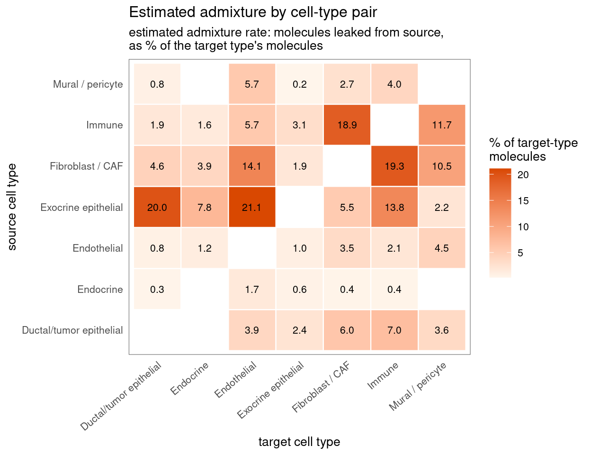

The magnitudes are far from uniform. Sorting the detected pairs by their
estimated admixture rate — the fraction of the target type’s molecules
that originated in the source:

``` r
pairs <- audit$pairs(detected_only = TRUE)
head(pairs[order(-pairs$rate),
  c("source", "target", "admixed_molecules", "rate")], 8)
```

    ##                 source                  target admixed_molecules      rate
    ## 21 Exocrine epithelial             Endothelial             67068 0.2107178
    ## 19 Exocrine epithelial Ductal/tumor epithelial            382869 0.1995796
    ## 29    Fibroblast / CAF                  Immune             97795 0.1928331
    ## 35              Immune        Fibroblast / CAF            206179 0.1886504
    ## 27    Fibroblast / CAF             Endothelial             44954 0.1412410
    ## 23 Exocrine epithelial                  Immune             69990 0.1380071
    ## 36              Immune        Mural / pericyte              6666 0.1173330
    ## 30    Fibroblast / CAF        Mural / pericyte              5979 0.1052369

Aggregating over targets shows which cell types shed the most material —
on this tissue, the exocrine compartment dominates as a source:

``` r
by_source <- aggregate(admixed_molecules ~ source, pairs, sum)
ggplot(by_source, aes(reorder(source, admixed_molecules),
    admixed_molecules / 1e3)) +
  geom_col(fill = "#c0392b", alpha = 0.85) +
  coord_flip() +
  labs(x = NULL, y = "estimated admixed molecules shed (thousands)") +
  theme_classic(base_size = 11)
```

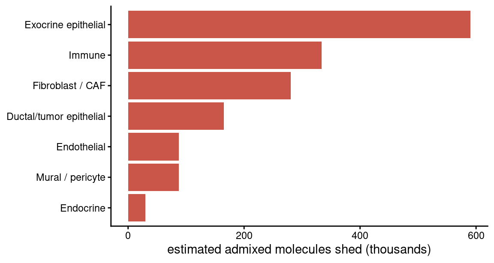

## Correcting with the generative model

The model is fitted on the audit’s detected pairs. The one place a
factorization enters this workflow is the initialization of the model’s
expression programs: the recommended configuration initializes them from
an NMF fit’s factor-labeled molecules, which preserves the most induced
biology (`init = "clusters"` fits without any NMF, at nearly identical
removal but lower induced-gene retention on large panels). The
correction then derives from the fitted model:

``` r
nmf_fit <- ds$fit(nmf_variant = "invsqrt_kl")
```

    ## Reusing cached run fit_manual_rank9_invsqrt_kl (parameters match)

``` r
model <- audit$fit_generative(init = nmf_fit, num_threads = 8)
model
```

    ## cellAdmix generative model
    ##   pairs: 39 
    ##   induced genes retained: 28 
    ##   removed molecules (expected): 1,253,319 
    ##   initialization: nmf_factors

``` r
correction <- model$correct()
before <- ds$counts()
after <- correction$counts()
```

The most quotable summary of the result is the admixture burden per cell
type: the fraction of each type’s total molecule content that the model
attributed to contamination or ambient background and removed.

``` r
generative_plot_burden(before, after, cell_annotation)
```

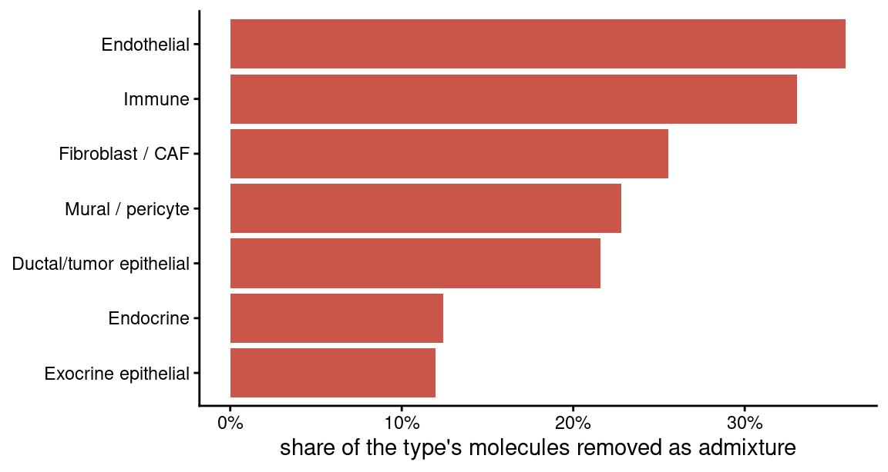

The model’s central output is the per-cell decomposition. Averaged over
ductal cells at each exocrine exposure, it shows where a contaminated
cell’s molecules come from: the cell’s own expression share falls with
exposure as the contamination share grows, with the ambient background
throughout and the induced expression appearing exactly in the exposed
cells:

``` r
source_type <- "Exocrine epithelial"
target_type <- "Ductal/tumor epithelial"
cells_xy <- ds$cells()
expo <- generative_exposure(cells_xy, cell_annotation, source_type)
generative_plot_composition(model, target_type, expo,
  "exocrine cells among 15 nearest neighbors")
```

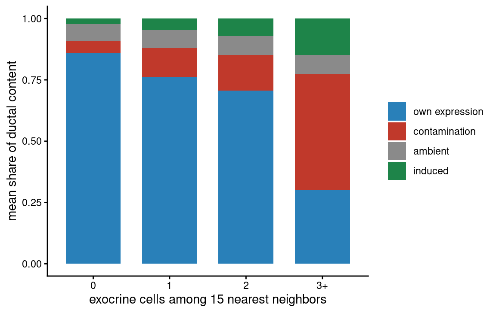

The same fractions drawn in space show the admixture concentrating at
the tissue interfaces: ductal cells inside the acinar tissue carry up to
half exocrine content, while the ductal/tumor mass itself is nearly
clean:

``` r
generative_plot_composition_map(model, source_type, target_type, cells_xy)
```

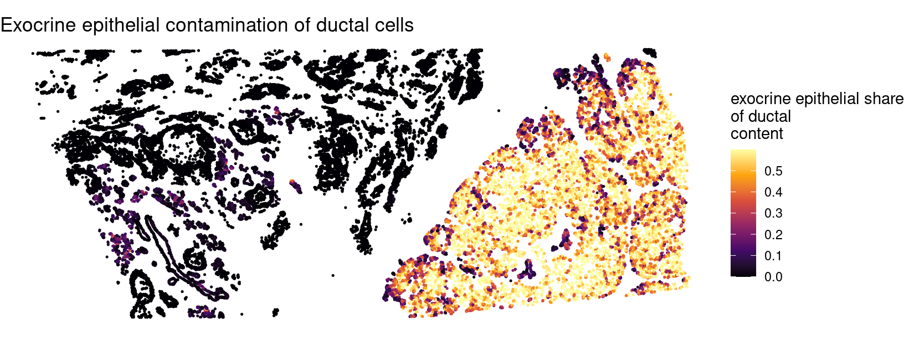

The decomposition is a per-cell statement, so it can be read for
individual cells. Three ductal cells illustrate the range — one deep in
the tumor mass, one moderately exposed, one embedded in acinar tissue:

``` r
picks <- generative_pick_example_cells(model, source_type, target_type,
  before, expo)
names(picks)[[1]] <- "tumor mass"
generative_plot_cell_composition(model, target_type, picks)
```

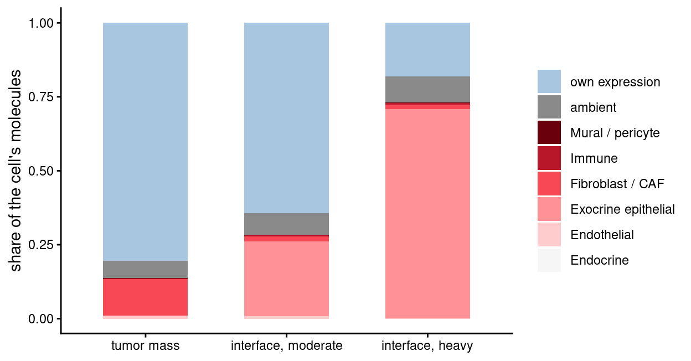

Individual cells can be inspected with the package’s standard
molecule-level rendering — stain background, cell boundaries, and
cell-type contours. Here the molecules are colored by gene origin: blue
for the ductal marker genes (the cell’s own identity), red for the
exocrine marker genes (the audit’s admixture panel for this pair —
material that should not be in a ductal cell), orange for the panel’s
remaining genes. Both cells below have a strong ductal identity; the
difference is their surroundings. In the tumor mass the red class is
nearly absent; at the acinar interface, the same kind of cell holds a
clearly visible population of exocrine-marker molecules — the same
material that dominates the neighboring exocrine cells. The red class
understates the fitted contamination fraction: the marker panel covers
only the exocrine-specific genes, while the fitted fraction also counts
transferred molecules of genes the two types share:

``` r
comp <- model$composition(source_type, target_type)
cc <- setNames(comp$contamination, comp$cell_id)
owner <- generative_gene_owner(before, cell_annotation)$owner
ductal_genes <- names(owner)[owner == target_type]
elig <- names(cc)[Matrix::colSums(before[, names(cc)]) >= 100]
duct_own_count <- Matrix::colSums(before[ductal_genes, elig])
rich <- elig[duct_own_count >= stats::quantile(duct_own_count, 0.6)]
cid_clean <- rich[which.min(cc[rich] + (expo[rich] > 0))]
cid_cont <- rich[which.max(cc[rich])]
mk_pool <- audit$markers(source_type, target_type)$pool
gene_classes <- c("ductal marker genes", "exocrine marker genes",
  "other genes")
cowplot::plot_grid(
  generative_plot_gene_origin_cell(nmf_fit, cid_clean, target_type,
    ductal_genes, mk_pool, gene_classes,
    sprintf("Tumor mass: %.0f%% exocrine content", 100 * cc[[cid_clean]])),
  generative_plot_gene_origin_cell(nmf_fit, cid_cont, target_type,
    ductal_genes, mk_pool, gene_classes,
    sprintf("Acinar interface: %.0f%% exocrine content", 100 * cc[[cid_cont]])),
  ncol = 2)
```

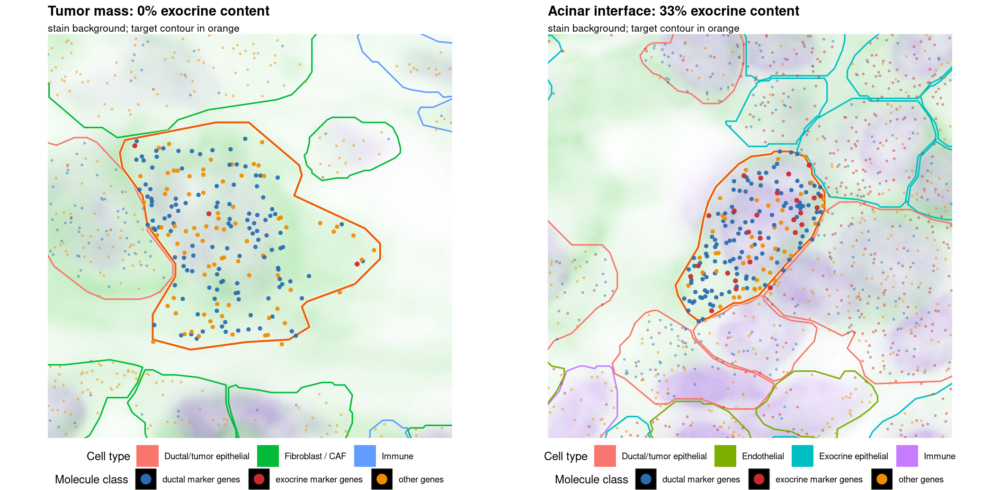

The model’s mechanics are visible in how the fitted contamination
fraction relates to the exposure-derived dose: each cell’s own
expression can move its estimate around the dose, but only within a
bounded factor — removal stays anchored to the demonstrated spatial
signal:

``` r
generative_plot_dose_vs_fitted(model, source_type, target_type, expo,
  "exocrine\nneighbors")
```

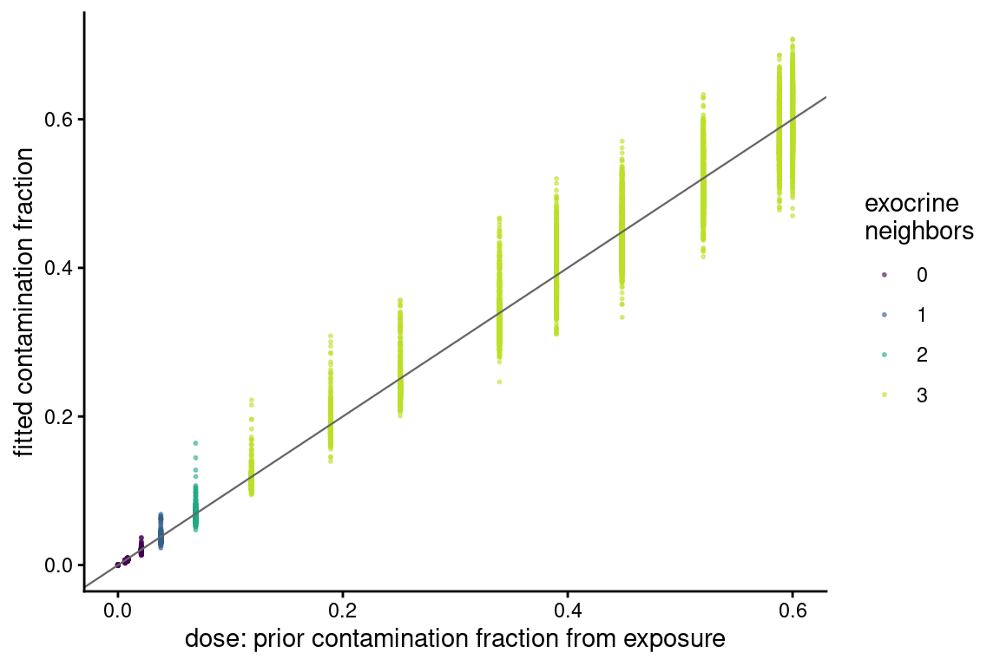

The audit’s standard per-pair diagnostic — the panel rate with exact 95%
intervals, the zero-neighbor line, and the ambient reference — verifies
the pair directly, before and after the correction:

``` r
audit$plot_exposure(source_type, target_type, correction = correction)
```

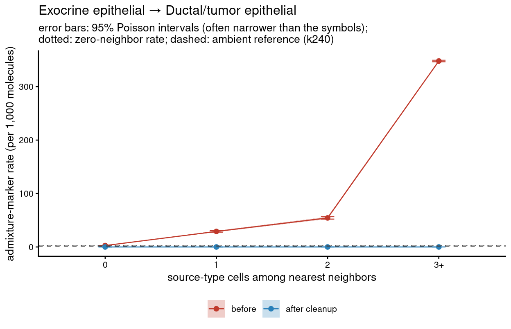

The transferred material itself is profile-shaped, not uniform: the
genes removed from ductal cells are dominated by the source’s largest
expression channels, the digestive enzymes of the exocrine pancreas:

``` r
duct_cells <- comp$cell_id
removed_g <- Matrix::rowSums(before[, duct_cells]) -
  Matrix::rowSums(after[, duct_cells])
head(data.frame(gene = names(sort(removed_g, decreasing = TRUE)),
  removed = round(sort(removed_g, decreasing = TRUE))), 8)
```

    ##          gene removed
    ## AMY2A   AMY2A  150613
    ## GATM     GATM   64326
    ## CFTR     CFTR   16732
    ## AQP8     AQP8   11748
    ## ANPEP   ANPEP    8108
    ## VCAN     VCAN    7722
    ## FBN1     FBN1    5240
    ## COL5A2 COL5A2    4804

## The induction pattern

The model retains genes whose exposure-linked excess exceeds what
transfer from the source can deliver — expression the target cells
switched on themselves. On this tissue the retained set is led by the
duct-cell program that ductal cells activate at acinar interfaces:

``` r
induced <- model$induced
head(induced[order(-induced$excess),
  c("source", "target", "gene", "excess", "fold", "z")], 8)
```

    ##                 source                  target    gene     excess     fold
    ## 4  Exocrine epithelial Ductal/tumor epithelial    CFTR 110866.738 4.640903
    ## 6  Exocrine epithelial Ductal/tumor epithelial   PROX1  11709.747 3.320363
    ## 8     Fibroblast / CAF Ductal/tumor epithelial  SEMA3C   4181.181 7.741105
    ## 25    Fibroblast / CAF                  Immune   PMP22   3183.480 3.092250
    ## 9     Fibroblast / CAF Ductal/tumor epithelial   BASP1   2750.508 2.332770
    ## 19    Mural / pericyte             Endothelial ADAMTS1   2045.614 3.725197
    ## 7     Fibroblast / CAF Ductal/tumor epithelial  APCDD1   2035.355 3.465730
    ## 5  Exocrine epithelial Ductal/tumor epithelial     CA4   1681.018 4.159023
    ##            z
    ## 4  24.154513
    ## 6  15.121189
    ## 8  22.477162
    ## 25 10.279818
    ## 9   8.124358
    ## 19 15.015962
    ## 7  12.000228
    ## 5  16.953810

What this means for downstream analysis is best seen the way
[docs/generative.md](../../docs/generative.md) (Figure 4) shows it: on
the corrected counts, every gene of the target type is tested for
expression change with each source’s proximity, jointly across all
sources so correlated neighborhoods do not cross-attribute. Genes with
essentially none of their content removed as transfer and no meaningful
share of the source’s transfer profile (filled points) are unambiguous
expression changes — the induced interface program rising (green) and
the ductal identity program falling (purple) — while genes entangled
with the transfer split stay open grey:

``` r
changes <- generative_induced_changes(before, after, model, cells_xy,
  cell_annotation, target_type)
generative_plot_volcano(changes, source_type)
```

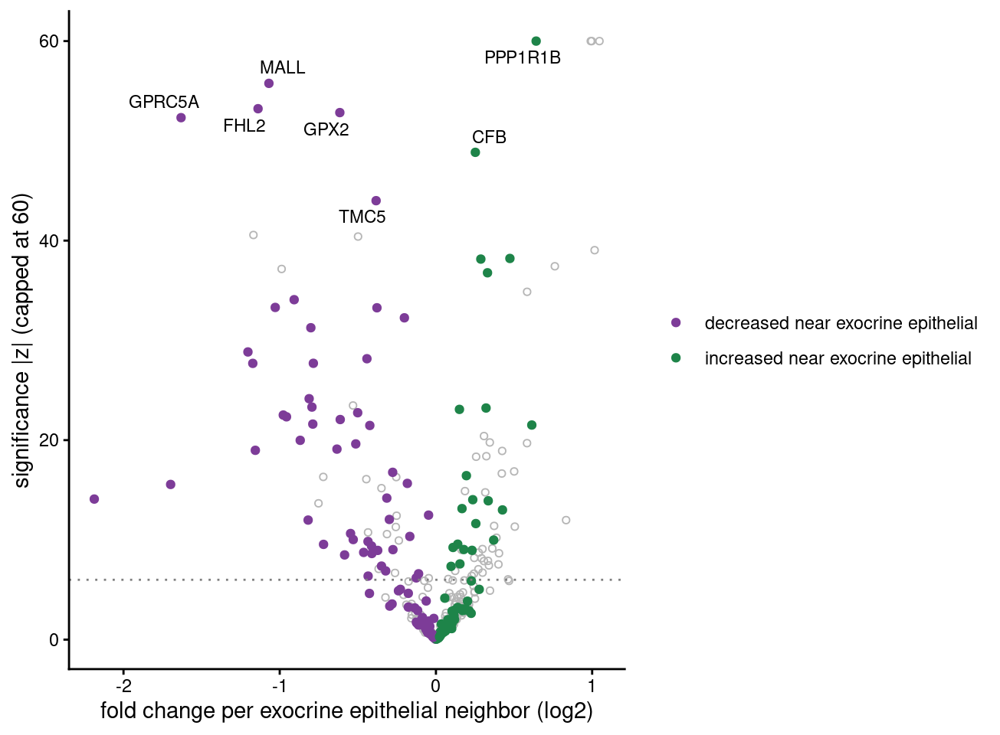

The evidence behind these calls is a proportionality test. Transferred
material samples the source’s transcriptome, so a gene’s excess in
ductal cells should be proportional to its share of the exocrine
profile; genes above the significance bound are the ductal cells’ own
response. Each point below is one exocrine-owned gene:

``` r
generative_plot_transfer_screen(before, model, cells_xy, cell_annotation,
  source_type, target_type, expo)
```

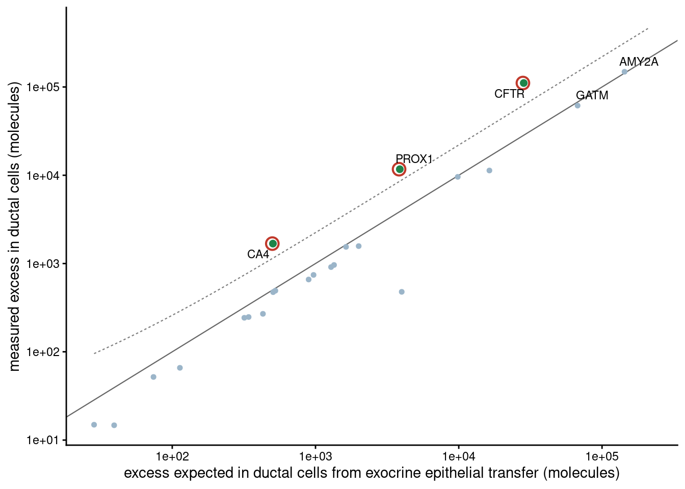

As in [docs/generative.md](../../docs/generative.md) (Figure 2), the
flagged genes are drawn at both transfer expectations — the open red
ring from the average exocrine cell, the filled green point from the
exocrine cells bordering ductal tissue; on this pair the two coincide,
so the markers superimpose. The dashed curve is the largest excess still
consistent with proportional transfer, allowing counting noise and a 15%
profile error.

The consequence is visible gene by gene. AMY2A sits on the diagonal
above — the largest exocrine transfer channel — and the correction
flattens its exposure gradient to the unexposed level. CFTR sits far
above the diagonal, and the correction preserves its gradient, removing
only the transferred share. The same fitted model can also derive the
opposite policy — `model$correct(retain_induced = FALSE)` removes the
fitted induced share along with the contamination — which shows directly
what retention protects, at no change on the transferred gene:

``` r
correction_noind <- model$correct(name = "generative_noind",
  retain_induced = FALSE)
generative_plot_gene_contrast(before, after, duct_cells, expo,
  c("AMY2A", "CFTR"), "exocrine cells among 15 nearest neighbors",
  "rate in ductal cells (per 1,000 molecules)",
  after_alt = correction_noind$counts())
```

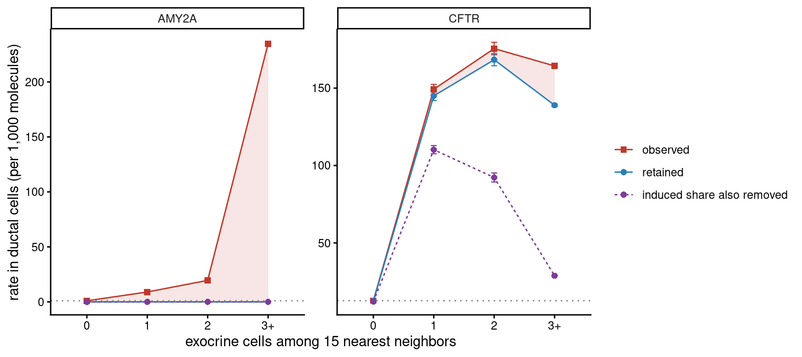

Across all retained genes, most of the exposure-linked excess survives
the correction — the retained fraction per gene, for the largest calls:

``` r
generative_plot_induced_retention(before, after, model, cells_xy,
  cell_annotation)
```

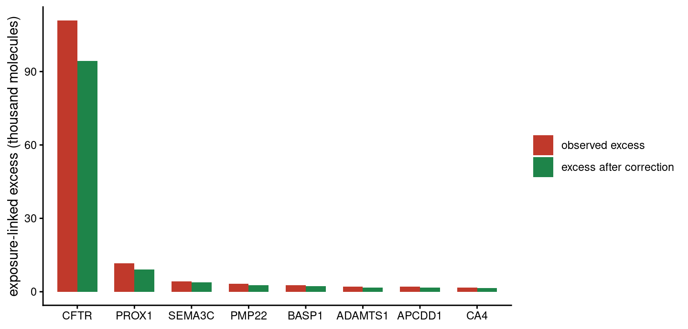

The induction is not one gene’s story: each interface has its own
program, retained in its own pair. The largest retained gene of four
different pairs, each in its target cells against its source’s exposure:

``` r
generative_plot_induced_pairs(before, after, model, cells_xy,
  cell_annotation, exclude = "CFTR")
```

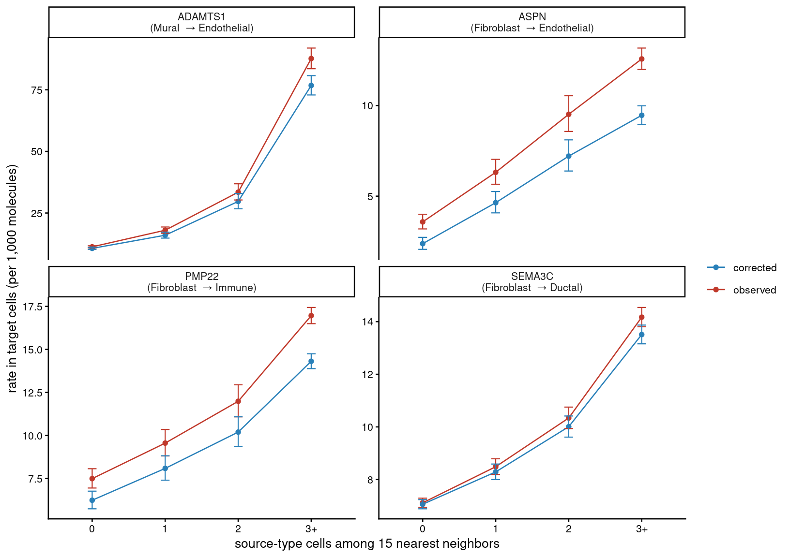

Which cells carry the induced expression is itself fitted: the per-cell
induced activity concentrates in the exposed cells, rather than being
spread uniformly over the type:

``` r
generative_plot_induced_activity(model, source_type, target_type, expo,
  "exocrine cells among 15 nearest neighbors")
```

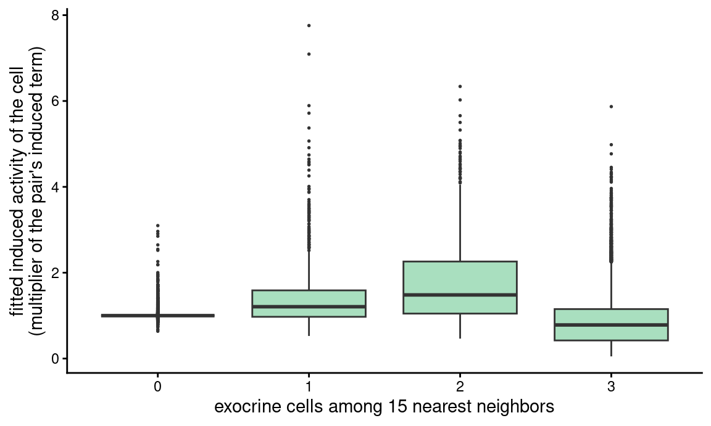

The retained program has a spatial identity of its own. Drawing the
corrected CFTR expression across ductal cells shows it peaking exactly
where the induced table says it should — the duct cells embedded in
acinar tissue — a pattern a marker-based correction would have removed
as contamination:

``` r
generative_plot_gene_map(after, model, source_type, target_type, cells_xy,
  "CFTR")
```

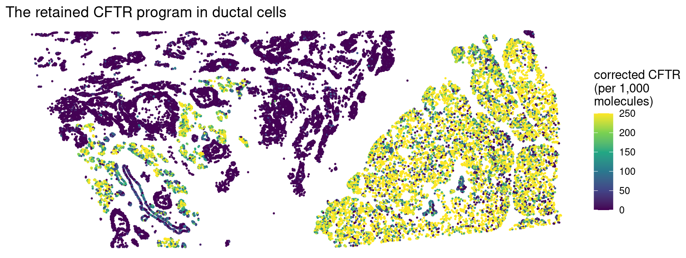

## Verification

The correction is verified against the audit’s own measurements, like
any other correction in the package. The pooled exposure profile shows
the flattening directly:

``` r
report <- audit$evaluate(correction)
report$summary()
```

    ## $detected_pairs
    ## [1] 39
    ## 
    ## $estimated_admixed_molecules
    ## [1] 1574854
    ## 
    ## $leakage_removed_overall
    ## [1] 0.9724715
    ## 
    ## $median_pair_sensitivity
    ## [1] 0.9904802
    ## 
    ## $own_marker_false_removal
    ## [1] 0
    ## 
    ## $worst_false_removal
    ## [1] "Ductal/tumor epithelial"

``` r
report$plot_cleanup()
```

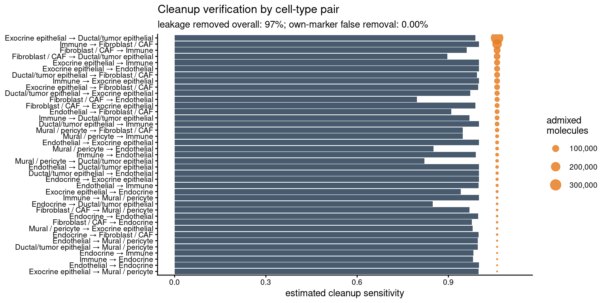

``` r
audit$plot_exposure(correction = correction)
```

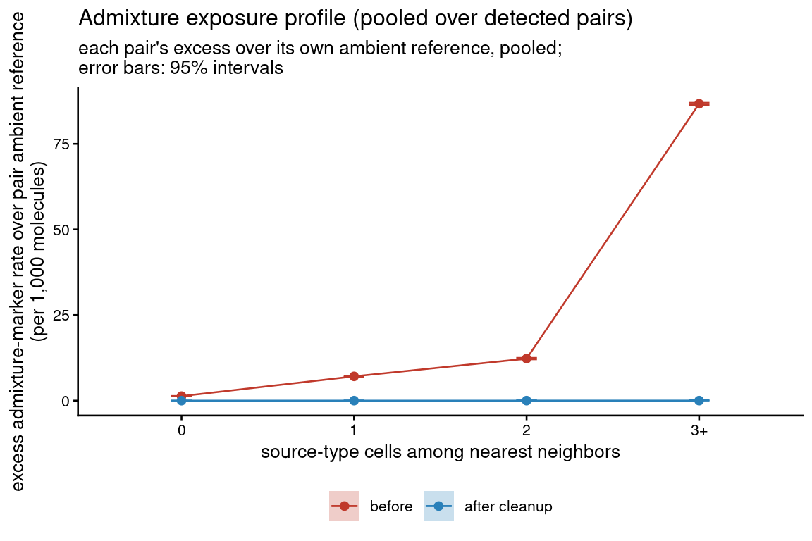

The downstream payoff is visible in cell state space: a UMAP of the
corrected counts separates the annotated cell types more cleanly than
the original counts, where contaminated interface cells blur the
boundaries between clusters:

``` r
original_state <- ds$cell_state_umap(cells_max = 5000)
corrected_state <- correction$cell_state_umap(cells_max = 5000,
  num_threads = 8)
generative_plot_state_umaps(original_state, corrected_state, cell_annotation)
```

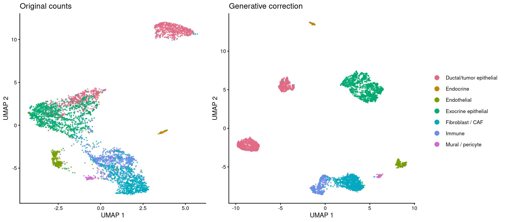

Two limits are worth keeping in mind when reading the results. The model
never removes a target type’s own marker genes (their contamination is
indistinguishable from native expression and is deliberately left in
place), so shared-gene admixture is under-removed by construction. And
induced expression is only recognizable when it is disproportionate to
the source’s transfer profile: induction of a source’s own top marker
genes cannot be told apart from admixture at count level and is removed
with it ([docs/generative.md](../../docs/generative.md), the
identifiability limit).
